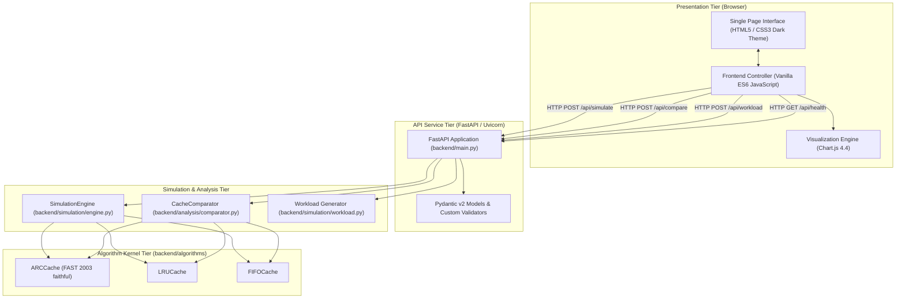
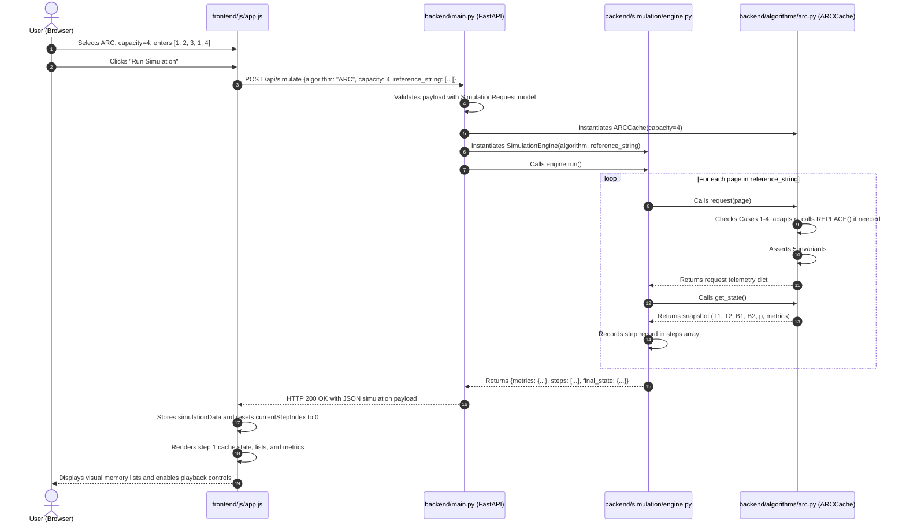

# ARC Page Replacement Simulator: System Architecture

This document describes the software architecture, modular decomposition, data flow pathways, and interface contracts of the **ARC Page Replacement Simulator**.

---

## 1. Architectural Overview

The system is engineered as a decoupled, multi-tier web application designed for academic experimentation and interactive visual analysis of cache replacement policies. It separates algorithmic simulation logic from network transport and user presentation.



---

## 2. Layered Structure & Module Responsibilities

The system is organized into four distinct architectural layers:

### 2.1 Algorithm Kernel Tier (`backend/algorithms/`)

The algorithmic core is completely independent of FastAPI, GUI frameworks, disk I/O, or external network dependencies. Each algorithm is implemented as a standalone Python class conforming to a uniform interface.

#### Unified Algorithmic Contract:
- `request(page: Any) -> Dict[str, Any]`: Processes a single page reference request, updates internal recency/frequency/arrival state, performs necessary replacements, and returns event telemetry.
- `get_state() -> Dict[str, Any]`: Returns a structured snapshot of current resident and history lists, metrics, and capacity parameters.
- `reset() -> None`: Clears all internal lists and resets counters to the initial state.

#### Modules:
1. **`arc.py` (`ARCCache`)**:
   - Implements the complete paper-faithful Adaptive Replacement Cache (FAST 2003).
   - Manages the four interlocking lists: $T_1$ (resident recency), $T_2$ (resident frequency), $B_1$ (recency ghost history), and $B_2$ (frequency ghost history).
   - Dynamically adapts the target parameter $p \in [0.0, c]$ via floating-point ratio steps: $\delta_1 = \max(1.0, |B_2|/|B_1|)$ and $\delta_2 = \max(1.0, |B_1|/|B_2|)$.
   - Implements the exact `REPLACE(p, x_t)` eviction subroutine including the special boundary check `(x_t in B2 and |T1| == p) or (|T1| > p)`.
   - Enforces continuous assertion of all 5 mathematical invariants after every access.
2. **`lru.py` (`LRUCache`)**:
   - Implements classical Least Recently Used replacement using `collections.OrderedDict`.
   - Promotes pages to the Most Recently Used (MRU) tail in $O(1)$ on hits.
   - Evicts the Least Recently Used (LRU) head in $O(1)$ on misses when full.
3. **`fifo.py` (`FIFOCache`)**:
   - Implements First-In, First-Out replacement using `collections.OrderedDict`.
   - Maintains strict chronological arrival order: hits do not alter queue positions.
   - Evicts the oldest arrival at the queue head in $O(1)$ on misses when full.

---

### 2.2 Simulation & Analysis Tier

#### 1. Simulation Engine (`backend/simulation/engine.py`)
- **Responsibility**: Orchestrates step-by-step execution of an algorithm instance over a page reference stream.
- **Telemetry Collection**:
  - Intercepts return payloads from `algorithm.request(page)`.
  - Captures cumulative counters (hits, misses, page faults, replacements, elapsed time).
  - Formats deep-copied step snapshots (`steps` array) containing current resident and ghost lists ordered from MRU to LRU.
- **Zero-Division Protection**: Handles edge cases such as empty reference streams safely.

#### 2. Comparative Analysis Engine (`backend/analysis/comparator.py`)
- **Responsibility**: Benchmarks ARC, LRU, and FIFO simultaneously across identical workloads.
- **Instance Isolation**: Instantiates fresh, isolated algorithm instances for every comparison, preventing cross-test state leakage.
- **Decision Engine**:
  - Implements **page-fault-only winner determination**.
  - Identifies single winners (`is_tie = False, best_algorithm = "NAME"`).
  - Detects multi-algorithm ties (`is_tie = True, best_algorithm = None, best_algorithms = [...]`).
  - Strict Rule: Secondary metrics (hits, replacements, execution time) are never used as tie-breakers.

#### 3. Workload Generator (`backend/simulation/workload.py`)
- **Responsibility**: Generates synthetic reference streams for diverse evaluation scenarios.
- **Strategies**:
  - `custom`: Validates and slices/repeats arbitrary user sequences.
  - `sequential`: Generates cyclical scans ($1 \dots M$) across working-set size $M$.
  - `looping`: Generates periodic loops ($1 \dots L$) across loop size $L$.
  - `random`: Generates independent Discrete Uniform page references over $M$ pages using deterministic seeds.
  - `repeated_locality`: Generates bimodal skewed access using a **Two-Tier Bernoulli Partition Model** ($p_{\text{hot}} = 0.8$ over $K$ hot pages, $0.2$ over $M-K$ cold pages).

---

### 2.3 API Service Tier (`backend/main.py`)

- **Framework**: FastAPI with Starlette and Uvicorn.
- **Schema Validation**: Uses Pydantic v2 models (`SimulationRequest`, `ComparisonRequest`, `WorkloadRequest`) with field validators that enforce positive capacities ($c \ge 1$), positive sequence lengths, and supported algorithm identifiers.
- **Error Handling**: Custom exception handlers intercept `ValueError` exceptions and return clean JSON error payloads (`{"detail": "..."}`) with HTTP status 400.
- **Static Mounting**: Mounts the `frontend/` directory to serve the single-page dashboard at root `/`.

---

### 2.4 Presentation Tier (`frontend/`)

- **`index.html`**: Semantic document structure dividing the dashboard into Header, Simulation Configuration, Step-by-Step Visualizer, Live Metrics, and Comparative Benchmarking sections.
- **`css/style.css`**: Modern dark-theme design system featuring modular CSS variables, responsive CSS Grid / Flexbox layouts, accessible typography, and subtle transitions.
- **`js/app.js`**:
  - Application controller managing client-side state.
  - Asynchronous HTTP communications using standard `fetch()` API.
  - Step playback controller with Play, Pause, Step Next, Step Prev, Reset, and adjustable speed slider ($100$ ms to $2,000$ ms).
  - Memory list rendering displaying LRU-to-MRU orientation, color-coded item badges, and ghost history lists.
  - Dynamic parameter $p$ split bar reflecting real-time adaptive target balance.
  - Chart.js 4.4 integration rendering comparative bar charts and hit ratio distributions.

---

## 3. End-to-End Data Flow

The following sequence diagram illustrates the lifecycle of a simulation request from user interaction to visual rendering:



---

## 4. Telemetry & State Transfer Contract

The simulation engine converts internal cache states into serialized JSON structures that the frontend consumes directly.

### Step Telemetry Record Format
Each element in the `steps` array contains:

```json
{
  "step": 4,
  "page": 1,
  "hit": true,
  "hit_type": "T1_HIT",
  "evicted_page": null,
  "movement": "Promoted page 1 from T1 to T2 (MRU)",
  "state": {
    "capacity": 4,
    "p": 1.0,
    "t1_target": 1.0,
    "t2_target": 3.0,
    "T1": [3, 2],
    "T2": [1],
    "B1": [],
    "B2": [],
    "size_T1": 2,
    "size_T2": 1,
    "size_B1": 0,
    "size_B2": 0,
    "size_cache": 3,
    "size_total": 3,
    "requests": 4,
    "hits": 1,
    "misses": 3,
    "hit_ratio": 0.25,
    "replacements": 0,
    "order": "MRU_to_LRU"
  },
  "cumulative_hits": 1,
  "cumulative_misses": 3,
  "cumulative_page_faults": 3,
  "cumulative_hit_ratio": 0.25,
  "cumulative_miss_ratio": 0.75,
  "p": 1.0,
  "T1": [3, 2],
  "T2": [1],
  "B1": [],
  "B2": []
}
```

### List Ordering Convention
To eliminate visual confusion in user interfaces:
- Algorithms return lists ordered from **MRU (index 0, top)** to **LRU (last index, bottom)**.
- The frontend explicitly renders list headers with `[MRU]` at the top/left and `[LRU]` at the bottom/right.

---

## 5. Comparative Evaluation & Isolation Architecture

When running multi-algorithm benchmarks via `POST /api/compare`:

1. **Independent Instantiation**:
   The comparator creates fresh instances:
   ```python
   algorithms = {
       "ARC": ARCCache(capacity),
       "LRU": LRUCache(capacity),
       "FIFO": FIFOCache(capacity)
   }
   ```
2. **Workload Identity**:
   Each instance processes the identical in-memory Python list representing the reference sequence.
3. **Execution Isolation**:
   No algorithm instance shares data structures, pointers, or caches with any other instance.
4. **Ranking & Winner Rule**:
   - `min_faults = min(res["page_faults"] for res in results.values())`
   - `winners = [name for name, res in results.items() if res["page_faults"] == min_faults]`
   - If `len(winners) > 1`: `is_tie = True, best_algorithm = None, best_algorithms = winners`
   - If `len(winners) == 1`: `is_tie = False, best_algorithm = winners[0], best_algorithms = winners`
   - Secondary metrics (hits, replacements, execution time) are **strictly prohibited** from altering the winner or breaking ties.

---

## 6. Directory Structure & File Map

```text
E:\OS_PROJECT/
├── backend/
│   ├── algorithms/
│   │   ├── __init__.py           # Package exports for ARCCache, LRUCache, FIFOCache
│   │   ├── arc.py                # ARC implementation, REPLACE, 5 invariants, float/int p
│   │   ├── lru.py                # LRU implementation using OrderedDict
│   │   └── fifo.py               # FIFO implementation using OrderedDict
│   ├── simulation/
│   │   ├── __init__.py           # Package exports for SimulationEngine and workload factory
│   │   ├── engine.py             # Step-by-step runner and telemetry recorder
│   │   └── workload.py           # Synthetic workload generators (sequential, looping, random, bimodal)
│   ├── analysis/
│   │   ├── __init__.py           # Package exports for CacheComparator
│   │   └── comparator.py         # Multi-algorithm comparator and page-fault-only tie logic
│   ├── tests/
│   │   ├── test_arc.py           # 21 unit, case, and randomized invariant stress tests
│   │   ├── test_lru.py           # 12 LRU unit tests
│   │   ├── test_fifo.py          # 12 FIFO unit tests
│   │   ├── test_simulation.py    # 15 simulation engine and workload tests
│   │   ├── test_comparator.py    # 10 comparative analysis and tie logic tests
│   │   ├── test_api.py           # 19 FastAPI endpoint and validation tests
│   │   └── test_environment.py  # 2 environment sanity tests
│   ├── main.py                   # FastAPI service, Pydantic models, error handlers, static mount
│   └── __init__.py
├── frontend/
│   ├── index.html                # Single-page dashboard markup
│   ├── css/
│   │   └── style.css             # Dark-theme styles, responsive grid, visual cards
│   └── js/
│       └── app.js                # Frontend state, API integration, playback, Chart.js
├── docs/
│   ├── PROJECT_REPORT.md         # Comprehensive academic project report
│   ├── ARCHITECTURE.md           # System architecture and data flow documentation
│   ├── API_DOCUMENTATION.md      # REST API endpoints, schemas, and example payloads
│   └── experiments/
│       ├── benchmark_results.csv # 120 raw per-trial benchmark records
│       ├── benchmark_summary.csv # 66 disaggregated/seed-aggregated summary records
│       └── BENCHMARK_METHODOLOGY.md # Experimental design, workload models, and findings
├── scripts/
│   └── run_benchmarks.py         # Automated benchmarking script
├── requirements.txt              # Pinned Python dependencies
└── README.md                     # Project quickstart and developer documentation
```

