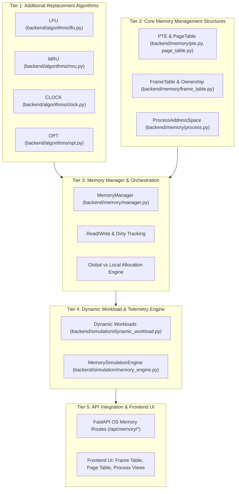

# Stage 12.0 — OS Memory Management Extension: Architecture Audit & Technical Design (Final)

**A Comprehensive Extension Design for the ARC Page Replacement Simulator into a Full Operating System Memory Management Simulator**

---

## 1. Current Repository and Git State

A read-only inspection of the Git repository at `e:/OS_PROJECT` confirmed the following state:

- **`git status`**:
  ```text
  On branch main
  Your branch is up to date with 'origin/main'.
  nothing to commit, working tree clean
  ```
- **`git branch --show-current`**: `main`
- **`git branch -avv`**:
  ```text
  * main                dd5a39b [origin/main] Merge GitHub initial commit with ARC simulator project
    remotes/origin/HEAD -> origin/main
    remotes/origin/main dd5a39b Merge GitHub initial commit with ARC simulator project
  ```
- **`git diff -- README.md`**: *(Clean — no diff)*
- **`git diff --cached`**: *(Clean — no staged changes)*
- **`git ls-files -u`**: *(Clean — 0 unmerged files)*
- **`git log -3 --oneline --decorate`**:
  ```text
  dd5a39b (HEAD -> main, origin/main, origin/HEAD) Merge GitHub initial commit with ARC simulator project
  df5e69f initial commit
  07425df Initial commit
  ```

### Audit Findings
1. **Merge Status**: **No merge is in progress.** The earlier unrelated-history merge and `README.md` conflict were previously resolved and committed in merge commit `dd5a39b`.
2. **Conflict Status**: **`README.md` is clean and unconflicted.**
3. **Working Tree**: Completely clean; all 32 baseline project files are tracked on branch `main`.
4. **Baseline Health**: All **91 automated pytest tests pass** (`.\venv\Scripts\python.exe -m pytest -v backend/tests/` completed in 1.11s).

---

## 2. Existing Baseline Architecture & Decoupled Policy Contract

The existing project contains an established, highly decoupled baseline:

```
+---------------------------------------------------------------------------------+
|                                 PRESENTATION TIER                               |
|              HTML5 / CSS3 Dark Theme / Vanilla ES6 JavaScript (app.js)          |
|       Chart.js 4.4 / Step-by-Step Playback / Parameter p Bar / Memory Lists     |
+---------------------------------------------------------------------------------+
                                       |
                                       | HTTP JSON (FastAPI / Uvicorn)
                                       v
+---------------------------------------------------------------------------------+
|                                 API SERVICE TIER                                |
|        GET /api/health   |   POST /api/simulate   |   POST /api/compare         |
|                          |   POST /api/workload                             |
+---------------------------------------------------------------------------------+
                                       |
                                       v
+---------------------------------------------------------------------------------+
|                          APPLICATION & ANALYSIS TIER                            |
|       SimulationEngine          |         CacheComparator                       |
|   (Captures steps & snapshots)  | (Multi-algorithm benchmark & tie handling)    |
|                                 | Workload Generator (sequential, random,       |
|                                 | bimodal locality, cyclic looping)             |
+---------------------------------------------------------------------------------+
                                       |
                                       v
+---------------------------------------------------------------------------------+
|                              ALGORITHM KERNEL TIER                              |
|           ARCCache              |         LRUCache        |       FIFOCache     |
|   (FAST 2003 faithful float p)  |     (OrderedDict MRU)   |   (Arrival order)   |
+---------------------------------------------------------------------------------+
```

### 2.1 The Decoupled 4-Stage Replacement Policy Interface Contract & ARC Invariant Lifecycle

To integrate replacement algorithms seamlessly with the OS Memory Management subsystem without duplicating eviction logic or risking state inconsistency, the algorithm interface is formalized into an **explicit 4-stage contract**.

#### Critical ARC Principles: Policy-Driven Eviction & Directory Bounds
In the original ARC algorithm (Megiddo & Modha, USENIX FAST 2003), page reference requests fall into four strictly defined cases:
1. **Case 1 (Resident Cache Hit)**: Page $x_t \in T_1 \cup T_2$. The page is promoted to the MRU position of $T_2$.
2. **Case 2 ($B_1$ Recency Ghost Hit)**: Page $x_t \in B_1$. ARC adapts target parameter $p$ upward favoring recency ($\delta_1 = 1$ if $|B_1| \ge |B_2|$ else $|B_2|/|B_1|$; $p = \min(c, p + \delta_1)$), invokes replacement if resident capacity is full, and fetches $x_t$ to the MRU of $T_2$.
3. **Case 3 ($B_2$ Frequency Ghost Hit)**: Page $x_t \in B_2$. ARC adapts target parameter $p$ downward favoring frequency ($\delta_2 = 1$ if $|B_2| \ge |B_1|$ else $|B_1|/|B_2|$; $p = \max(0, p - \delta_2)$), invokes replacement if resident capacity is full, and fetches $x_t$ to the MRU of $T_2$.
4. **Case 4 (Cold Miss)**: Page $x_t \notin T_1 \cup T_2 \cup B_1 \cup B_2$. The page has no previous history in the cache or directory. **Cold misses do NOT adapt $p$** ($p$ remains unchanged, $\Delta p = 0$). Instead, ARC enforces directory size bounds ($|L_1| \le c$ and $|L_1| + |L_2| \le 2c$) through specific trimming rules before replacement, and fetches $x_t$ to the MRU of $T_1$.

> [!IMPORTANT]
> **Eviction Requirement is Policy-Determined, Not Solely Physical Memory Fullness**:
> In ARC cold-miss Case IV(a) and Case IV(b), the directory rules can mandate `REPLACE(p, x_t)` **even when the number of resident pages is below physical capacity**. Physical memory fullness is an OS resource condition, whereas `requires_eviction` is an intrinsic algorithmic invariant. Therefore, `prepare_request()` must evaluate and return `requires_eviction` directly.

The 4-stage contract coordinates this lifecycle cleanly:

1. **`prepare_request(incoming_page: Any, process_context: Optional[int] = None) -> RequestClassification`**:
   - **Explicit Classification Return Contract**:
     Returns a structured classification dictionary containing:
     - `status`: `"HIT" | "GHOST_B1" | "GHOST_B2" | "COLD_MISS"`
     - `target_list`: `"T1" | "T2"`
     - `requires_eviction`: `bool` — explicitly determines whether the replacement policy requires an eviction, independent of physical frame availability.
     - `eviction_reason`: Specific rationale (e.g. `"ARC_CASE_4A_B1_TRIM_REPLACE"`, `"ARC_CASE_4A_T1_DIRECT"`, `"ARC_CASE_4B_REPLACE"`, `"ARC_GHOST_HIT_RESIDENT_FULL"`, `"NONE"`).
     - `evict_mode`: ARC-specific execution mode: `"REPLACE" | "T1_DIRECT" | "NONE"`.
     - `ghost_evicted`: Optional identifier of ghost entry pruned from $B_1$ or $B_2$ (`None` if no ghost pruned).
     - `delta`: Parameter $p$ adjustment value ($0.0$ for hits and cold misses).
     - `adapted_p`: Updated value of target parameter $p$.
   
   - **ARC Policy Decision Rules**:
     - **B1 / B2 Ghost Hits (Dynamic $p$ Adaptation)**:
       - **Case II ($x_t \in B_1$ — Recency Ghost Hit)**:
         $$\delta_1 = \begin{cases} 1 & \text{if } |B_1| \ge |B_2| \\ \frac{|B_2|}{|B_1|} & \text{otherwise} \end{cases}, \quad p = \min(c, p + \delta_1)$$
         `target_list = "T2"`, `requires_eviction = (|T1| + |T2| >= c)`, `evict_mode = "REPLACE"` if eviction required else `"NONE"`.
       - **Case III ($x_t \in B_2$ — Frequency Ghost Hit)**:
         $$\delta_2 = \begin{cases} 1 & \text{if } |B_2| \ge |B_1| \\ \frac{|B_1|}{|B_2|} & \text{otherwise} \end{cases}, \quad p = \max(0, p - \delta_2)$$
         `target_list = "T2"`, `requires_eviction = (|T1| + |T2| >= c)`, `evict_mode = "REPLACE"` if eviction required else `"NONE"`.
     - **Case IV: Cold Miss Directory-Management Rules ($x_t \notin T_1 \cup T_2 \cup B_1 \cup B_2$)**:
       - Parameter $p$ is **not adapted** ($\Delta p = 0$).
       - Target resident list is strictly `target_list = "T1"`.
       - **Case IV(a) (If $|T_1| + |B_1| == c$, i.e., $|L_1| == c$)**:
         - **Subcase 1a (If $|T_1| < c$)**:
           Remove LRU entry from ghost list $B_1$ (`self.B1.popitem(last=False)`).
           **Requires REPLACE**: `requires_eviction = True`, `eviction_reason = "ARC_CASE_4A_B1_TRIM_REPLACE"`, `evict_mode = "REPLACE"`.
           *(Note: This requires eviction even if physical memory currently has free frames!)*
         - **Subcase 1b (Otherwise, $|T_1| == c$)**:
           Remove LRU entry from resident list $T_1$ directly (`self.T1.popitem(last=False)`).
           *Critical Distinction*: Because $|T_1| == c$ and $|T_1| + |B_1| == c$, ghost list $B_1$ is empty ($|B_1| = 0$). This is a direct removal from resident set $T_1$ and must **not** be described as a $B_1$ removal. Subroutine REPLACE is bypassed: `requires_eviction = True`, `eviction_reason = "ARC_CASE_4A_T1_DIRECT"`, `evict_mode = "T1_DIRECT"`.
       - **Case IV(b) (Else, if $|T_1| + |B_1| < c$ and $|T_1| + |T_2| + |B_1| + |B_2| \ge c$)**:
         - If total directory size equals $2c$ ($|T_1| + |T_2| + |B_1| + |B_2| == 2c$):
           Remove LRU entry from ghost list $B_2$ (`self.B2.popitem(last=False)`).
         - **Requires REPLACE**: `requires_eviction = True`, `eviction_reason = "ARC_CASE_4B_REPLACE"`, `evict_mode = "REPLACE"`.
       - **Warm-Up Case (Else, $|T_1| + |T_2| + |B_1| + |B_2| < c$)**:
         - Cold miss warm-up phase. Memory is not full: `requires_eviction = False`, `eviction_reason = "NONE"`, `evict_mode = "NONE"`.
   
   - **Concrete Example Walkthrough ($c=4, T_1=2, B_1=2, T_2=0, B_2=0$)**:
     - Cache capacity $c = 4$. Resident set $T_1$ has 2 pages ($[A, B]$), $B_1$ has 2 ghost pages ($[C, D]$), $T_2$ and $B_2$ are empty.
     - Resident occupancy is $|T_1| + |T_2| = 2$, leaving $4 - 2 = 2$ free physical frames.
     - Incoming page $E$ arrives ($E \notin T_1 \cup T_2 \cup B_1 \cup B_2$ — Cold Miss).
     - Directory check: $|T_1| + |B_1| = 2 + 2 = 4 = c$. Since $|T_1| = 2 < c$, Case IV(a) Subcase 1a applies:
       1. LRU entry of $B_1$ ($C$) is trimmed.
       2. ARC mandates `REPLACE(p, E)`.
       3. `prepare_request(E)` returns `requires_eviction = True`, `evict_mode = "REPLACE"`.
     - `MemoryManager` observes `classification.requires_eviction == True` and executes replacement despite the 2 free frames:
       1. `select_victim(E)` evaluates $\text{REPLACE}(p, E)$ with $|T_1|=2 > p=0 \implies$ selects $A$ (LRU of $T_1$).
       2. $A$'s PTE is invalidated, and `evict_victim(A)` moves $A$ to $B_1$.
       3. The physical frame previously assigned to $A$ (`fid_A`) is reused for incoming page $E$.
       4. $E$ is mapped to `fid_A` and inserted into $T_1$ (MRU).
     - Post-state: $T_1 = [B, E]$ ($|T_1| = 2$), $B_1 = [D, A]$ ($|B_1| = 2$), $T_2 = []$, $B_2 = []$.
     - The physical frame count remains 2 allocated, 2 free. No extra frame is consumed, and ARC's mathematical invariant is strictly preserved.

   - **Polymorphism for Non-ARC Baselines (LRU, FIFO, MRU, LFU, CLOCK, OPT)**:
     - For standard algorithms without ghost directories, prepare_request() sets 
equires_eviction = False.
     - In the MemoryManager, the unified eviction rule:
       `python
       needs_eviction = (
           classification.requires_eviction
           or free_physical_frames == 0
           or process_quota_exhausted
       )
       `
       evaluates to ree_physical_frames == 0 or process_quota_exhausted since classification.requires_eviction is False.

2. **select_victim(incoming_page: Any, process_context: Optional[int] = None) -> PageOrFrameIdentifier**:
   - Evaluates resident cache state and returns the candidate victim identifier without mutating any list or parameter.
   - **Invoked whenever eviction is required** (
eeds_eviction == True).
   - **ARC Decision Logic**:
     - If `evict_mode == "T1_DIRECT"` (Case 4A-2, $|T_1| == c$): returns the LRU page of $T_1$ directly (`next(iter(self.t1))`).
     - Otherwise (`evict_mode == "REPLACE"`): uses the already-adjusted $p$ and evaluates $x_t \in B_2$ against resident size $|T_1|$ using the exact FAST 2003 condition:
       $$(|T_1| \ge 1) \land (((x_t \in B_2) \land (|T_1| == p)) \lor (|T_1| > p))$$
       - If true: returns the LRU page of $T_1$ (`next(iter(self.t1))`).
       - Otherwise: returns the LRU page of $T_2$ (`next(iter(self.t2))`).
   - **Strict Non-Mutating Guarantee**: ARC inspects state without modifying $T_1, T_2, B_1, B_2$, and without altering $p$.
   - **Polymorphic Compatibility**: Other algorithms ignore `incoming_page`, evaluating their own resident state.

3. **`evict_victim(victim: PageOrFrameIdentifier) -> None`**:
   - Confirms and executes removal of the victim from resident cache state.
   - **ARC Eviction Execution**:
     - If `evict_mode == "T1_DIRECT"`: directly removes $victim$ from resident $T_1$ (discarded without ghost addition, as $B_1$ is empty and $|T_1| == c$).
     - Otherwise: moves $victim$ to ghost history ($T_1 \to B_1$ if evicted from $T_1$, or $T_2 \to B_2$ if evicted from $T_2$). The ghost list already has room because trimming was completed in `prepare_request`.
     - **No Duplicate Adaptation**: Does **not** adjust parameter $p$ or repeat trimming.
   - In other algorithms: removes victim from active resident tracking.
   - **Called by Memory Manager ONLY AFTER**: victim dirty check, simulated disk write-back, and PTE invalidation (`valid = False, frame_id = None`) are fully complete.

4. **`insert_page(incoming_page: PageOrFrameIdentifier, is_write: bool = False) -> None`**:
   - Inserts the newly arrived page into active resident tracking:
     - In ARC: consumes the classification recorded in `prepare_request()`.
       - If ghost hit in $B_1$ or $B_2$: removes $x_t$ from the respective ghost list and inserts into the MRU position of $T_2$.
       - If cold miss: inserts into the MRU position of $T_1$.
       - Does **not** repeat ghost-hit adaptation or ghost trimming.
     - In LRU / MRU: inserts into MRU position.
     - In FIFO: appends to arrival queue tail.
     - In CLOCK: assigns to allocated physical frame slot and sets reference bit $= 1$.
   - **Called by Memory Manager ONLY AFTER**: physical frame allocation/reassignment and requester PTE mapping (`valid = True, frame_id = fid`) are established.

#### Coordination Guard & Double-Eviction Prevention:
The Memory Manager orchestrates page fault handling using a unified, policy-aware lifecycle. The eviction decision consistently evaluates all three conditions:

```python
needs_eviction = (
    classification.requires_eviction
    or free_physical_frames == 0
    or process_quota_exhausted
)
```

Where:
- `classification.requires_eviction` represents replacement-policy-mandated eviction, such as ARC cold-miss directory cases.
- `free_physical_frames == 0` represents global physical-memory exhaustion.
- `process_quota_exhausted` represents local process memory quota exhaustion, even when global physical frames remain free.

$$\begin{aligned}
\text{Page Fault on } x_t \longrightarrow \mathbf{prepare\_request}(x_t) \longrightarrow \text{Decide: } \mathbf{needs\_eviction} \\
\longrightarrow \begin{cases} 
\mathbf{needs\_eviction} == \mathbf{True}: & \mathbf{select\_victim}(x_t) \longrightarrow \text{Write-Back + Invalidate} \longrightarrow \mathbf{evict\_victim}(v) \longrightarrow \text{Reuse } fid_v \longrightarrow \text{Map PTE} \longrightarrow \mathbf{insert\_page}(x_t) \\
\mathbf{needs\_eviction} == \mathbf{False}: & \text{Allocate Free Frame } fid_{free} \longrightarrow \text{Map PTE} \longrightarrow \mathbf{insert\_page}(x_t)
\end{cases}
\end{aligned}$$

This separation guarantees that:
1. **Unified Eviction Trigger**: Eviction executes if the policy mandates it (`classification.requires_eviction`), if global physical frames are exhausted (`free_physical_frames == 0`), or if the process's allocated frame quota is exhausted under local replacement (`process_quota_exhausted`).
2. **Frame Conservation & Single Eviction Guarantee**: Exactly one victim is selected and evicted per incoming page fault. When an eviction occurs, the selected victim's physical frame ($fid_v$) is reclaimed and reused directly for the incoming page. Unallocated free frames in the pool remain intact, and **no second eviction** is performed for the same page fault.
3. **Dirty Write-Back & State Consistency**: Victim dirty check, simulated disk write-back, PTE invalidation, frame reassignment, and policy insertion proceed in atomic lockstep.

#### Standalone `request(page)` Implementation & Full Algorithmic Fidelity:
For standalone execution, the `request(page)` method in `backend/algorithms/arc.py` must preserve the **complete original paper-faithful ARC request behaviour**, including:
- Exact Case 1 (T1/T2 hit promotion to T2),
- Exact Case 2 (B1 ghost hit with $\delta_1$ recency adaptation, REPLACE, and T2 fetch),
- Exact Case 3 (B2 ghost hit with $\delta_2$ frequency adaptation, REPLACE, and T2 fetch),
- Exact Case 4 Cold Miss (Case 4A-1 B1 LRU pruning + REPLACE, Case 4A-2 direct T1 LRU removal, Case 4B B2 LRU pruning on $2c$ + REPLACE, and T1 fetch),
- Rich telemetry generation (`hit_type`, `case_name`, `movement`, `ghost_evicted`, `evicted_page`, `p_before`, `p_after`, snapshots).

It is **not merely a generic caller of the four-stage methods**; rather, `ARCCache.request(page)` is the definitive, standalone reference implementation from FAST 2003 (Figure 4) that satisfies all 21 ARC unit tests and the `SimulationEngine`. The four-stage methods (`prepare_request`, `select_victim`, `evict_victim`, `insert_page`) provide the OS Memory Manager with the decoupled lifecycle without altering the standalone algorithm's mathematical behavior.

---

## 3. Proposed Final Directory Structure

```text
e:/OS_PROJECT/
├── backend/
│   ├── algorithms/               # [EXISTING - PRESERVED] Algorithm Kernels
│   │   ├── __init__.py           # Exports ARCCache, LRUCache, FIFOCache, + NEW (LFU, MRU, CLOCK, OPT)
│   │   ├── arc.py                # [PRESERVED UNTOUCHED] FAST 2003 faithful ARC implementation
│   │   ├── lru.py                # [PRESERVED UNTOUCHED] LRU implementation
│   │   ├── fifo.py               # [PRESERVED UNTOUCHED] FIFO implementation
│   │   ├── lfu.py                # [NEW] Least Frequently Used (amortized O(1) frequency buckets)
│   │   ├── mru.py                # [NEW] Most Recently Used (O(1) tail eviction)
│   │   ├── clock.py              # [NEW] CLOCK / Second-Chance algorithm (physical frame slots)
│   │   └── opt.py                # [NEW] Belady's Optimal / MIN (offline clairvoyant baseline)
│   ├── memory/                   # [NEW PACKAGE] OS Memory Management Subsystem
│   │   ├── __init__.py           # Exports PageTable, FrameTable, MemoryManager, ProcessAddressSpace
│   │   ├── pte.py                # PageTableEntry (valid, dirty, referenced, frame_id, protection)
│   │   ├── page_table.py         # Per-Process PageTable data structure
│   │   ├── frame_table.py        # Physical Frame Pool & Frame Ownership metadata tracking
│   │   ├── process.py            # Process representation (PID, address space, local stats, lifecycle)
│   │   └── manager.py            # MemoryManager orchestrator (Read/Write, Page Faults, Disk Write-back)
│   ├── simulation/               # [EXTENDED] Execution & Telemetry
│   │   ├── __init__.py           # Exports SimulationEngine, MemorySimulationEngine, workload generators
│   │   ├── engine.py             # [PRESERVED UNTOUCHED] Baseline single-algorithm engine
│   │   ├── memory_engine.py      # [NEW] OS-level memory simulation engine (processes, frames, R/W)
│   │   ├── workload.py           # [PRESERVED UNTOUCHED] Baseline workload generators
│   │   └── dynamic_workload.py   # [NEW] Multi-phase dynamic workloads & transition generator
│   ├── analysis/                 # [EXTENDED] Comparative Analysis
│   │   ├── __init__.py           # Exports CacheComparator, MemoryComparator
│   │   ├── comparator.py         # [PRESERVED UNTOUCHED] Baseline 3-algorithm comparator
│   │   └── memory_comparator.py  # [NEW] Multi-process & global/local replacement comparator
│   ├── tests/                    # [EXTENDED] Test Suite
│   │   ├── test_arc.py           # [PRESERVED UNTOUCHED]
│   │   ├── test_lru.py           # [PRESERVED UNTOUCHED]
│   │   ├── test_fifo.py          # [PRESERVED UNTOUCHED]
│   │   ├── test_simulation.py    # [PRESERVED UNTOUCHED]
│   │   ├── test_comparator.py    # [PRESERVED UNTOUCHED]
│   │   ├── test_api.py           # [PRESERVED UNTOUCHED]
│   │   ├── test_environment.py   # [PRESERVED UNTOUCHED]
│   │   ├── test_lfu.py           # [NEW] LFU unit and edge case tests
│   │   ├── test_mru.py           # [NEW] MRU unit tests
│   │   ├── test_clock.py         # [NEW] CLOCK unit tests (physical frame slots & second chance)
│   │   ├── test_opt.py           # [NEW] OPT offline clairvoyant tests
│   │   ├── test_memory_manager.py# [NEW] Page table, frame allocation, R/W dirty tracking, write-backs
│   │   ├── test_multi_process.py # [NEW] Global vs local replacement & process address isolation
│   │   ├── test_dynamic_workload.py # [NEW] Phase transition workloads & adaptation metrics
│   │   └── test_memory_api.py    # [NEW] Endpoints for OS memory simulation
│   ├── main.py                   # [BACKWARD-COMPATIBLE EXTENSION] Mounts new /api/memory/* routes
│   └── __init__.py
├── frontend/                     # [EXTENDED] Interactive Dashboard
│   ├── index.html                # Enhanced with Frame Table, Page Table, Process & R/W Views
│   ├── css/style.css             # Styles for physical memory frames, dirty bits, and process pills
│   └── js/
│       ├── app.js                # [PRESERVED BACKWARD COMPATIBLE] Baseline app controller
│       └── memory_app.js         # [NEW MODULE] Dedicated OS memory visualizer controller
├── docs/                         # [PRESERVED] Existing baseline documentation
│   ├── PROJECT_REPORT.md         # [PRESERVED UNTOUCHED]
│   ├── ARCHITECTURE.md           # [PRESERVED UNTOUCHED] Baseline architecture
│   ├── API_DOCUMENTATION.md      # [PRESERVED UNTOUCHED]
│   ├── STAGE_12_ARCHITECTURE_AUDIT.md # [THIS FILE] Extension architecture audit & design
│   └── experiments/              # [PRESERVED UNTOUCHED]
├── scripts/                      # [PRESERVED]
├── requirements.txt              # [PRESERVED UNTOUCHED]
└── README.md                     # [PRESERVED]
```

---

## 4. Detailed Module Responsibilities

### 4.1 Additional Replacement Algorithms (`backend/algorithms/`)

#### 1. `LFU` (`backend/algorithms/lfu.py`)
- **Eviction Criterion**: Evicts the resident page with the lowest cumulative access count ($\min \text{freq}$).
- **Tie-Breaking**: Uses **LRU within the frequency bucket** to break ties deterministically.
- **Data Structures**:
  - `freq_to_nodes: Dict[int, OrderedDict[Any, None]]`: Mapping from frequency $f$ to an ordered set of pages with that frequency.
  - `page_to_freq: Dict[Any, int]`: Mapping from page ID to its current frequency count.
  - `min_freq: int`: Integer tracking the lowest frequency currently present in resident cache.
- **Complexity**: Amortized $O(1)$ lookup, promotion, and eviction. Space complexity $O(c)$.
- **Telemetry**: Returns current `min_freq`, per-page frequency map, hits, misses, replacements.

#### 2. `MRU` (`backend/algorithms/mru.py`)
- **Eviction Criterion**: Evicts the page that was accessed **most recently** (the opposite of LRU).
- **Data Structure**: `collections.OrderedDict` where the tail (`last=True`) is MRU and the head (`last=False`) is LRU.
- **Complexity**: $O(1)$ lookup and promotion; $O(1)$ eviction via `popitem(last=True)`. Space complexity $O(c)$.
- **Telemetry**: Order of resident elements, evicted page, hits, misses.

#### 3. `CLOCK` / Second Chance (`backend/algorithms/clock.py`) — Physical Frame Slot Representation
- **OS Memory Management Representation**:
  - The OS-level CLOCK algorithm operates directly on **physical frame slots** ($0, 1, \dots, c-1$), where each slot in CLOCK's circular array corresponds to one physical memory frame.
  - `clock_slots: List[int]` of size $c$, indexed by `frame_id`.
  - The Memory Manager maintains the authoritative two-way mapping:
    - `frame_table[frame_id].owner_pid` and `frame_table[frame_id].vpn`.
    - `page_table[pid][vpn].frame_id`.
- **Synchronized Reference-Bit Updates**:
  - The hardware-mirrored reference bit resides in the Page Table Entry (`pte.referenced`) and is mirrored in `frame_table[fid].referenced`.
  - On every page access (read or write), the Memory Manager sets `frame_table[fid].referenced = True` and synchronizes the slot's bit: `clock.set_reference(fid, 1)`.
  - As the CLOCK hand advances circularly across frame slots:
    - If `clock.get_reference(hand) == 1`: CLOCK clears the bit to 0 in both `clock` and `frame_table[hand].referenced` (and the corresponding `pte.referenced`), then advances `hand = (hand + 1) % c` (second chance granted).
    - If `clock.get_reference(hand) == 0`: Physical frame `hand` is selected as the victim!
- **Eviction Return Protocol**:
  - Eviction returns the selected frame ID and its current page owner: `(victim_frame_id, owner_pid, victim_vpn)`.
  - The Memory Manager performs simulated disk write-back if the frame is dirty, invalidates the victim's PTE, and immediately reassigns physical frame `victim_frame_id` to the incoming page.
- **Standalone Compatibility**:
  - For standalone single-algorithm simulation (outside the OS memory manager), CLOCK also provides an adapter mapping abstract page IDs to internal slots, preserving full compatibility with `SimulationEngine`.
- **Realistic Complexity**:
  - Lookup/Hit: $O(1)$ average time.
  - Eviction: **$O(c)$ worst-case time** (in the worst case where all frames have bit $1$, the hand inspects up to $2c$ slots before finding a victim); amortized $O(1)$ under distributed references.

#### 4. `OPT` / Belady's MIN (`backend/algorithms/opt.py`) — Offline Theoretical Baseline
- **Designation**: **Strictly an offline, theoretical clairvoyant baseline**.
- **Precomputation Mechanism**:
  - OPT must receive the **complete future reference sequence** $R = [x_1, x_2, \dots, x_N]$ before simulation commences via `initialize_future_sequence(reference_string)`.
  - Precomputes a lookup index:
    $$\text{page\_to\_future\_indices: } \text{Dict}[Any, \text{collections.deque}[int]]$$
    mapping each distinct page $p$ to a FIFO queue of future step indices where $p$ is requested.
- **Step-by-Step Consumption**:
  - At each step $t$ during `request(page)`:
    - The current access step index $t$ is consumed from the head of the page's queue: `page_to_future_indices[page].popleft()`.
    - If the queue becomes empty, the page has no further references in the trace (future distance $= \infty$).
    - Otherwise, next reference distance is $d = \text{queue}[0] - t$.
  - On a page fault in a full cache ($|cache| == c$):
    - OPT iterates over all $c$ resident pages and calculates each page's future distance.
    - Victim chosen: $v = \arg\max_{p \in cache} \text{distance}(p)$. Ties with distance $\infty$ are broken by FIFO arrival order.
- **Realistic Complexity**:
  - Preprocessing: $O(N)$ time, $O(N)$ space.
  - Lookup/Hit: $O(1)$ time.
  - Eviction: **$O(c)$ per eviction** (scanning $c$ resident pages to find the maximum future distance). Total simulation time: $O(N \cdot c)$.

---

### 4.2 Realistic Complexity Comparison Table

Eviction in CLOCK and OPT is explicitly not characterized as guaranteed $O(1)$:

| Algorithm | Lookup / Hit Time | Eviction Time (Miss with Full Cache) | Space Overhead | Realistic Complexity Notes |
| :--- | :---: | :---: | :---: | :--- |
| **LRU** | $O(1)$ | $O(1)$ | $O(c)$ | **Guaranteed $O(1)$**: Hash map + doubly-linked list (`OrderedDict`). |
| **FIFO** | $O(1)$ | $O(1)$ | $O(c)$ | **Guaranteed $O(1)$**: Hash map + arrival queue (`OrderedDict`). |
| **ARC** | $O(1)$ | $O(1)$ | $O(2c)$ | **Guaranteed $O(1)$**: Four `OrderedDict`s + $O(1)$ arithmetic on $p$. |
| **MRU** | $O(1)$ | $O(1)$ | $O(c)$ | **Guaranteed $O(1)$**: Hash map + tail pop (`popitem(last=True)`). |
| **LFU** | $O(1)$ | $O(1)$ | $O(c)$ | **Amortized $O(1)$**: Frequency buckets + `min_freq` pointer. |
| **CLOCK** | $O(1)$ | **$O(c)$ worst case**, amortized $O(1)$ | $O(c)$ | **Not guaranteed $O(1)$**: In worst case (all ref bits $= 1$), hand inspects up to $2c$ slots before eviction. |
| **OPT** | $O(1)$ | **$O(c)$ per eviction**, $O(N)$ precomputation | $O(c + N)$ | **$O(c)$ per eviction**: Scans all $c$ resident pages to find maximal future distance. Offline clairvoyant baseline. |

---

### 4.3 MRU Validation & Corrected Hand-Worked Cyclic Workload Example

To validate MRU behavior under cyclic looping workloads and prevent overbroad claims:

#### Hand-Worked Trace ($c = 3, L = 4$)
- **Cache Capacity**: $c = 3$.
- **Cyclic Reference String**: $R = [1, 2, 3, 4, 1, 2, 3, 4, 1, 2, 3, 4]$ ($N = 12$, looping over $L = 4 > c$).

#### Comparative Step-by-Step Execution:

| Step | Page | LRU State (MRU at right) | LRU Event | MRU State (MRU at right) | MRU Event |
| :---: | :---: | :---: | :---: | :---: | :---: |
| 1 | `1` | `[1]` | Miss (Fault 1) | `[1]` | Miss (Fault 1) |
| 2 | `2` | `[1, 2]` | Miss (Fault 2) | `[1, 2]` | Miss (Fault 2) |
| 3 | `3` | `[1, 2, 3]` | Miss (Fault 3) | `[1, 2, 3]` | Miss (Fault 3) |
| 4 | `4` | `[2, 3, 4]` (Evict LRU `1`) | Miss (Fault 4) | `[1, 2, 4]` (Evict MRU `3`!) | Miss (Fault 4) |
| 5 | `1` | `[3, 4, 1]` (Evict LRU `2`) | Miss (Fault 5) | `[2, 4, 1]` (`1` in cache!) | **HIT 1** |
| 6 | `2` | `[4, 1, 2]` (Evict LRU `3`) | Miss (Fault 6) | `[4, 1, 2]` (`2` in cache!) | **HIT 2** |
| 7 | `3` | `[1, 2, 3]` (Evict LRU `4`) | Miss (Fault 7) | `[4, 1, 3]` (Evict MRU `2`!) | Miss (Fault 5) |
| 8 | `4` | `[2, 3, 4]` (Evict LRU `1`) | Miss (Fault 8) | `[1, 3, 4]` (`4` in cache!) | **HIT 3** |
| 9 | `1` | `[3, 4, 1]` (Evict LRU `2`) | Miss (Fault 9) | `[3, 4, 1]` (`1` in cache!) | **HIT 4** |
| 10 | `2` | `[4, 1, 2]` (Evict LRU `3`) | Miss (Fault 10)| `[3, 1, 2]` (`2` in cache!) | **HIT 5** |
| 11 | `3` | `[1, 2, 3]` (Evict LRU `4`) | Miss (Fault 11)| `[1, 2, 3]` (`3` in cache!) | **HIT 6** |
| 12 | `4` | `[2, 3, 4]` (Evict LRU `1`) | Miss (Fault 12)| `[1, 2, 4]` (`4` in cache!) | **HIT 7** |

#### Summary Results & Academic Conclusion:
- **LRU Total**: **12 Page Faults, 0 Hits (0.0% Hit Ratio)** $\implies$ Total cyclic thrashing.
- **MRU Total**: **5 Page Faults, 7 Hits (58.33% Hit Ratio)** $\implies$ Avoids total thrashing by preserving older resident pages.

#### Academic Caveat & Scope:
- **Why MRU succeeded in this specific loop**: In a strict periodic cycle where $L = c + 1$, the page that was referenced most recently will not be needed again until all other $L - 1$ pages have been referenced. Evicting the MRU page protects the older resident pages that will be needed sooner.
- **Why MRU is NOT universally superior**:
  - If the loop fits within cache ($L \le c$), LRU achieves $100\%$ hits after warmup, whereas MRU continues evicting recently used pages and degrades.
  - Under temporal locality (bursts of the same page), MRU performs poorly because it immediately evicts the page that was just referenced.
  - Under random or mixed workloads, MRU exhibits high page fault rates.
  - MRU is therefore documented as a targeted analytical policy for supra-capacity looping, not a general-purpose replacement algorithm.

---

### 4.4 Memory Management Subsystem (`backend/memory/`)

#### 1. Page Table Entry (`backend/memory/pte.py`)
```python
class PageTableEntry:
    vpn: int                # Virtual Page Number
    frame_id: Optional[int] # Physical Frame Number (None if not in RAM)
    valid: bool             # Present/Valid bit (True = in RAM, False = on disk)
    dirty: bool             # Modified bit (True = written to, requires write-back)
    referenced: bool        # Referenced bit (synchronized with CLOCK)
    protection: str         # "READ_WRITE" or "READ_ONLY"
```

#### 2. Frame Table & Strict Ownership
```python
class FrameMetadata:
    frame_id: int
    owner_pid: Optional[int] # Exclusive process owner (None if free)
    vpn: Optional[int]       # Virtual page currently mapped
    dirty: bool              # Mirrored from PTE
    referenced: bool         # Authoritative hardware-mirrored reference bit
    allocated_at_step: int   # Timestep when frame was assigned
```
- **Exclusive Ownership**: A physical frame is owned by at most one process at any time.
- **Quota Validation**:
  $$\sum_{i=1}^{P} c_i \le \text{total\_physical\_frames}$$
  If configured process quotas exceed physical capacity, `MemoryManager` raises a `ValueError` during initialization.
- **Local Replacement Isolation Guarantee**:
  When process $P_i$ page-faults under local replacement and has exhausted its quota $c_i$:
  - The victim is selected **strictly** from $P_i$'s own resident pages.
  - The frame holding $P_i$'s victim is reassigned to $P_i$'s incoming page.
  - **No cross-process evictions**: $P_i$ cannot evict, invalidate, or alter frames owned by $P_j$ ($j \ne i$).

---

### 4.5 Exact Metadata Consistency & Eviction Lifecycle

To ensure that the replacement policy, page tables, and frame table can never become inconsistent, the Memory Manager handles memory access, parameter adaptation, and page faults through a strict, atomic sequence:

```mermaid
sequenceDiagram
    autonumber
    participant MM as MemoryManager
    participant Policy as ReplacementPolicy
    participant PT_V as Victim PageTable
    participant FT as FrameTable
    participant PT_N as Incoming PageTable

    Note over MM: Step 1: Memory Access on (pid_new, vpn_new) -> Page Fault (PTE invalid)
    
    Note over MM,Policy: Step 2: Policy Request Preparation & Pre-Adaptation / Trimming
    MM->>Policy: Call prepare_request(incoming_page=(pid_new, vpn_new))
    Policy-->>MM: Returns RequestClassification [status, target_list, requires_eviction, eviction_reason, evict_mode]
    
    Note over MM: Step 3: Eviction Decision: needs_eviction = (classification.requires_eviction or free_physical_frames == 0 or process_quota_exhausted)
    
    alt needs_eviction == True (Policy Mandated OR Physical Memory Full OR Process Quota Exhausted)
        Note over MM,Policy: Step 3a: Victim Selection (Non-Mutating)
        MM->>Policy: Call select_victim(incoming_page=(pid_new, vpn_new))
        Policy-->>MM: Returns victim candidate: (pid_v, vpn_v) [NO STATE MUTATION, uses updated p / evict_mode]
        
        Note over MM: Step 3b: Victim Frame Identification
        MM->>PT_V: Lookup PTE for (pid_v, vpn_v)
        PT_V-->>MM: Returns PTE_v (frame_id = fid, dirty = was_dirty)
        
        Note over MM: Step 3c: Dirty Check & Simulated Disk Write-Back
        alt PTE_v.dirty == True
            MM->>MM: Increment total_writebacks and process_writebacks
            MM->>MM: Record telemetry: writeback_occurred = True
        else PTE_v.dirty == False
            MM->>MM: Clean page dropped; writeback_occurred = False
        end
        
        Note over MM: Step 3d: Invalidate Victim Page Table Entry
        MM->>PT_V: Invalidate: valid=False, frame_id=None, dirty=False, referenced=False
        MM->>MM: Decrement pid_v.resident_set_size -= 1
        
        Note over MM,Policy: Step 3e: Confirm Eviction to Replacement Policy
        MM->>Policy: Call evict_victim(victim) [CONFIRMS EVICTION: GHOST TRANSITION OR DIRECT T1 DROP; NO p CHANGE]
        Note over MM: Exactly one victim evicted; victim frame fid reused for incoming page!
    else needs_eviction == False (Warmup / Free Frames Available & Quota Within Limit)
        Note over MM: Step 3: Allocate Free Frame directly from pool
        MM->>MM: Allocate fid from free frame pool
    end
    
    Note over MM: Step 4: Reassign Physical Frame Metadata
    MM->>FT: Update frame fid: owner_pid=pid_new, vpn=vpn_new, dirty=(op==WRITE), referenced=True
    
    Note over MM: Step 5: Map Incoming Page in Requester Page Table
    MM->>PT_N: Map: valid=True, frame_id=fid, dirty=(op==WRITE), referenced=True
    MM->>MM: Increment pid_new.resident_set_size += 1
    
    Note over MM,Policy: Step 6: Insert Page into Resident Set
    MM->>Policy: Call insert_page(incoming_page) [REGISTERS IN RESIDENT SET; NO RE-ADAPTATION]
```

#### Detailed Lifecycle Invariants:
1. **Pre-Eviction Adaptation & Directory Trimming Invariant**:
   `prepare_request(incoming_page)` runs immediately upon a page fault, prior to checking frame availability.
   - For ghost hits in $B_1$ or $B_2$, parameter $p$ is adjusted before any replacement logic.
   - For cold misses ($x_t \notin T_1 \cup T_2 \cup B_1 \cup B_2$), $p$ is **not** adjusted ($\Delta p = 0$), and ghost directory trimming (pruning $B_1$ on $|L_1| == c, |T_1| < c$ or $B_2$ on $|L_1| + |L_2| == 2c$) or direct $T_1$ eviction (on $|L_1| == c, |T_1| == c$) is resolved prior to victim selection. This guarantees that directory bounds $|B_1| + |B_2| \le c$ and $|L_1| + |L_2| \le 2c$ are strictly preserved and headroom is established before resident victims transition to ghost lists.
2. **Victim Selection Non-Mutating Invariant**:
   `select_victim(incoming_page)` identifies the replacement victim without mutating resident sets ($T_1, T_2$), ghost sets ($B_1, B_2$), or parameter $p$. If direct $T_1$ eviction was flagged in `prepare_request`, it selects the LRU of $T_1$; otherwise it evaluates the exact `REPLACE` condition.
3. **Dirty Write-Back Invariant**:
   A dirty victim page is flushed to simulated disk storage (`total_writebacks += 1`) before its PTE is invalidated or its frame reassigned. Clean victim pages are discarded without I/O overhead.
4. **Eviction Confirmation Invariant**:
   `evict_victim(victim)` is invoked only after disk write-back and PTE invalidation are complete.
   - In standard ARC replacement, this transitions the victim from $T_1 \to B_1$ or $T_2 \to B_2$ into the space prepared during `prepare_request`.
   - In Case 4A-2 ($|T_1| == c$), the victim is directly removed from $T_1$ without ghost addition (since $B_1$ is empty).
   - Does **not** alter parameter $p$ or repeat trimming.
5. **No Redundant Adaptation Invariant**:
   `insert_page(incoming_page)` retrieves the pre-computed classification from `prepare_request()` and inserts the incoming page into the appropriate resident list ($T_2$ for ghost hits, $T_1$ for misses) without repeating directory searches, ghost trimming, or parameter adjustments.
6. **Policy-Driven Eviction & Frame Conservation Invariant**:
   The eviction decision consistently evaluates:
   ```python
   needs_eviction = (
       classification.requires_eviction
       or free_physical_frames == 0
       or process_quota_exhausted
   )
   ```
   Where:
   - `classification.requires_eviction` represents replacement-policy-mandated eviction, such as ARC cold-miss directory cases.
   - `free_physical_frames == 0` represents global physical-memory exhaustion.
   - `process_quota_exhausted` represents local process memory quota exhaustion, even when global physical frames remain free.
   Exactly one victim is selected and evicted per incoming page fault, and the selected victim's physical frame is reused for the incoming page.

---

### 4.6 CLOCK Reference-Bit Consistency & Synchronization

1. **Authoritative Model**:
   - The **Page Table Entry's `referenced` bit** (`pte.referenced`) is the single source of truth, mirrored synchronously in `frame_table[fid].referenced`.
2. **Synchronization on Page Access (Hit or Miss)**:
   - When page $(pid, vpn)$ is accessed:
     - `pte.referenced = True`
     - `frame_table[fid].referenced = True`
     - CLOCK algorithm's slot bit is updated: `clock.set_reference(fid, 1)`
3. **Synchronization During CLOCK Sweeping**:
   - As the CLOCK hand scans frame `fid`:
     - It reads `frame_table[fid].referenced`.
     - If `1`: It clears both flags:
       $$\text{pte.referenced} = \text{False}, \quad \text{frame\_table}[fid].\text{referenced} = \text{False}$$
       The hand advances to `(hand + 1) % c` (second chance granted).
     - If `0`: Frame `fid` is selected as the victim.

---

### 4.7 Process Termination Lifecycle

When a process terminates (`terminate_process(pid)`):

1. **Frame Identification**: The Memory Manager inspects `frame_table` for all frames where `owner_pid == pid`.
2. **Dirty Page Flush**: For each allocated frame:
   - If `pte.dirty == True`: Trigger simulated termination write-back (`termination_writebacks += 1`, `total_writebacks += 1`).
3. **Page Table Teardown**:
   - All PTEs of $P_{pid}$ are marked `valid = False, frame_id = None, dirty = False, referenced = False`.
   - Process `resident_set_size` is set to $0$.
   - Process state transitions to `TERMINATED`.
4. **Frame Return**:
   - Each released frame `fid` is cleared: `owner_pid = None, vpn = None, dirty = False, referenced = False`.
   - `fid` is returned to the head of `free_frames` queue for reuse.
5. **Replacement Policy Cleanup**:
   - Under Global Replacement: The shared policy is notified to remove all pages belonging to $pid$ via `policy.remove_page((pid, vpn))`.
   - Under Local Replacement: The process's dedicated algorithm instance $A_{pid}$ is deleted/reset.
6. **Statistics Finalization**:
   - Process metrics (`total_requests`, `page_faults`, `hits`, `hit_ratio`, `writebacks`, `lifespan`) are frozen and archived into `terminated_process_history`.

---

## 5. Request and Response API Design

The new endpoints are scoped under `/api/memory/*` to preserve baseline endpoints untouched:

### `POST /api/memory/simulate`
Executes an OS memory simulation across multiple processes, physical frames, and read/write sequences:
```json
{
  "algorithm": "ARC",
  "total_frames": 16,
  "allocation_policy": "GLOBAL",
  "processes": [
    {"pid": 1, "allocated_frames": 8, "num_virtual_pages": 32},
    {"pid": 2, "allocated_frames": 8, "num_virtual_pages": 32}
  ],
  "access_sequence": [
    {"pid": 1, "vpn": 4, "operation": "READ"},
    {"pid": 1, "vpn": 4, "operation": "WRITE"},
    {"pid": 2, "vpn": 4, "operation": "READ"}
  ]
}
```

---

## 6. Dependency Graph and Implementation Order



---

## 7. Existing Files That Must Remain Untouched

To preserve system stability, paper-faithfulness, and backward compatibility, the following 12 core files **must not be modified**:

1. [`backend/algorithms/arc.py`](file:///e:/OS_PROJECT/backend/algorithms/arc.py) — Preserves paper-faithful FAST 2003 floating-point ARC implementation and 5 mathematical invariants.
2. [`backend/algorithms/lru.py`](file:///e:/OS_PROJECT/backend/algorithms/lru.py) — Preserves baseline LRU cache.
3. [`backend/algorithms/fifo.py`](file:///e:/OS_PROJECT/backend/algorithms/fifo.py) — Preserves baseline FIFO cache.
4. [`backend/simulation/engine.py`](file:///e:/OS_PROJECT/backend/simulation/engine.py) — Preserves baseline single-algorithm simulation engine contract.
5. [`backend/simulation/workload.py`](file:///e:/OS_PROJECT/backend/simulation/workload.py) — Preserves baseline synthetic workload generators.
6. [`backend/analysis/comparator.py`](file:///e:/OS_PROJECT/backend/analysis/comparator.py) — Preserves baseline comparative analysis and page-fault tie logic.
7. [`backend/tests/test_arc.py`](file:///e:/OS_PROJECT/backend/tests/test_arc.py) — Preserves 21 ARC verification and invariant stress tests.
8. [`backend/tests/test_lru.py`](file:///e:/OS_PROJECT/backend/tests/test_lru.py) — Preserves 12 LRU unit tests.
9. [`backend/tests/test_fifo.py`](file:///e:/OS_PROJECT/backend/tests/test_fifo.py) — Preserves 12 FIFO unit tests.
10. [`docs/experiments/benchmark_results.csv`](file:///e:/OS_PROJECT/docs/experiments/benchmark_results.csv) — Preserves 120 raw execution records.
11. [`docs/experiments/benchmark_summary.csv`](file:///e:/OS_PROJECT/docs/experiments/benchmark_summary.csv) — Preserves 66 summary benchmark records.
12. [`docs/experiments/BENCHMARK_METHODOLOGY.md`](file:///e:/OS_PROJECT/docs/experiments/BENCHMARK_METHODOLOGY.md) — Preserves documented methodology and verified bimodal distributions.
