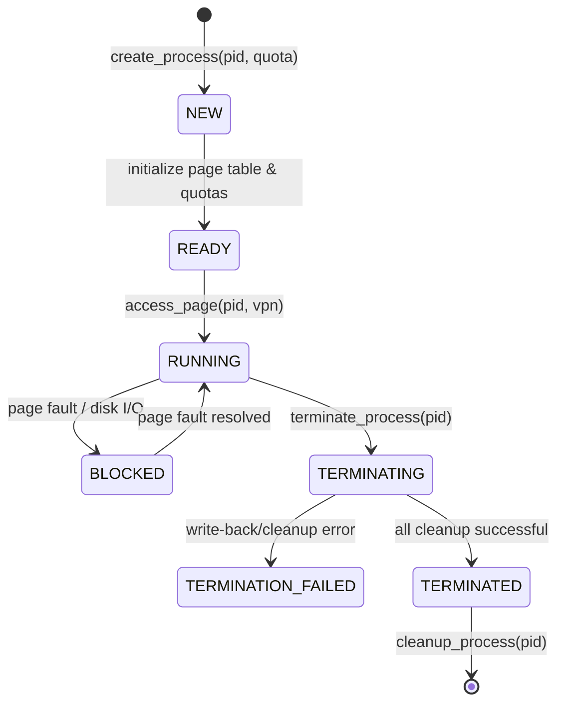
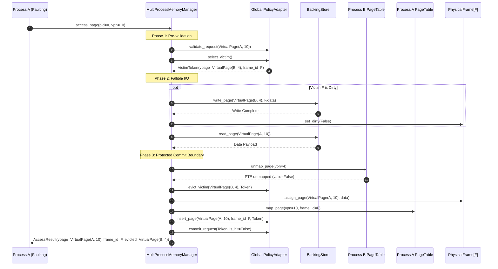
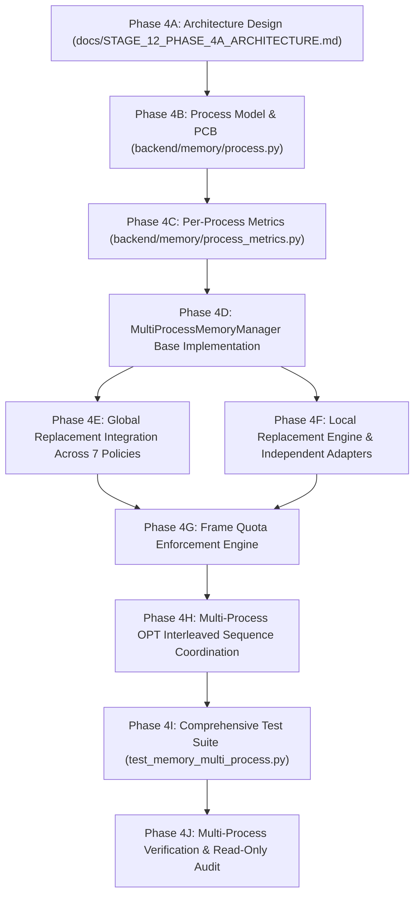
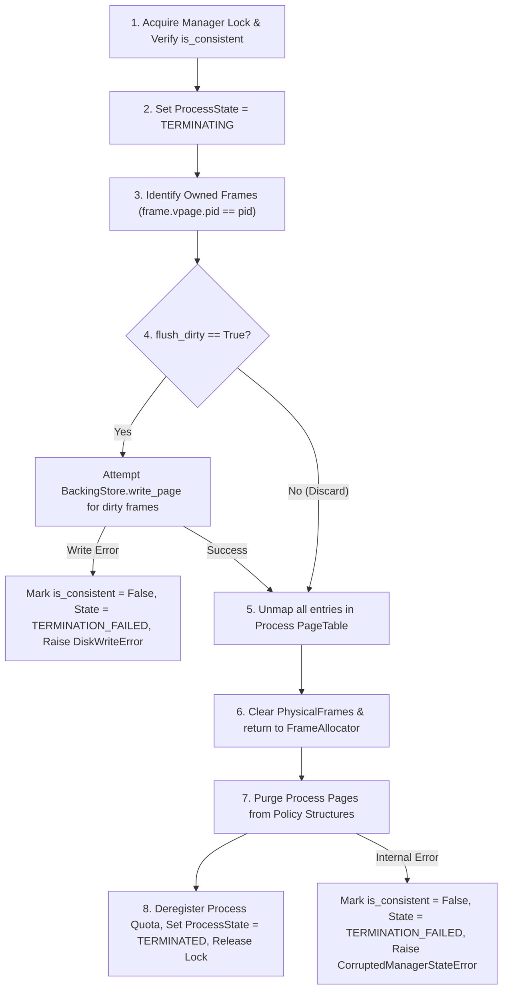

# Stage 12.2 — Phase 4A: Multi-Process Memory Management Architecture Design

**Document ID**: `STAGE_12_PHASE_4A_ARCHITECTURE`  
**Status**: Architecture Proposal & Specification (Read-Only Audit Phase)  
**Target Subsystem**: OS Virtual Memory Manager, Multi-Process Address Spaces, and Replacement Policies  
**Working Directory**: `E:\OS_PROJECT`  
**Branch**: `feature/os-memory-management`  

---

## 1. Executive Summary & Assessment of Current Architecture

### 1.1 Context and Baseline Assessment
The operating system memory management simulator currently possesses a robust, three-phase transactional memory subsystem (`backend/memory/`) verified by 260 automated tests across seven replacement algorithms (LRU, FIFO, LFU, MRU, ARC, CLOCK, OPT).

The existing architecture provides:
1. **Virtual Page Identity (`backend/memory/page.py`)**: Immutable, hashable `VirtualPage(pid, vpn)` composite keys.
2. **Hardware MMU Representation (`backend/memory/frame.py`)**: Authoritative `PhysicalFrame` tracking `frame_id`, resident `vpage`, `reference_bit`, and `dirty`.
3. **Per-Process Page Tables (`backend/memory/page_table.py`)**: `PageTable(pid)` mapping virtual page numbers to physical frame indices via `PageTableEntry`.
4. **Physical Frame Allocator (`backend/memory/allocator.py`)**: Central FIFO queue of unallocated frames with double-free detection.
5. **Simulated Secondary Storage (`backend/memory/backing_store.py`)**: Key-value page storage indexed by `VirtualPage` with fault-injection hooks.
6. **Replacement Policy Adapter (`backend/memory/policy_adapter.py`)**: Bridge adapting standalone algorithms to 3-phase transactional hooks (`validate_request`, `select_victim`, `evict_victim`, `insert_page`, `record_hit`, `commit_request`, `abort_request`).
7. **Transactional Memory Manager (`backend/memory/manager.py`)**: Core engine orchestrating Phase 1 (pre-validation), Phase 2 (fallible disk I/O), and Phase 3 (protected hardware & policy commit).

### 1.2 Limitations of the Single-Process Paradigm
While `VirtualPage` and `PageTable` natively include a `pid` attribute, the higher-level memory management operates under an implicit single-process or uncoordinated multi-process regime:
- **Unmanaged Process Lifecycles**: Processes are implicitly created when `get_page_table(pid)` is called; there is no formal registration, state machine (`READY`, `RUNNING`, `TERMINATED`), or termination cleanup.
- **Replacement Scope Undifferentiated**: The replacement policies operate on resident pages without distinguishing between **Global Replacement** (any resident page can be evicted to satisfy a page fault) and **Local Replacement** (a process can only evict its own resident pages).
- **Resource Starvation and Lack of Quotas**: A single aggressive process can monopolize all physical frames, starving other processes without boundary enforcement (min/max quotas).
- **Aggregate-Only Telemetry**: `MemoryMetrics` aggregates hits and misses globally without per-process isolation, hindering multi-tenant performance analysis.

### 1.3 Objectives of Phase 4
Phase 4 extends the architecture into a full-fledged multi-process memory management system supporting:
- Explicit process abstraction with independent virtual address spaces.
- Shared physical memory with strict, verifiable frame ownership.
- Both **Global** and **Local** page replacement models across all seven policies.
- Per-process minimum and maximum frame quotas.
- Transactional cross-process eviction safety.
- Multi-process offline reference sequence coordination for Belady's Optimal (OPT) policy.
- Zero breaking changes to the existing single-process API.

---

## 2. Proposed System Architecture & Class Hierarchy

```
+---------------------------------------------------------------------------------------------------+
|                                       APPLICATION / API LAYER                                     |
|               Single-Process Workloads          |         Multi-Process Simulation Engine         |
+---------------------------------------------------------------------------------------------------+
                                                  |
                                                  v
+---------------------------------------------------------------------------------------------------+
|                                      MEMORY MANAGER KERNEL                                        |
|  +---------------------------------------------------------------------------------------------+  |
|  | MultiProcessMemoryManager (extends MemoryManager)                                           |  |
|  |   - Process Table: Dict[int, ProcessControlBlock]                                           |  |
|  |   - Replacement Scope: ReplacementScope.GLOBAL | ReplacementScope.LOCAL                     |  |
|  |   - Frame Quota Enforcement Engine                                                          |  |
|  |   - Global Transaction Coordinator (3-Phase Commit)                                         |  |
|  +---------------------------------------------------------------------------------------------+  |
|         |                                      |                                  |               |
|         v                                      v                                  v               |
|  +-------------------+              +----------------------+             +---------------------+  |
|  | Process Subsystem |              | Hardware MMU State   |             | Policy Subsystem    |  |
|  |                   |              |                      |             |                     |  |
|  | ProcessControlBlock|              | FrameAllocator       |             | GlobalPolicyAdapter |  |
|  | PageTable(pid)    | <----------> | Dict[int,            | <---------> |        OR           |  |
|  | ProcessMetrics    |              |   PhysicalFrame]     |             | PerProcessAdapters  |  |
|  | ProcessQuota      |              +----------------------+             +---------------------+  |
|  +-------------------+                         |                                                  |
+------------------------------------------------|--------------------------------------------------+
                                                 v
                                  +------------------------------+
                                  | BackingStore (Swap Storage)  |
                                  | Key: VirtualPage(pid, vpn)   |
                                  +------------------------------+
```

### 2.1 Proposed Module Layout

```
backend/
├── memory/
│   ├── __init__.py               # Exports VirtualPage, PhysicalFrame, MemoryManager, ProcessControlBlock
│   ├── allocator.py              # FrameAllocator (shared physical frame pool)
│   ├── backing_store.py          # BackingStore (secondary swap storage)
│   ├── exceptions.py             # Memory system exception hierarchy
│   ├── frame.py                  # PhysicalFrame (hardware status)
│   ├── manager.py                # Base MemoryManager (backward-compatible)
│   ├── multi_process_manager.py  # NEW: MultiProcessMemoryManager
│   ├── page.py                   # VirtualPage(pid, vpn) composite key
│   ├── page_table.py             # PageTable, PageTableEntry
│   ├── policy_adapter.py         # PolicyAdapter (extended with process-awareness)
│   ├── process.py                # NEW: ProcessControlBlock, ProcessState, ProcessQuota
│   └── process_metrics.py        # NEW: ProcessMemoryMetrics
```

---

## 3. Process and Address-Space Model

### 3.1 Process Control Block (`ProcessControlBlock`)
Each process executing within the memory manager is represented by a `ProcessControlBlock` (PCB) holding process state, virtual memory mappings, quotas, and telemetry.

```python
from enum import Enum
from dataclasses import dataclass, field
from typing import Optional, List
from backend.memory.page_table import PageTable
from backend.memory.process_metrics import ProcessMemoryMetrics

class ProcessState(Enum):
    NEW = "NEW"
    READY = "READY"
    RUNNING = "RUNNING"
    BLOCKED = "BLOCKED"
    TERMINATING = "TERMINATING"
    TERMINATION_FAILED = "TERMINATION_FAILED"
    TERMINATED = "TERMINATED"

@dataclass
class ProcessQuota:
    min_frames: int = 0
    max_frames: Optional[int] = None
    
    def __post_init__(self):
        if not isinstance(self.min_frames, int) or isinstance(self.min_frames, bool) or self.min_frames < 0:
            raise ValueError(f"min_frames must be an integer >= 0, got {self.min_frames!r}")
        if self.max_frames is not None:
            if not isinstance(self.max_frames, int) or isinstance(self.max_frames, bool) or self.max_frames < 1:
                raise ValueError(f"max_frames must be an integer >= 1 or None, got {self.max_frames!r}")
            if self.max_frames < self.min_frames:
                raise ValueError(f"max_frames ({self.max_frames}) cannot be less than min_frames ({self.min_frames})")

@dataclass
class ProcessControlBlock:
    pid: int
    name: str = ""
    state: ProcessState = ProcessState.NEW
    page_table: PageTable = field(init=False)
    metrics: ProcessMemoryMetrics = field(default_factory=ProcessMemoryMetrics)
    quota: ProcessQuota = field(default_factory=ProcessQuota)
    reference_count: int = 0
    
    def __post_init__(self):
        if not isinstance(self.pid, int) or isinstance(self.pid, bool) or self.pid < 0:
            raise ValueError(f"PID must be a non-negative integer, got {self.pid!r}")
        self.page_table = PageTable(self.pid)
        if not self.name:
            self.name = f"Process_{self.pid}"
```

### 3.2 Address Space Isolation via `VirtualPage(pid, vpn)`
Memory addressing maintains total process isolation through the immutable composite key `VirtualPage(pid, vpn)`:
1. **Virtual Space Disjointness**: Process $P_1$ accessing VPN `5` generates `VirtualPage(pid=1, vpn=5)`. Process $P_2$ accessing VPN `5` generates `VirtualPage(pid=2, vpn=5)`.
   $$\text{VirtualPage}(1, 5) \ne \text{VirtualPage}(2, 5)$$
2. **Backing Store Keying**: Swap disk blocks are keyed by `VirtualPage`. Therefore, $P_1$ and $P_2$ store completely distinct payloads in swap, preventing data collision.
3. **Hardware Frame Association**: `PhysicalFrame.vpage` stores the full `VirtualPage` object. A frame mapped to $P_1$ explicitly records `vpage=VirtualPage(1, 5)`.

### 3.3 Process Lifecycle Management



1. **Process Creation (`create_process(pid, quota=None)`)**:
   - Validates that `pid` is not already registered.
   - Instantiates `ProcessControlBlock(pid, quota=quota)`.
   - Transitions state to `READY`.
2. **Process Execution (`access_page(pid, vpn, operation, write_data)`)**:
   - Asserts process exists and is not `TERMINATED`.
   - Transitions state to `RUNNING`.
   - Executes 3-phase memory reference.
3. **Process Termination (`terminate_process(pid, flush_dirty=False)`)**:
   - Identifies all resident physical frames currently mapped to `pid`.
   - If `flush_dirty=True`: dirty frames are persisted to `BackingStore`. If `flush_dirty=False`: dirty frames are discarded (standard Unix process termination semantics).
   - Informs replacement policy to evict/remove all pages belonging to `pid`.
   - Clears physical frames (`frame.clear_frame()`) and returns them to `FrameAllocator.free_frame()`.
   - Unmaps all entries in `page_table`.
   - Transitions state to `TERMINATED`.
4. **Process Cleanup (`cleanup_process(pid)`)**:
   - Removes PCB from manager table.
   - Discards all process pages from `BackingStore`.

---

## 4. Shared Physical Memory & Frame Ownership Model

### 4.1 Global Physical Frame Pool
Physical frames $0 \dots C-1$ form a single unified hardware pool managed by `FrameAllocator`.
- **Zero Partitioning Overhead**: Frames are dynamically assigned to processes on demand.
- **Strict Ownership Invariant**: At any point in time, a physical frame $F$ is in exactly one of two states:
  1. **Free**: `F.is_free == True`, `F.vpage == None`, `F.frame_id in FrameAllocator._free_frames`.
  2. **Allocated**: `F.is_allocated == True`, `F.vpage == VirtualPage(pid, vpn)`, `F.frame_id in FrameAllocator._allocated_frames`.

### 4.2 Multi-Tier Consistency Triangle
To prevent memory corruption, stale pointers, and phantom allocations, the system enforces a strict **Three-Way Consistency Invariant**:

$$\forall F \in [0, C-1] \text{ such that } F.\text{is\_allocated}:$$
$$\text{PageTable}[F.\text{vpage.pid}].\text{get\_entry}(F.\text{vpage.vpn}).\text{frame\_id} = F.\text{frame\_id}$$
$$\land \; \text{PageTable}[F.\text{vpage.pid}].\text{is\_valid}(F.\text{vpage.vpn}) = \text{True}$$
$$\land \; F.\text{frame\_id} \in \text{FrameAllocator.\_allocated\_frames}$$
$$\land \; \text{PolicyAdapter.contains}(F.\text{vpage}) = \text{True}$$

```
                    +---------------------------+
                    |  PhysicalFrame.vpage      |
                    |  VirtualPage(pid, vpn)    |
                    +---------------------------+
                             /         \
                            /           \
                           v             v
             +--------------------+    +--------------------+
             | PageTable(pid)     |    | PolicyAdapter      |
             | PTE(vpn).frame_id  |    | Resident Set       |
             | PTE(vpn).valid=True|    | contains(vpage)    |
             +--------------------+    +--------------------+
                           \             /
                            \           /
                             v         v
                    +---------------------------+
                    | FrameAllocator            |
                    | is_allocated(frame_id)    |
                    +---------------------------+
```

---

## 5. Global Replacement Design

### 5.1 Principle of Global Replacement
In **Global Replacement**, the entire set of resident physical frames across all processes forms a single candidate eviction pool. A page fault occurring in Process $P_{\text{req}}$ can reclaim a physical frame currently occupied by Process $P_{\text{victim}}$ ($P_{\text{victim}} \ne P_{\text{req}}$).

### 5.2 Cross-Process Eviction Workflow



### 5.3 Behavior Across All Seven Policies Under Global Replacement
| Algorithm | Global State Representation | Cross-Process Victim Selection Mechanics |
| :--- | :--- | :--- |
| **LRU** | Single `OrderedDict[VirtualPage, int]` | Oldest page accessed across all processes is at head; evicted regardless of owning PID. |
| **FIFO** | Single `OrderedDict[VirtualPage, int]` | Oldest frame loaded across all processes is evicted first. |
| **LFU** | Shared frequency heaps/maps | Page with lowest access frequency across all processes evicted; ties broken by global LRU. |
| **MRU** | Single `OrderedDict[VirtualPage, int]` | Most recently used page across any process evicted. |
| **ARC** | Global $T_1, T_2, B_1, B_2$ lists of `VirtualPage` | Ghost hits from any process adapt shared parameter $p$; recency vs frequency balanced globally. |
| **CLOCK** | Single circular buffer of `capacity` slots; hand sweeps global frames | Inspects MMU `reference_bit` of physical frames; clears bits across processes until finding 0. |
| **OPT** | Interleaved global reference sequence `[VirtualPage(pid, vpn), ...]` | Evicts page whose next reference across the global timeline is farthest in the future. |

---

## 6. Local Replacement Design

### 6.1 Principle of Local Replacement
In **Local Replacement**, a process experiencing a page fault is restricted to evicting only pages from its own resident set. Process $P_A$ cannot evict frames allocated to Process $P_B$.

### 6.2 Architectural Evaluation of Implementation Approaches

#### Approach A: Independent Policy Instance Per Process
Each process is allocated its own dedicated `PolicyAdapter` instance managing its resident working set.
- **Pros**:
  - **Complete Algorithmic Independence**: ARC target parameter $p_i$ adapts purely based on process $i$'s locality; CLOCK hand sweeps only process $i$'s frames; LFU tracks local frequencies.
  - **Zero Cross-Process Contamination**: Thrashing in process $A$ cannot flush process $B$'s ghost directory ($B_1/B_2$) or clear process $B$'s reference bits.
  - **Deterministic Local OPT**: Process $i$'s future sequence is cleanly isolated without inter-process clock interleaving.
- **Cons**:
  - Requires explicit per-process frame quota / capacity partitioning.

#### Approach B: Shared Policy with Process-Filtered Victim Selection
A single global policy instance where `select_victim(process_context=pid)` skips pages where `vpage.pid != pid`.
- **Pros**:
  - Single central data structure.
- **Cons (Severe Correctness Flaws)**:
  - **ARC**: Ghost directories $B_1, B_2$ are global. Process $A$'s miss can adapt parameter $p$, distorting replacement for Process $B$. Directory pruning in Case IV purges another process's ghost history.
  - **CLOCK**: The CLOCK hand advances over slots. If the hand encounters a slot belonging to Process $B$, what does it do? If it clears Process $B$'s reference bit without evicting it, it penalizes Process $B$ for Process $A$'s fault! If it skips Process $B$'s slot without clearing the bit, CLOCK properties degrade into an un-ordered scan.
  - **LFU**: Process $A$'s high-frequency loop inflates frequencies, making Process $B$'s pages permanent victims if unfiltered, or creating skewed comparisons if filtered.
  - **OPT**: Comparing distances in a unified sequence requires filtering future indices per process on every eviction, increasing algorithmic complexity to $O(C \cdot N)$.

### 6.3 Recommendation: Hybrid Approach A with Dynamic Quotas
**Recommendation**: Adopt **Approach A (Independent Policy Instance Per Process)** for Local Replacement:
1. `MultiProcessMemoryManager` instantiates a `PolicyAdapter` for each active process upon creation.
2. In Local Mode, `access_page(pid, vpn)` routes victim selection strictly to `process_table[pid].policy`.
3. If the process has not yet reached its allocated quota or memory has free frames, it claims a new frame from `FrameAllocator`.
4. Once the process resident count reaches its quota (or capacity), its local policy evicts its own oldest/least-optimal page.

---

## 7. Frame Quotas and Memory Allocation

### 7.1 Quota Specification
Quotas are specified via `ProcessQuota(min_frames: int, max_frames: Optional[int])`:
- **`min_frames`**: Guaranteed frame allocation reserve. In Global Replacement, pages belonging to a process whose resident frame count $\le \text{min\_frames}$ are **shielded from eviction** by other processes.
- **`max_frames`**: Hard frame ceiling. A process cannot occupy more than `max_frames` physical frames. When resident count reaches `max_frames`, the process is forced to perform **local eviction**, even under Global Replacement mode.

### 7.2 Allocation & Eviction Decision Matrix

```
Is there a free physical frame in FrameAllocator?
  ├── YES:
  │     Does the requesting process have resident_count < max_frames?
  │       ├── YES: Allocate free frame from FrameAllocator (NO eviction).
  │       └── NO:  Process reached ceiling -> Force LOCAL eviction of process's own page.
  └── NO (Physical Memory Full):
        Is Replacement Scope LOCAL?
          ├── YES: Force LOCAL eviction of process's own page.
          └── NO (GLOBAL):
                Select candidate victim across all processes:
                Is victim process resident_count <= victim process min_frames?
                  ├── YES: Candidate is SHIELDED -> Skip candidate, select next victim.
                  └── NO:  Evict victim (Cross-process or Intra-process).
```

### 7.3 Starvation and Deadlock Prevention
If all resident pages belong to processes at or below their `min_frames`, a global page fault could encounter zero eligible victims.
- **Strict Invariant**: The system enforces that $\sum_{p} \text{min\_frames}_p < \text{Total Physical Capacity}$.
- If configuration attempts to overcommit minimum guarantees, `MemoryManager` rejects the quota assignment with an `InvalidQuotaError`.

---

## 8. Transactional Safety & Concurrency Architecture

### 8.1 Multi-Process Three-Phase Commit Protocol
The memory manager extends its three-phase transaction model to guarantee atomicity across process boundaries:

```
+---------------------------------------------------------------------------------------------------+
| PHASE 1: READ-ONLY PRE-VALIDATION                                                                 |
|   1. Acquire Manager Lock. Verify manager is_consistent == True.                                  |
|   2. Check if (pid, vpn) is a hit in PageTable(pid).                                              |
|   3. If hit: identify target_frame = PageTable(pid).get_frame_id(vpn).                            |
|   4. If miss:                                                                                     |
|        a. Check quota and FrameAllocator.has_free_frame().                                        |
|        b. If eviction needed: invoke PolicyAdapter.select_victim(scope).                          |
|           Obtain immutable VictimToken(vpage=VirtualPage(v_pid, v_vpn), frame_id=F).              |
|        c. Validate victim exists in PageTable(v_pid) and is mapped to frame F.                    |
+---------------------------------------------------------------------------------------------------+
                                                  |
                                                  v
+---------------------------------------------------------------------------------------------------+
| PHASE 2: FALLIBLE EXTERNAL I/O (PRE-COMMIT)                                                       |
|   1. If victim is dirty:                                                                          |
|        BackingStore.write_page(VirtualPage(v_pid, v_vpn), Frame[F].data)                          |
|        On failure: Frame[F] remains dirty; abort transaction; re-raise DiskWriteError.            |
|   2. BackingStore.read_page(VirtualPage(req_pid, req_vpn))                                        |
|        On failure: Frame[F] remains mapped to victim; abort transaction; re-raise DiskReadError.  |
+---------------------------------------------------------------------------------------------------+
                                                  |
                                                  v
+---------------------------------------------------------------------------------------------------+
| PHASE 3: PROTECTED COMMIT BOUNDARY (Zero-Fail Hardware & Software Mutations)                      |
|   1. PageTable(v_pid).unmap_page(v_vpn) [Victim unmapped].                                        |
|   2. PolicyAdapter.evict_victim(VirtualPage(v_pid, v_vpn), Token).                                |
|   3. PhysicalFrame[F].assign_page(VirtualPage(req_pid, req_vpn), dirty, ref=True, data).          |
|   4. PageTable(req_pid).map_page(req_vpn, frame_id=F) [Incoming mapped].                          |
|   5. PolicyAdapter.insert_page(VirtualPage(req_pid, req_vpn), frame_id=F, Token).                 |
|   6. PolicyAdapter.commit_request(Token).                                                         |
|   7. Update ProcessMemoryMetrics for req_pid and v_pid.                                           |
|   * Any unexpected runtime failure in Phase 3 sets is_consistent = False (Panic State).          |
+---------------------------------------------------------------------------------------------------+
```

### 8.2 Invariant Verification Checklist
1. **No Orphan Mappings**: A victim is unmapped from `PageTable(v_pid)` before the frame is reassigned.
2. **No Duplicate Residency**: Frame $F$ is assigned to `VirtualPage(req_pid, req_vpn)` only after unmapping.
3. **Dirty Preservation**: A write-back failure in Phase 2 preserves `Frame[F].dirty == True` and leaves `PageTable(v_pid)` completely valid.
4. **Sequence Position Preservation**: A page-in failure in Phase 2 aborts without calling `commit_request()`, ensuring OPT and policy sequence steps are not advanced.
5. **Lock Granularity**: A centralized `threading.RLock` at the `MultiProcessMemoryManager` level guarantees that cross-process allocations, page table updates, and frame reassignments occur with mutual exclusion.

---

## 9. Belady's Optimal (OPT) Multi-Process Design

### 9.1 Multi-Process Reference Stream Representation
Belady's Optimal replacement requires complete clairvoyant knowledge of future memory references. For multiple processes, references are represented as composite tuples:

$$\mathcal{S} = \left[ (P_{i_0}, V_{j_0}), (P_{i_1}, V_{j_1}), \dots, (P_{i_T}, V_{j_T}) \right]$$

In `MultiProcessMemoryManager`:
- References are normalized to `VirtualPage(pid, vpn)`.
- The global sequence represents the interleaved execution schedule of the simulated CPU scheduler.

### 9.2 Global vs Local OPT Resolution
1. **Global OPT Mode**:
   - `OptimalCache` holds the entire interleaved sequence $\mathcal{S}$.
   - When eviction occurs, `OptimalCache.select_victim()` calculates the next occurrence index in $\mathcal{S}$ for every resident page across all processes:
     $$\text{dist}(p) = \min \{ t - t_{\text{curr}} \mid \mathcal{S}[t] = p, t > t_{\text{curr}} \}$$
   - The resident page whose next reference across the global timeline is farthest in the future (or infinity) is evicted.
2. **Local OPT Mode**:
   - Each process $P_k$ has an independent `OptimalCache` initialized with only its own sub-sequence:
     $$\mathcal{S}_k = [ V \in \mathcal{S} \mid V.\text{pid} == k ]$$
   - A page fault in $P_k$ evaluates future distances strictly along $P_k$'s own timeline, preserving intra-process optimality without inter-process dependency.

### 9.3 Limitations of Offline Clairvoyance
- Dynamic scheduling (e.g., interactive priority preemption, I/O blocking) cannot be predicted statically.
- The global OPT sequence assumes a fixed, deterministic interleaving trace. If process execution order changes dynamically at runtime, the static sequence becomes invalid, requiring dynamic trace regeneration or online approximations (e.g. ARC).

---

## 10. Metrics and Telemetry Architecture

### 10.1 Per-Process Telemetry (`ProcessMemoryMetrics`)
Each process tracks its own fine-grained memory lifecycle metrics:

```python
@dataclass
class ProcessMemoryMetrics:
    requests: int = 0
    hits: int = 0
    misses: int = 0
    pageins: int = 0
    writebacks: int = 0
    clean_evictions_local: int = 0
    dirty_evictions_local: int = 0
    evictions_by_others: int = 0       # Cross-process evictions suffered
    evictions_of_others: int = 0       # Cross-process evictions caused
    resident_frames: int = 0
    
    @property
    def hit_ratio(self) -> float:
        return round(self.hits / self.requests, 4) if self.requests > 0 else 0.0

    @property
    def page_fault_rate(self) -> float:
        return round(self.misses / self.requests, 4) if self.requests > 0 else 0.0
```

### 10.2 Global Aggregate Derivation (Zero Double Counting)
Global metrics are mathematically derived from process-level counters without duplicate accounting:

$$\text{Total Requests} = \sum_{p \in \text{Processes}} p.\text{requests}$$
$$\text{Total Hits} = \sum_{p \in \text{Processes}} p.\text{hits}$$
$$\text{Total Misses} = \sum_{p \in \text{Processes}} p.\text{misses}$$
$$\text{Total Cross-Process Evictions} = \sum_{p \in \text{Processes}} p.\text{evictions\_of\_others} = \sum_{p \in \text{Processes}} p.\text{evictions\_by\_others}$$
$$\text{Total Resident Frames} = \sum_{p \in \text{Processes}} p.\text{resident\_frames} = \text{FrameAllocator.allocated\_count}$$

---

## 11. Migration & Backward Compatibility Strategy

### 11.1 Preservation of Existing Single-Process MemoryManager API
To ensure that all 260 existing tests in `backend/tests/` continue to pass without modification:
1. `MemoryManager` retains its exact constructor signature:
   ```python
   MemoryManager(capacity: int, algorithm: Union[str, Any] = "LRU", backing_store=None, reference_sequence=None)
   ```
2. In `MemoryManager`, requests default to `pid=1` if not specified.
3. `MultiProcessMemoryManager` inherits from `MemoryManager`, adding:
   - `scope: ReplacementScope = ReplacementScope.GLOBAL`
   - `create_process(pid, quota)`
   - `terminate_process(pid)`
   - `get_process_metrics(pid)`
4. `access_page(pid, vpn, operation, write_data)` remains fully compatible, operating seamlessly whether one or ten processes are active.

---

## 12. Detailed Verification and Test Plan

### 12.1 Proposed Test Suite: `backend/tests/test_memory_multi_process.py`

| Test Case Name | Objective & Scenario | Expected Outcome |
| :--- | :--- | :--- |
| `test_mp_identical_vpn_isolation` | Processes 1 and 2 access VPN 10 with different write data. | Two distinct physical frames allocated; each PageTable maps its own frame; backing store holds distinct data. |
| `test_mp_global_cross_process_eviction` | Process 1 fills cache; Process 2 accesses page. | Process 2 causes eviction of Process 1's page; Process 1 PTE marked invalid; Process 2 PTE marked valid. |
| `test_mp_cross_process_dirty_writeback` | Process 1 writes to page; Process 2 causes eviction. | Process 1's dirty page written back to BackingStore; dirty bit cleared; Process 2 loads clean page into frame. |
| `test_mp_failed_cross_process_writeback` | Disk write fails during cross-process eviction. | DiskWriteError raised; Process 1's page remains resident and dirty; Process 2 request aborted cleanly. |
| `test_mp_local_replacement_isolation` | Local mode active. Process 1 reaches quota; requests new page. | Process 1 evicts its own resident page; Process 2's resident pages are completely untouched. |
| `test_mp_quota_min_shielding` | Process 1 has `min_frames=2`. Process 2 faults when memory is full. | Global replacement skips Process 1's pages, evicting an unshielded page from Process 2 or 3. |
| `test_mp_quota_max_enforcement` | Process 1 has `max_frames=2`. Memory has 10 free frames. | Process 1 reaches 2 frames; next access triggers local eviction despite free frames in allocator. |
| `test_mp_process_termination_frame_reclaim` | Process 1 owns 3 resident frames and terminates. | All 3 frames cleared and returned to FrameAllocator; `free_count` increases by 3; policy resident count updated. |
| `test_mp_multi_process_opt_clairvoyance` | Interleaved sequence: `[(1,1), (2,1), (1,2), (2,2), (1,1)]`. | Global OPT identifies the page with furthest future reference across the composite timeline. |
| `test_mp_multi_process_arc_p_adaptation` | Interleaved workload causes ghost hits in Process 1 ($B_1$) and Process 2 ($B_2$). | Shared target parameter $p$ adapts correctly without directory size bound violations ($T_1+T_2 \le c$). |
| `test_mp_reset_recovery` | MemoryManager resets with 5 active processes. | All frames cleared, all page tables reset, all process metrics reset, consistency restored to True. |
| `test_mp_concurrency_stress` | 4 simulated processes access interleaved random memory references. | Zero lost frames, zero double mappings, 100% invariant consistency maintained. |

---

## 13. Implementation Dependency Graph



---

## 14. Risks & Mitigation Strategies

| Risk | Impact | Mitigation Strategy |
| :--- | :--- | :--- |
| **Cross-Process Race Conditions** | High | Centralize transaction synchronization under a re-entrant lock (`threading.RLock`) in `MultiProcessMemoryManager`. Avoid fine-grained per-process locks during cross-process evictions to eliminate deadlock risk. |
| **Memory Leak on Process Termination** | High | Enforce mandatory frame reclamation loop in `terminate_process()`. Ensure every allocated frame mapped to the terminated PID calls `FrameAllocator.free_frame()` and `frame.clear_frame()`. |
| **Ghost Directory Pollution in ARC** | Medium | In Global Mode, allow shared adaptation as designed by FAST 2003. In Local Mode, enforce independent `ARCCache` instances per process to ensure total locality isolation. |
| **Quota Overcommitment** | Medium | Validate during process creation and quota modification that $\sum \text{min\_frames} < \text{capacity}$. Reject violating configurations with `InvalidQuotaError`. |
| **OPT Sequence Desynchronization** | Medium | Provide rigid normalization in `initialize_sequence()` converting all sequence items to `VirtualPage(pid, vpn)`. Validate sequence steps against calling PID in `prepare_request()`. |

---

## 15. Architectural Decisions Requiring User Approval

Before proceeding with Phase 4B implementation, the following design decisions are submitted for user review and approval:

1. **Process Termination Dirty-Flush Default**:
   - *Option 1*: Discard dirty frames on process termination without writing back (standard Unix `exit()` behavior for private memory).
   - *Option 2 (Proposed)*: Configurable `flush_dirty: bool = False` parameter in `terminate_process()`, allowing testing of both persistence and discard paths.
2. **Local Replacement Architecture**:
   - Confirmed recommendation to adopt **Approach A (Independent Policy Instance Per Process)** rather than attempting flawed filter-based sharing for ARC, CLOCK, and LFU.
3. **Locking Strategy**:
   - Single manager-wide `threading.RLock` confirmed for initial multi-process safety before considering fine-grained per-process locks in future distributed optimization stages.

---

## 16. Stage 12.2 Phase 4A Refinement and Gap Closure

### 16.1 Global Replacement with Minimum-Frame Protection
To enforce minimum-frame quotas (`min_frames`) under Global Replacement without compromising algorithm invariants, the architecture establishes a strict separation between **Policy Heuristic Selection** and **OS Quota Eligibility Enforcement**.

#### The Quota Eligibility Predicate
Let $P_{\text{req}}$ be the process experiencing the page fault. A resident candidate page $V = \text{VirtualPage}(P_v, \text{VPN}_v)$ is an **eligible eviction victim** if and only if:
$$\text{IsEligible}(V, P_{\text{req}}) \iff (P_v == P_{\text{req}}) \lor (P_v.\text{resident\_count} > P_v.\text{quota.min\_frames})$$
- A process is **never shielded from evicting its own pages**.
- A candidate belonging to a foreign process ($P_v \ne P_{\text{req}}$) is **shielded** if that foreign process is currently at or below its guaranteed minimum quota ($P_v.\text{resident\_count} \le P_v.\text{min\_frames}$).

#### Algorithm-by-Algorithm Mechanics
1. **LRU / FIFO / MRU**:
   - Data Structure: `OrderedDict[VirtualPage, int]`.
   - Mechanics: Iterates through the ordered resident cache from the eviction end (head for LRU/FIFO, tail for MRU).
   - Selection: Selects the first page $V$ satisfying $\text{IsEligible}(V, P_{\text{req}})$.
   - Invariant Impact: Shielded pages are skipped without altering their position, access timestamp, or arrival ordering.
2. **LFU**:
   - Data Structure: Frequency buckets `freq_to_pages: Dict[int, OrderedDict[VirtualPage, None]]`.
   - Mechanics: Ascends frequency buckets starting at `min_freq`. Within each bucket, inspects pages in LRU order.
   - Selection: Selects the first page satisfying $\text{IsEligible}(V, P_{\text{req}})$.
   - Invariant Impact: The lowest-frequency eligible page is evicted. Shielded pages remain in their respective frequency buckets with frequencies intact.
3. **CLOCK (Second Chance) with Protected Frame Detection**:
   - Data Structure: Circular buffer `slots[0..C-1]`, authoritative MMU `reference_bit`, and circular `hand`.
   - **No-Eligible-Victim Detection & Termination Guarantees**:
     - *Pre-Pass Eligibility Check*: Prior to mutating any MMU reference bits, the algorithm verifies whether at least one eligible resident frame exists:
       $$N_{\text{eligible}} = \sum_{s=0}^{C-1} \mathbb{I}(\text{slots}[s] \ne \text{None} \land \text{IsEligible}(\text{slots}[s], P_{\text{req}}))$$
       If $N_{\text{eligible}} == 0$:
       - **Immediate Abort**: CLOCK returns `None` as a controlled no-eligible-victim result.
       - **State Preservation**: The circular `hand` is preserved at its initial position $\text{hand}_{\text{start}}$.
       - **Zero Bit Mutation**: Zero MMU reference bits are cleared; zero slots are modified.
     - *Bounded Sweep*: When $N_{\text{eligible}} > 0$, the hand sweeps at most $2 \cdot C$ slot inspections (two full revolutions). It is mathematically impossible to loop indefinitely because eligible reference bits are cleared from 1 to 0 on their first encounter, guaranteeing an eligible victim with bit 0 on or before round two.
     - **Shielded Frame Handling**: When the hand encounters a shielded slot ($V = \text{slots}[s]$ where $\text{IsEligible}(V, P_{\text{req}})$ is `False`), the hand advances $\text{hand} = (s + 1) \pmod C$ **WITHOUT clearing the reference bit** of $V$.
       - *Rationale*: Clearing the reference bit of a page that is legally ineligible for eviction would unfairly penalize the protected process during subsequent sweeps when its quota expires.
     - **Eligible Candidate Handling**: If $\text{IsEligible}(V, P_{\text{req}})$ is `True`:
       - If `frame[s].reference_bit == 1`: clear `reference_bit = 0` and advance hand.
       - If `frame[s].reference_bit == 0`: select $V$ as victim; advance hand past $s$ upon Phase 3 commit.
4. **ARC (Adaptive Replacement Cache) — Quota-Constrained Variant**:
   - **Important Architectural Clarification**: The quota-aware ARC algorithm described here is a **Quota-Constrained ARC Variant** and not an unconditional implementation of the original paper replacement rule (Megiddo & Modha, USENIX FAST 2003). In pure ARC, victim selection is determined strictly by $|T_1|$ and target parameter $p$, without external process resource constraints.
   - **Normal ARC REPLACE Decision**:
     In the original FAST 2003 specification, subroutine `REPLACE(p, x)` evaluates:
     $$\text{TargetList} = T_1 \text{ if } (|T_1| \ge 1) \land \left( (x \in B_2 \land |T_1| == p) \lor (|T_1| > p) \lor (|T_2| == 0) \right) \text{ else } T_2$$
     The paper unconditionally evicts the LRU of $T_1$ (placing it into ghost list $B_1$) or the LRU of $T_2$ (placing it into ghost list $B_2$).
   - **The Quota-Protection Override**:
     When minimum-frame quotas are active ($\text{min\_frames} > 0$), all pages currently residing in $\text{TargetList}$ may belong to shielded processes ($P_v.\text{resident\_count} \le P_v.\text{min\_frames}$). Unconditional adherence to the paper rule would either:
     a) Force the eviction of a shielded page, violating the OS kernel's minimum guarantee contract, or
     b) Halt with a false out-of-memory error while eligible unshielded pages exist in the alternate list.
     To resolve this, the **Quota-Constrained ARC Variant** executes:
     - *Primary Search*: Scans $\text{TargetList}$ from LRU to MRU for a page satisfying $\text{IsEligible}(V, P_{\text{req}})$.
     - *Fallback Search*: If all pages in $\text{TargetList}$ are shielded, the algorithm overrides the list target and scans the alternate list ($L_{\text{alt}} = T_2$ if $\text{TargetList} == T_1$, else $T_1$) from LRU to MRU for the first eligible page.
   - **Alternate-List Victim Transition into Ghost Lists**:
     When an alternate-list victim is selected via fallback, its resident entry transitions into the ghost list corresponding to its **actual source collection**:
     - If evicted from $T_1$ (primary or fallback): victim moves to the MRU of $B_1$.
     - If evicted from $T_2$ (primary or fallback): victim moves to the MRU of $B_2$.
     This maintains the structural integrity of $B_1$ (recency history) and $B_2$ (frequency history).
   - **Why Quota Overrides Must NOT Independently Modify $p$**:
     In ARC, adaptation of parameter $p$ is mathematically driven by learning from ghost cache hits ($x \in B_1 \implies \Delta p = \max(1, |B_2|/|B_1|)$; $x \in B_2 \implies \Delta p = \max(1, |B_1|/|B_2|)$). Quota-induced evictions are external operating system policy constraints, not workload locality signals. Artificially adjusting $p$ on a quota fallback would corrupt the online learning rate and introduce systematic bias into recency vs frequency tracking. Therefore, $p$ is never modified by quota overrides.
   - **Preservation of Original ARC Behavior vs Quota-Constrained Variant**:
     Standard ARC behavior is preserved only when the normal ARC-selected victim itself is quota-eligible. If that victim is protected, selecting another eligible page—even from the same list—is quota-constrained ARC behavior. When no quota protection applies (all processes have `min_frames = 0`, the system default) or when the normal ARC-selected victim itself is unshielded, zero overrides occur, and ARC functions with 100% mathematical fidelity to the FAST 2003 paper.
   - **Test Verification (Distinguishing Standard vs Quota-Constrained ARC)**:
     Tests in `backend/tests/test_memory_multi_process.py` explicitly verify both modes:
     - `test_arc_standard_replace_unconstrained`: Confirms exact FAST 2003 mathematical replacement behavior when quotas are not restrictive.
     - `test_arc_quota_constrained_alternate_fallback`: Constructs an adversarial scenario where $T_1$ contains only shielded pages of $P_1$ while $T_2$ contains unshielded pages of $P_2$. Asserts that eviction draws from $T_2$, transitions victim to $B_2$, leaves $p$ untouched, and respects $P_1$'s quota.
5. **OPT (Belady's MIN)**:
   - Data Structure: Clairvoyant sequence occurrence queues `page_to_future_indices`.
   - Selection: Calculates future distance $\text{dist}(V)$ across all resident pages, but takes the maximum strictly over eligible candidates:
     $$\text{Victim} = \arg\max_{V \in \text{Resident} \land \text{IsEligible}(V, P_{\text{req}})} \text{dist}(V)$$
   - Deterministic Tie-Breaking: Broken by earliest arrival order (FIFO) among eligible candidates sharing the same distance or infinity.
   - Invariant Impact: Provably optimal within the subset of pages permitted for eviction by OS resource policies.

---

### 16.2 Exact Quota Semantics & Decision Table
To ensure deterministic, deadlock-free resource allocation, quotas operate under formal mathematical constraints.

#### Quota Definitions & Validation Rules
- **`min_frames` (integer $\ge 0$)**: Guaranteed physical frame reserve. `min_frames = 0` is valid and represents an unreserved process.
- **`max_frames` (integer $\ge 1$ or `None`)**: Hard upper ceiling. `max_frames = 0` is **strictly disallowed** (raises `ValueError`), as every process must be capable of allocating at least one frame to execute.
- **Validation `min_frames > max_frames`**: Raises `ValueError` during process registration or quota modification.
- **Capacity Constraint**: At all times, the sum of minimum guarantees across all registered processes must be strictly less than the total physical frame capacity:
  $$\sum_{p \in \text{Processes}} p.\text{quota.min\_frames} < \text{capacity}$$
  Attempting to register a process or update a quota that violates this constraint raises `InvalidQuotaError`. This prevents deadlock where every frame is shielded and zero evictions can take place.
- **Hard Ceiling Rule**: If a process has reached `max_frames`, it **MUST evict locally from its own resident pages**, even if `FrameAllocator` has free physical frames available. Free frames are preserved for other processes that have not reached their ceiling.

#### Page-Fault Handling Decision Table
Let $P = \text{requesting process}$, $R_P = P.\text{resident\_count}$, $F_{\text{free}} = \text{FrameAllocator.free\_count}$:

| Case | Access State | Free Frames ($F_{\text{free}}$) | Process Resident Count ($R_P$) | Scope | Action Taken |
| :---: | :---: | :---: | :---: | :---: | :--- |
| **1** | Hit | Any | Any | Any | Mark MMU reference bit (and dirty if write); update policy hit state; NO allocation or eviction. |
| **2** | Miss | $F_{\text{free}} > 0$ | $R_P < \text{max\_frames}$ | Local or Global | Allocate unallocated frame from `FrameAllocator`; NO eviction. |
| **3** | Miss | $F_{\text{free}} > 0$ | $R_P \ge \text{max\_frames}$ | Local or Global | **Forced Local Eviction**: Evicts oldest/least-optimal page of $P$; reuses reclaimed frame; free frames untouched. |
| **4** | Miss | $F_{\text{free}} == 0$ | Any | Local | **Local Eviction**: Evicts $P$'s own page via local policy; reuses frame. |
| **5** | Miss | $F_{\text{free}} == 0$ | $R_P \ge \text{max\_frames}$ | Global | **Forced Local Eviction**: Evicts $P$'s own page (ceiling reached). |
| **6** | Miss | $F_{\text{free}} == 0$ | $R_P < \text{max\_frames}$ | Global | **Global Eviction**: Policy selects best victim among pages satisfying $\text{IsEligible}(V, P)$. |
| **7** | Miss | $F_{\text{free}} == 0$ | Any | Global | **Shielding Fallback**: If all foreign pages are shielded ($R_{\text{foreign}} \le \text{min\_frames}$), fallback to evicting $P$'s own page. If $P$ has no pages resident, raise `NoFreeFrameError`. |

---

### 16.3 Process Termination and Policy Cleanup Lifecycle
Process termination is a critical kernel boundary operation that must be failure-safe and atomic in its accounting. Termination is **strictly not considered successful** until every phase of dirty-page synchronization, page-table disconnection, frame deallocation, and policy cleanup has successfully completed.



#### Detailed Cleanup Protocol & Failure-Safe Invariants
1. **Locking & Pre-Check**: Acquires manager `_lock`. Verifies `self.is_consistent == True`. If manager is already inconsistent, raises `CorruptedManagerStateError`.
2. **State Transition to `TERMINATING`**: Sets $P.\text{state} = \text{TERMINATING}$. Any concurrent or subsequent call to `access_page(pid, ...)` for this PID is rejected with `UnsupportedOperationError`.
3. **Identification of Owned Frames**: Scans all physical frames $F \in [0, C-1]$ where $F.\text{is\_allocated} \land F.\text{vpage.pid} == pid$.
4. **Dirty Data Handling & Idempotent Persistence**:
   - **`flush_dirty=True` Path**:
     - Iterates through the process's dirty frames sequentially and calls `backing_store.write_page(frame.vpage, frame.data)`.
     - *Partially Persisted Writes on Failure*: If frames 1 through $k-1$ succeed but frame $k$ fails with a `DiskWriteError`:
       - The data from frames 1 through $k-1$ **remains safely persisted in secondary storage** (idempotent write-through prevents loss of completed I/O).
       - However, termination is **NOT successful**. The operation aborts immediately.
       - The process state is transitioned to `TERMINATION_FAILED`.
       - The manager latches `self.is_consistent = False` (Panic state).
       - Frame allocations, page tables, and policy structures remain frozen in place without partial teardown, enabling diagnostic inspection.
       - All subsequent memory requests across all processes are blocked with `CorruptedManagerStateError`.
   - **`flush_dirty=False` Path**:
     - Dirty bits and data payloads are cleanly discarded without disk I/O (standard Unix `exit()` semantics for private heap/stack memory).
5. **Page Table Disconnection**: Iterates through valid virtual pages in $P.\text{page\_table}$, calling `unmap_page(vpn)`. Subsequently calls `page_table.reset()`.
6. **Hardware Frame Deallocation**: For each owned frame $F$:
   - Calls `frame.clear_frame()`, zeroing MMU `reference_bit`, `dirty`, `vpage`, and `data`.
   - Calls `FrameAllocator.free_frame(F.frame_id)`, returning the frame to the FIFO free queue.
7. **Subsystem-Specific Policy Purging**:
   - **LRU / FIFO / MRU**: Deletes all keys matching `k.pid == pid` from `policy.cache`.
   - **LFU**: Deletes all keys matching `k.pid == pid` from `page_to_freq` and `freq_to_pages`. Recomputes `min_freq`.
   - **CLOCK**: Scans circular `slots[0..C-1]`. For any slot $s$ where `slots[s].pid == pid`, sets `slots[s] = None`, `reference_bits[s] = 0`, and removes entry from `page_to_slot`. Hand position is left undisturbed.
   - **ARC**: Purges matching pages from $T_1, T_2, B_1, B_2$. Clamps parameter $p = \min(|T_1 \cup T_2|, \max(0, p))$ to preserve ARC directory boundary invariants.
   - **OPT**: Purges matching pages from `policy.cache` and clears their corresponding occurrence queues in `page_to_future_indices`.
   - **Local Mode**: The process's dedicated `PolicyAdapter` instance is dereferenced and garbage collected.
   - *Internal Failure Safety*: If an unexpected error occurs during policy purging, `self.is_consistent = False` is latched, $P.\text{state} = \text{TERMINATION_FAILED}$, and `CorruptedManagerStateError` is raised.
8. **Finalization & Quota Release**:
   - Releases $P.\text{quota.min\_frames}$ back to the unreserved frame pool.
   - Sets $P.\text{state} = \text{TERMINATED}$.
   - Only at this point is process termination reported as **SUCCESSFUL**.

#### Prevention of Stale Policy Entries and Orphan Frames
- Stale policy entries or orphaned frames can never be accessed after a termination failure:
  1. If termination fails, the manager is marked `is_consistent = False`, immediately locking out all subsequent memory operations.
  2. If termination succeeds, frames are zeroed and unmapped before being returned to the free pool, and all matching keys are purged from policy structures before `_lock` is released.
- The sole recovery mechanism from a failed termination panic is a coordinated kernel reset via `MemoryManager.reset()`.

---

### 16.4 OPT Reference Sequence Construction and Validation

#### Sequence Representation & Ingestion
- **Global OPT Sequence**: Represented as a sequence of composite references $\mathcal{S}_{\text{global}} = [V_0, V_1, \dots, V_{N-1}]$ where each item is normalized to `VirtualPage(pid, vpn)`.
- **Local OPT Sequence**: In Local Replacement, the manager automatically projects the global sequence onto each registered process during initialization:
  $$\mathcal{S}_p = [ V \in \mathcal{S}_{\text{global}} \mid V.\text{pid} == p ]$$
- **Pre-Execution Supply Requirement**: OPT is provably offline; the complete sequence must be provided at initialization (`MultiProcessMemoryManager(capacity, algorithm="OPT", reference_sequence=seq)`). Sequences **cannot be modified dynamically** once simulation begins.

#### Validation & Non-Mutating Failure Guarantees
1. **Identifier Validation**: Every reference in the sequence must normalize to valid integer `pid >= 0` and `vpn >= 0`. Invalid types raise `InvalidAddressError`.
2. **Unexpected Request Rejection**:
   - In Global Mode: Incoming access at step $t$ must strictly match $\mathcal{S}_{\text{global}}[t]$. If $V_{\text{incoming}} \ne \mathcal{S}_{\text{global}}[t]$, raises `ValueError` ("Sequence mismatch at index $t$").
   - In Local Mode: Access by process $p$ must strictly match $\mathcal{S}_p[\text{current\_step}_p]$.
   - **Zero State Mutation**: Mismatched requests fail in Phase 1 before any state is modified; `current_step`, occurrence deques, hardware frames, and page tables remain untouched.
3. **Sequence Exhaustion**: Accessing beyond the sequence length raises `ValueError("Reference sequence exhausted")` without state mutation.
4. **Phase 2 I/O Failure Invariant**: If write-back or page-in fails in Phase 2, `abort_request()` is invoked. `commit_request()` is never reached, guaranteeing that `current_step` is **not advanced** and future index queues are **not popped**.
5. **Termination with Remaining References**: If process $P$ terminates while unconsumed references for $P$ remain in $\mathcal{S}_{\text{global}}$, subsequent references to $P$ in the global stream raise `UnsupportedOperationError("Process terminated")`. Traces must reflect realistic workload completions.

---

### 16.5 Policy Ownership and Cleanup Matrix

| Replacement Scope | Policy Instance Ownership | Candidate Eviction Pool | Termination Cleanup Responsibility | Dynamic Mode Switching |
| :---: | :--- | :--- | :--- | :--- |
| **Global** | Single shared `PolicyAdapter` owned by `MultiProcessMemoryManager` | All resident pages across all processes (filtered by `min_frames` quota) | Manager scans shared structures ($T_1/T_2/B_1/B_2$, circular slots, frequency heaps) and purges terminated PID entries | **Unsupported during active simulation**. Changing scope requires full `reset()`. |
| **Local** | Dedicated `PolicyAdapter` per process, owned by `ProcessControlBlock` | Strictly the faulting process's own resident pages | Terminated process's `PolicyAdapter` is dereferenced and garbage collected; zero impact on other processes | **Unsupported during active simulation**. Changing scope requires full `reset()`. |

#### Initialization Mechanics
- In **Global Mode**, `MultiProcessMemoryManager` initializes a single `PolicyAdapter(algorithm, capacity)`. `ProcessControlBlock.policy` is set to `None`.
- In **Local Mode**, `MultiProcessMemoryManager` passes `algorithm` to each `ProcessControlBlock`, initializing a dedicated `PolicyAdapter(algorithm, capacity=p.quota.max_frames or capacity)` per process.
- **Dynamic Switching Restriction**: Switching between Global and Local modes during an active simulation is strictly forbidden. The algorithms maintain fundamentally incompatible state structures (e.g. unified circular buffer vs isolated buffers; single adapted parameter $p$ vs independent $p_i$). Mode changes require `reset()`.

---

### 16.6 Exact Transaction Ordering and Multi-Process Failure Atomicity

Every memory reference adheres to an unalterable **11-step execution sequence**:

```
+---------------------------------------------------------------------------------------------------+
| PHASE 1: READ-ONLY PRE-VALIDATION                                                                 |
|   1. Request Validation: Validate PID exists, VPN >= 0, operation in {READ, WRITE}.               |
|      For OPT: validate incoming page matches sequence at current step.                            |
|   2. Quota Evaluation: Check if resident count >= max_frames (force local eviction) or            |
|      if FrameAllocator has free frames available (bypass eviction).                               |
|   3. Victim Selection: If eviction required, select candidate victim satisfying                   |
|      IsEligible(V, P_req). Produces immutable VictimToken(victim_vpage, frame_id).                |
+---------------------------------------------------------------------------------------------------+
                                                  |
                                                  v
+---------------------------------------------------------------------------------------------------+
| PHASE 2: FALLIBLE EXTERNAL I/O (PRE-COMMIT)                                                       |
|   4. Backing-Store Write-Back: If victim dirty, BackingStore.write_page(victim_vpage, data).       |
|      On error: Frame remains dirty; abort transaction; raise DiskWriteError.                      |
|   5. Backing-Store Page-In: BackingStore.read_page(incoming_vpage).                               |
|      On error: Victim remains resident; abort transaction; raise DiskReadError.                   |
+---------------------------------------------------------------------------------------------------+
                                                  |
                                                  v
+---------------------------------------------------------------------------------------------------+
| PHASE 3: PROTECTED COMMIT BOUNDARY (Zero-Fail In-Memory Updates)                                  |
|   6. Victim Page-Table Unmapping: PageTable(victim_pid).unmap_page(victim_vpn).                    |
|   7. Policy Eviction: PolicyAdapter.evict_victim(victim_vpage, Token).                            |
|   8. Hardware Frame Reassignment: PhysicalFrame[F].assign_page(incoming_vpage, dirty, ref, data). |
|   9. Requester Page-Table Mapping: PageTable(req_pid).map_page(req_vpn, frame_id=F).              |
|  10. Policy Insertion or Hit Update: PolicyAdapter.insert_page(...) or record_hit(...).           |
|  11. Telemetry and Sequence Advancement: PolicyAdapter.commit_request(Token); update metrics.     |
+---------------------------------------------------------------------------------------------------+
```

#### Multi-Process Failure Atomicity
To avoid corrupting one process when an operation for another fails:
- **Zero Cross-Process Mutation in Phases 1 & 2**:
  - If Step 4 (write-back of $P_{\text{victim}}$'s page) fails: $P_{\text{victim}}$'s PTE is still marked `valid=True`, frame $F$ is still mapped to $P_{\text{victim}}$, dirty bit remains `True`, and $P_{\text{req}}$ has zero mappings.
  - If Step 5 (page-in of $P_{\text{req}}$'s page) fails: $P_{\text{victim}}$ is still completely mapped and resident. Neither page table has been modified.
- **Atomic Transition in Phase 3**:
  - Steps 6 through 11 involve strictly synchronous in-memory dictionary and pointer assignments. They perform zero I/O and cannot encounter transient network/disk failures.
  - If an unexpected Python exception (e.g. `MemoryError`) occurs during Phase 3, the manager sets `self.is_consistent = False`, immediately entering a panic state that blocks all subsequent accesses until recovery, ensuring partial mappings can never be accessed.

---
*End of Refined Architecture Specification: Stage 12.2 Phase 4A.*
