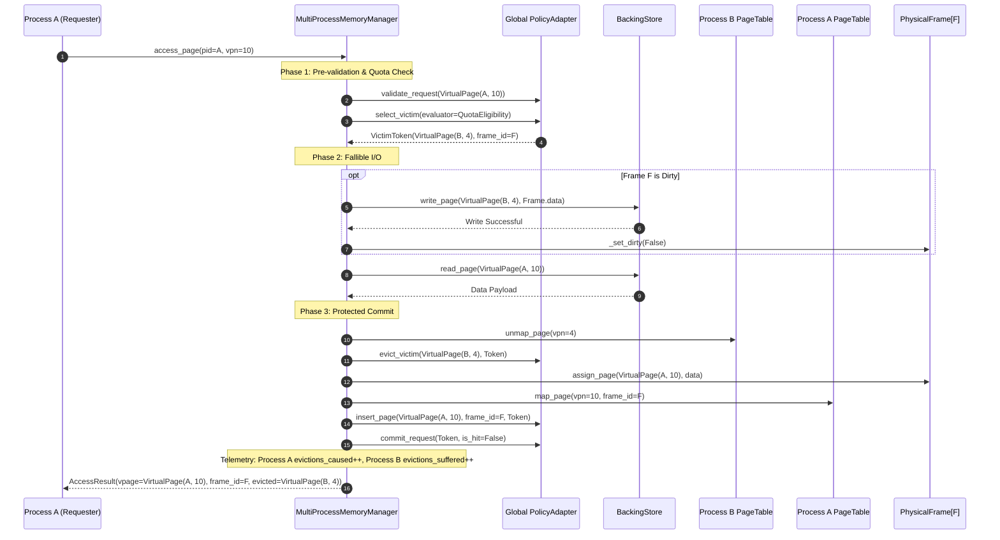
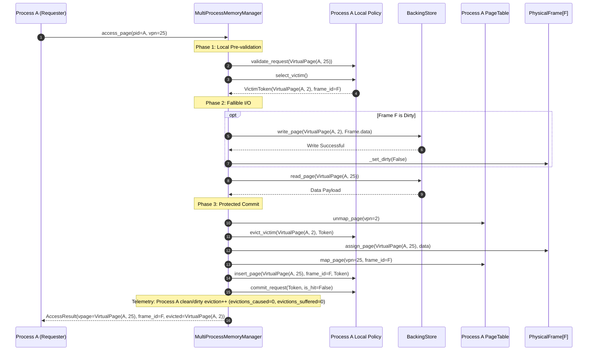
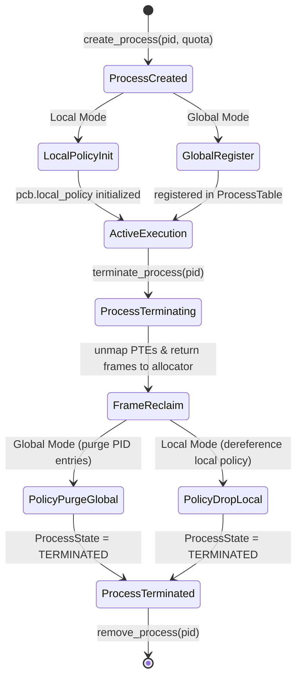
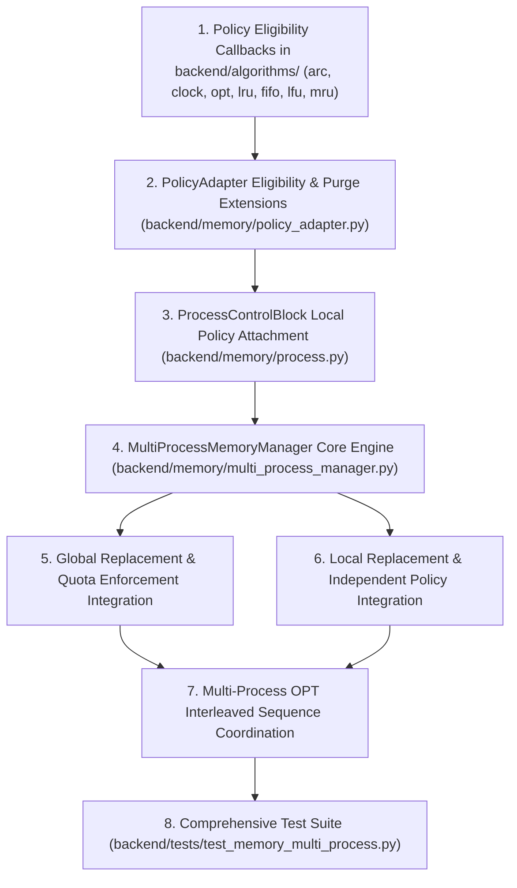

# Stage 12.2 — Phase 4C: Global and Local Replacement Architecture Design

**Document ID**: `STAGE_12_PHASE_4C_ARCHITECTURE`  
**Status**: Architecture Specification & Review Resolutions (Approved Final Specification)  
**Target Subsystem**: Virtual Memory Manager, Multi-Process Address Spaces, Global/Local Replacement Engines, Frame Quotas  
**Working Directory**: `E:\OS_PROJECT`  
**Branch**: `feature/os-memory-management`  

---

## 1. Executive Summary & Baseline Architecture Findings

### 1.1 Baseline System State
The operating system memory management simulator has successfully established a high-integrity virtual memory subsystem across Stages 12.1 through 12.2 Phase 4B:
- **Baseline Passing Tests**: 283 backend automated tests passing with zero failures.
- **Hardware Abstraction**: `PhysicalFrame` represents hardware MMU frame state, authoritative hardware reference bits, dirty flags, and ownership properties (`owner_pid`, `vpn`).
- **Translation Layer**: `PageTable` provides per-process translation (`PageTableEntry`), isolated VPN spaces, and reverse mapping queries.
- **Allocation & Storage**: `FrameAllocator` manages physical frames via double-free-checked FIFO queues; `BackingStore` simulates swap block storage keyed by `VirtualPage(pid, vpn)`.
- **Integrated Policies**: All seven page replacement algorithms (LRU, FIFO, LFU, MRU, ARC, CLOCK, OPT) are verified in standalone mode, with ARC, CLOCK, and OPT fully integrated into the transactional `MemoryManager`.
- **Process Abstraction**: `ProcessControlBlock` (PCB), `ProcessTable`, `ProcessState` (7-state finite-state machine with failure-safe teardown), `ProcessQuota` (min/max frame constraints), and `ProcessMemoryMetrics` are fully implemented and verified.

### 1.2 Identified Architectural Gaps for Phase 4C
1. **Replacement Scope Undifferentiated in `MemoryManager`**:
   The current `MemoryManager` operates with a single `PolicyAdapter`. While `VirtualPage` distinguishes processes via `pid`, the manager lacks a formal abstraction distinguishing **Global Replacement** (where a page fault in $P_A$ can evict an eligible frame from $P_B$) from **Local Replacement** (where $P_A$ is strictly confined to evicting its own resident frames).
2. **Quota Enforcement Disconnected from Victim Selection**:
   `ProcessQuota` defines `min_frames` and `max_frames`, but the current `MemoryManager.access_page()` lifecycle allocates frames solely based on `allocator.has_free_frame()` and unconditional policy eviction. It does not prevent foreign eviction of processes at `min_frames`, nor does it force local eviction when an individual process reaches `max_frames` while free physical memory exists.
3. **Policy Instance Topology Undefined for Local Mode**:
   Under Local Replacement, sharing a single policy instance across processes introduces catastrophic cross-talk (e.g., ARC ghost directory purging across processes, CLOCK hand sweeping another process's frames, LFU frequency skew). Local Replacement requires a clean policy ownership topology.
4. **OPT Interleaved Sequence Handling**:
   While OPT is integrated for single-process sequences, multi-process OPT requires formal sequence validation, per-process stream filtering, quota-aware future distance calculation, and atomic sequence rollback on I/O failure.

---

## 2. Global Replacement Architecture

### 2.1 Core Architectural Principles
In **Global Replacement**:
1. **Unified Frame Competition**: All active processes compete for frames within a single shared physical memory pool of capacity $C$.
2. **Single Shared Policy Instance**: A single `PolicyAdapter` instance tracks residency and eviction ordering across all resident pages of all processes.
3. **Cross-Process Eviction**: When physical memory is exhausted (or when ARC mandates eviction), a faulting process $P_{\text{req}}$ may evict a resident page $V_{\text{victim}}$ belonging to a different process $P_{\text{victim}}$ ($P_{\text{victim}} \ne P_{\text{req}}$), provided $P_{\text{victim}}$ is not protected by its minimum quota.
4. **Isolated Address Translation Updates**: The victim page $V_{\text{victim}}$ is unmapped from $P_{\text{victim}}$'s `PageTable`, its dirty payload is written back to secondary storage under $V_{\text{victim}}$'s identity, the physical frame is reassigned, and $V_{\text{req}}$ is mapped into $P_{\text{req}}$'s `PageTable`.
5. **Accurate Telemetry Attribution**: The eviction is attributed across both processes: $P_{\text{req}}$ records an `eviction_caused`, while $P_{\text{victim}}$ records an `eviction_suffered`.

### 2.2 Global Eviction Workflow



---

## 3. Local Replacement Architecture

### 3.1 Core Architectural Principles
In **Local Replacement**:
1. **Per-Process Residency Boundary**: Each process manages its own resident working set. A page fault occurring in Process $P_{\text{req}}$ is restricted to evicting **only** pages that are currently owned by $P_{\text{req}}$.
2. **Dedicated Policy Instance Per Process**: Every registered process owns an independent `PolicyAdapter` instance. The policy's internal ordering (e.g., LRU queue, CLOCK hand, ARC $T_1/T_2/B_1/B_2$, LFU frequency buckets) reflects purely $P_{\text{req}}$'s access history.
3. **Zero Cross-Process Algorithmic Contamination**:
   - A looping scan in $P_A$ flushes only $P_A$'s local cache; it cannot displace pages of $P_B$.
   - Ghost cache hits in $P_A$ adapt only $P_A$'s ARC parameter $p_A$; $P_B$'s parameter $p_B$ remains untouched.
   - Reference bits checked by CLOCK belong exclusively to frames allocated to $P_{\text{req}}$.
4. **Physical Frame Pool Sharing**: The physical memory frames themselves remain in a shared pool managed by `FrameAllocator`. As long as physical memory has free frames and $P_{\text{req}}.\text{resident\_count} < P_{\text{req}}.\text{quota.max\_frames}$, $P_{\text{req}}$ allocates free frames. Once its quota or local capacity is reached, it evicts locally.

### 3.2 Local Eviction Workflow



---

## 4. Policy Ownership, Registration, and Lifecycle Model

### 4.1 Ownership Topology

| Attribute | Global Replacement Mode | Local Replacement Mode |
| :--- | :--- | :--- |
| **Policy Instance Count** | Exactly 1 (`MultiProcessMemoryManager.policy`) | Exactly $N$, where $N$ is the number of active processes |
| **Instance Storage** | Owned directly by `MultiProcessMemoryManager` | Owned by each `ProcessControlBlock.local_policy` |
| **Capacity Parameter** | Total system physical capacity ($C$) | $\text{local\_capacity} = \min(P.\text{quota.max\_frames}, C)$ if finite; else $C$ |
| **Target Candidate Pool** | All resident pages across all processes | Resident pages belonging strictly to `vpage.pid == pcb.pid` |
| **PCB Policy Reference** | `pcb.local_policy = None` | `pcb.local_policy = PolicyAdapter(...)` |

### 4.2 Lifecycle Transitions



#### A. Process Creation After Simulation Starts
- **Global Replacement**:
  - The new process is registered in `ProcessTable`.
  - Its `PageTable` is initialized empty.
  - The global policy requires no re-sizing; its capacity remains $C$.
  - For online algorithms (LRU, FIFO, LFU, MRU, CLOCK, ARC), the process immediately participates in the global pool upon its first access.
- **Local Replacement**:
  - The manager instantiates a dedicated `PolicyAdapter` for the new process.
  - Local capacity is set deterministically: $\text{local\_capacity} = \min(P.\text{quota.max\_frames}, C)$ if finite; else $C$ if unbounded.
  - The local policy is attached to `pcb.local_policy`.

#### B. Process Termination Teardown
When `terminate_process(pid, flush_dirty)` is called:
1. **Acquire Manager Lock**: Ensure zero transactions are executing.
2. **Transition State**: Set `state = TERMINATING`.
3. **Dirty Page Synchronization**: If `flush_dirty=True`, write dirty frames to `BackingStore`. On error, transition to `TERMINATION_FAILED`, mark manager `is_consistent = False`, and abort.
4. **Frame Reclamation**:
   - For every physical frame $F$ where `F.vpage.pid == pid`:
     - Clear frame hardware state via `F.clear_frame()`.
     - Return frame ID to `FrameAllocator.free_frame(F.frame_id)`.
   - Unmap all entries in `pcb.page_table` and call `pcb.page_table.reset()`.
5. **Policy Teardown**:
   - **Global Mode**: Purge all keys where `vpage.pid == pid` from the global policy data structures (see Section 6 for algorithm-specific purge mechanics).
   - **Local Mode**: Call `pcb.local_policy.reset()` and set `pcb.local_policy = None`. The instance is immediately garbage-collected.
6. **State Finalization**: Transition to `TERMINATED`. Release quota reservations.

#### C. Policy Mode Switching Prohibition
- **Strict Invariant**: Switching replacement mode (`GLOBAL` $\leftrightarrow$ `LOCAL`) during an active simulation is **strictly prohibited**.
- **Technical Justification**: Global and Local modes maintain structurally incompatible state representations. A global CLOCK hand sweeps a unified buffer; transitioning to local mode would leave orphaned hands and fragmented slot indices. In ARC, global parameter $p$ aggregates cross-process history; splitting $p$ into per-process parameters $p_i$ is mathematically undefined without trace replay.
- **Requirement**: Changing the replacement mode requires a complete, coordinated `manager.reset()`.

---

## 5. Quota Enforcement Engine & Minimum Guarantee Protection

### 5.1 Formal Quota Rules

1. **Minimum Quota (`min_frames: int >= 0`)**:
   - Represents an OS guaranteed physical frame reserve protecting a process **exclusively against foreign eviction** by other processes.
   - When a process has $R_P \le \text{min\_frames}$, its resident pages are **shielded from cross-process eviction**.
   - A process is **never shielded from evicting its own pages**.
2. **Maximum Quota (`max_frames: Optional[int] >= 1`)**:
   - Represents a hard allocation ceiling.
   - A process cannot exceed `max_frames` resident physical frames at any time.
   - If $R_P \ge \text{max\_frames}$, the process **MUST perform a local eviction**, even if `FrameAllocator` has unallocated physical frames available. Free physical frames are preserved for other processes below their ceiling.
3. **Aggregate Minimum Quota Validation (Hard Validity Constraint)**:
   - The formal hard validity constraint enforced across the system is:
     $$\sum_{p \in \text{Processes}} p.\text{quota.min\_frames} \le C$$
   - **Equality vs. Strict Inequality Semantics**:
     - **The Hard Constraint is Weak Inequality ($\le C$)**: A configuration where $\sum \text{min\_frames} == C$ is **strictly valid**. It does not corrupt memory, violate hardware abstractions, or cause replacement deadlocks among processes with resident pages (since any active process can legally evict and replace its own pages).
     - **No Spare Unreserved Capacity**: When the sum equals physical capacity, all physical frames may be held at minimum reservations. Under this condition, an unreserved process ($\text{min\_frames} = 0$) or a newly arrived process with 0 resident pages will be unable to obtain a physical frame once memory is full, failing with `NoFreeFrameError`.
     - **Guaranteed Spare Capacity Requirement**: If a workload scenario or operating configuration requires guaranteed spare capacity for unreserved or dynamically arriving processes, the configuration must explicitly require **strict inequality** ($\sum \text{min\_frames} < C$). The kernel must NOT silently alter the hard validity constraint to strict inequality.
     - *Validation Location*: Checked synchronously in `ProcessTable.create_process()`, `ProcessTable.register_process()`, and `MultiProcessMemoryManager.set_process_quota()`.
     - *Exception*: Violating configurations raise `InvalidQuotaError(f"Aggregate minimum quota sum ({new_sum}) exceeds physical capacity ({C})")`.

---

## 6. Algorithmic Victim Eligibility Across All Seven Policies

### 6.1 The Unified Quota-Eligibility Predicate
Let $P_{\text{req}}$ be the process requesting memory access. A candidate resident page $V = \text{VirtualPage}(P_v, \text{VPN}_v)$ is **quota-eligible for eviction** if and only if:

$$\text{IsEligible}(V, P_{\text{req}}) \iff (P_v == P_{\text{req}}) \lor (P_v.\text{resident\_count} > P_v.\text{quota.min\_frames})$$

### 6.2 Algorithm-by-Algorithm Selection & Fallback Mechanics

#### 1. LRU (Least Recently Used)
- **Data Structure**: `OrderedDict[VirtualPage, int]` (Head = LRU, Tail = MRU).
- **Selection**: Iterates from Head to Tail. Selects the first page $V$ satisfying $\text{IsEligible}(V, P_{\text{req}})$.
- **Fallback**: If all resident pages belong to shielded foreign processes, and $P_{\text{req}}$ has no resident pages, raises `NoFreeFrameError`.
- **Integrity**: Skipped shielded pages retain their exact position and recency ordering.

#### 2. FIFO (First-In, First-Out)
- **Data Structure**: `OrderedDict[VirtualPage, int]` (Head = oldest arrival, Tail = newest arrival).
- **Selection**: Iterates from Head to Tail. Selects the first page $V$ satisfying $\text{IsEligible}(V, P_{\text{req}})$.
- **Integrity**: Skipped shielded pages maintain their exact arrival queue position.

#### 3. MRU (Most Recently Used)
- **Data Structure**: `OrderedDict[VirtualPage, int]` (Tail = MRU).
- **Selection**: Iterates in reverse (from Tail to Head). Selects the first page $V$ satisfying $\text{IsEligible}(V, P_{\text{req}})$.
- **Integrity**: The most recently used eligible page is evicted; shielded pages are skipped.

#### 4. LFU (Least Frequently Used)
- **Data Structure**: `page_to_freq: Dict[VirtualPage, int]` and `freq_to_pages: Dict[freq, OrderedDict[VirtualPage, None]]`.
- **Selection**: Ascends frequency buckets starting from `min_freq`. Within each frequency bucket, inspects pages in LRU order. Selects the first page satisfying $\text{IsEligible}(V, P_{\text{req}})$.
- **Tie-Breaking**: Deterministic LRU tie-breaking within the minimum eligible frequency tier is preserved.
- **Integrity**: Frequencies of shielded pages remain untouched.

#### 5. CLOCK (Second Chance) with Protected Frame Detection
- **Data Structure**: Circular array `slots[0..C-1]`, pointer `hand`, authoritative MMU `reference_bit`.
- **No-Eligible-Victim Pre-Check**:
  Before sweeping or modifying any hardware reference bits, CLOCK evaluates:
  $$N_{\text{eligible}} = \sum_{s=0}^{C-1} \mathbb{I}(\text{slots}[s] \ne \text{None} \land \text{IsEligible}(\text{slots}[s], P_{\text{req}}))$$
  If $N_{\text{eligible}} == 0$:
  - Immediately aborts and returns `None`.
  - The circular `hand` pointer remains at its starting position.
  - Zero reference bits are modified.
- **Shielded Slot Sweep Invariant**:
  When sweeping and inspecting slot $s$ holding page $V$:
  - If $\text{IsEligible}(V, P_{\text{req}})$ is `False`: the hand advances past $s$ **WITHOUT clearing the MMU reference bit**. Clearing the reference bit of a protected frame would unfairly penalize it during future sweeps when its quota expires.
  - If $\text{IsEligible}(V, P_{\text{req}})$ is `True`:
    - If `reference_bit == 1`: clear `reference_bit = 0` and advance hand.
    - If `reference_bit == 0`: select $V$ as victim; advance hand past $s$ on commit.
- **Bounded Sweep**: The sweep inspects at most $2C$ slots. Since eligible bits are cleared on their first pass, a victim is guaranteed in $\le 2$ revolutions whenever $N_{\text{eligible}} > 0$.

#### 6. ARC (Adaptive Replacement Cache) — Quota-Constrained Variant
- **Original Paper REPLACE Rule**:
  Evaluates $\text{TargetList} = T_1$ if $(|T_1| \ge 1) \land ((x \in B_2 \land |T_1| == p) \lor (|T_1| > p) \lor (|T_2| == 0))$ else $T_2$. Evicts LRU of $\text{TargetList}$.
- **Quota-Constrained Override**:
  1. *Primary Search*: Scans $\text{TargetList}$ from LRU to MRU for a page satisfying $\text{IsEligible}(V, P_{\text{req}})$.
  2. *Fallback Search*: If all pages in $\text{TargetList}$ are shielded, scans the alternate list ($L_{\text{alt}} = T_2$ if $\text{TargetList} == T_1$, else $T_1$) from LRU to MRU for an eligible page.
- **Ghost Directory Transition Rule**:
  The victim transitions into the ghost directory corresponding to its **actual source collection**:
  - Evicted from $T_1$ (primary or fallback) $\implies$ victim key moves to MRU of $B_1$.
  - Evicted from $T_2$ (primary or fallback) $\implies$ victim key moves to MRU of $B_2$.
- **Invariance of Parameter $p$**: Quota overrides do not modify target parameter $p$. Adaptation of $p$ is strictly reserved for workload locality signals (ghost hits in $B_1$ or $B_2$).
- **Fidelity Distinction**: Standard ARC behavior occurs only when the normal paper-selected victim is quota-eligible. When a quota override forces a different candidate, it is explicitly classified as **Quota-Constrained ARC**.

#### 7. OPT (Belady's MIN)
- **Data Structure**: Precomputed future occurrence queues `page_to_future_indices: Dict[VirtualPage, deque[int]]`.
- **Selection**: Computes future distance $\text{dist}(V)$ for all resident pages, but selects the maximum strictly across eligible candidates:
  $$\text{Victim} = \arg\max_{V \in \text{Resident} \land \text{IsEligible}(V, P_{\text{req}})} \text{dist}(V)$$
- **Tie-Breaking**: Ties in distance (including infinity for pages never referenced again) are broken deterministically by earliest FIFO arrival order among eligible candidates.

---

## 7. Comprehensive Global vs. Local Decision Matrix

Let:
- $F_{\text{free}} = \text{FrameAllocator.free\_count}$
- $R_P = P_{\text{req}}.\text{resident\_count}$
- $\text{min}_P = P_{\text{req}}.\text{quota.min\_frames}$
- $\text{max}_P = P_{\text{req}}.\text{quota.max\_frames}$

| Scenario ID | State / Condition | $F_{\text{free}}$ | Requester Residency ($R_P$) | Scope | Action Taken | Frame Reused / Allocated | Victim Process |
| :---: | :--- | :---: | :---: | :---: | :--- | :--- | :--- |
| **S-1** | Hit | Any | Any | Any | Hit commit; update MMU ref/dirty; record hit in policy. | None (existing frame retained) | None |
| **S-2** | Free frame available, requester below max | $> 0$ | $R_P < \text{max}_P$ | Any | Allocate free physical frame via `FrameAllocator`. No eviction. | New free frame | None |
| **S-3** | Free frame available, requester at max | $> 0$ | $R_P \ge \text{max}_P$ | Any | **Forced Local Eviction**: Requester at ceiling. Evicts $P_{\text{req}}$'s own oldest page. Free frames preserved. | Reuses reclaimed frame | $P_{\text{req}}$ (Intra-process) |
| **S-4** | Memory full, eligible foreign victims exist | $0$ | $R_P < \text{max}_P$ | Global | **Global Eviction**: Policy selects candidate where $\text{IsEligible}(V, P_{\text{req}})$ is True. | Reuses reclaimed frame | $P_{\text{victim}}$ (Cross-process) |
| **S-5** | Memory full, only protected foreign processes exist | $0$ | $R_P > 0$ | Global | **Shielding Fallback**: Foreign pages protected. Policy evicts $P_{\text{req}}$'s own page. | Reuses reclaimed frame | $P_{\text{req}}$ (Self-eviction) |
| **S-6** | Memory full, only protected foreign processes exist, requester $R_P = 0$ | $0$ | $R_P == 0$ | Global | **No Legal Victim**: Foreign pages protected; requester has no pages. Raises `NoFreeFrameError`. Zero state mutation. | None | None |
| **S-7** | Requester has no resident pages, free frame exists | $> 0$ | $R_P == 0$ | Any | Allocate free frame from `FrameAllocator`. No eviction. | New free frame | None |
| **S-8** | Requester at minimum quota ($R_P \le \text{min}_P$) | $0$ | $R_P \le \text{min}_P$ | Global | If requester faults, its own pages are eligible for self-eviction, but protected from other processes. | Reuses reclaimed frame | Foreign or Self |
| **S-9** | Requester at minimum and maximum simultaneously ($R_P == \text{min}_P == \text{max}_P$) | Any | $R_P == \text{max}_P$ | Any | **Self-Eviction Required**: Requester evicts its own page. Resident count momentarily $K-1$, restored to $K$ upon commit. | Reuses reclaimed frame | $P_{\text{req}}$ (Self-eviction) |
| **S-10** | ARC requires directory pruning ($|L_1| = c$ or $|L_1 \cup L_2| = 2c$) | Any | Any | Any | **Ghost List Trimming**: Drops ghost key from $B_1$ or $B_2$. No physical frames or disk I/O involved. | None | None |
| **S-11** | ARC requires resident eviction ($T_1 \to B_1$ or $T_2 \to B_2$) | $> 0$ | Any | Any | **Directory-Mandated Eviction**: Evicts resident page into ghost list to maintain $|T_1| + |T_2| \le c$. | Reuses reclaimed frame | Candidate via REPLACE |
| **S-12** | Local replacement, memory full, requester $R_P = 0$ | $0$ | $R_P == 0$ | Local | **Local Out of Memory**: Requester has no resident pages and cannot evict foreign frames. Raises `NoFreeFrameError`. | None | None |
| **S-13** | No legal victim exists (all memory full, zero eligible pages) | $0$ | Zero eligible | Any | Request aborts safely in Phase 1. Raises `NoFreeFrameError`. Frames, PTEs, and OPT sequence untouched. | None | None |

---

## 8. ARC Capacity Sizing & Directory Management Under Quotas

### 8.1 Local ARC Sizing Policy & Physical Pool Constraints
An ARC instance must never have a configured capacity larger than the total physical memory pool $C$.
- **Why ARC Capacity Cannot Exceed Physical Capacity**:
  Physical memory is fundamentally bounded by $C$ physical frames. In ARC, the resident capacity $c$ dictates when the algorithm mandates resident eviction ($|T_1| + |T_2| \ge c$). If an ARC instance were configured with $c > C$, its resident lists could theoretically accept up to $c$ pages without triggering an eviction, while the underlying physical hardware would completely exhaust all $C$ frames. This mismatch would trigger a low-level `NoFreeFrameError` inside `FrameAllocator` rather than allowing ARC's REPLACE routine to select an optimal victim.
- **Deterministic Capacity Formula**:
  $$\text{local\_arc\_capacity} = \begin{cases} \min(P.\text{quota.max\_frames}, C) & \text{if } P.\text{quota.max\_frames is not None} \\ C & \text{if } P.\text{quota.max\_frames is None} \end{cases}$$
- **Directory and Parameter Bounds**:
  All ARC resident and ghost directory bounds are strictly expressed in terms of $\text{local\_arc\_capacity}$:
  - Resident lists: $|T_1| + |T_2| \le \text{local\_arc\_capacity}$.
  - Ghost lists: $|B_1| + |B_2| \le \text{local\_arc\_capacity}$. Total directory capacity is $2 \cdot \text{local\_arc\_capacity}$.
  - Adaptive target parameter: $p \in [0.0, \text{float}(\text{local\_arc\_capacity})]$ (or integer $[0, \text{local\_arc\_capacity}]$).
- **Dynamic Capacity Modification Invariant**:
  Altering effective ARC capacity on an active cache corrupts ghost-history ratios ($|B_1|/|B_2|$), boundary clamping of $p$, and directory pruning triggers. Therefore, changing effective ARC capacity **requires a coordinated reset and policy reinitialization**.

### 8.2 Global ARC Mechanics and Directory Pruning vs. Resident Eviction
- **Global Capacity**: $c = C$.
- **Resident-Page Eviction vs. Directory Pruning**:
  - *Resident Eviction ($T_1 \to B_1$ or $T_2 \to B_2$)*: Reclaims a hardware physical frame, unmaps the PTE, executes dirty write-back if modified, and moves the page key to ghost history.
  - *Directory Pruning ($B_1$ or $B_2$ tail drop)*: Discards an expired historical key from ghost lists to satisfy $|L_1| \le c$ or $|L_1 \cup L_2| \le 2c$. **Zero physical frames, zero page tables, and zero disk I/O operations are involved**.
- **Quota Overrides in Global ARC**:
  - If the paper-selected victim in `TargetList` is shielded, ARC falls back to the alternate list.
  - Victim transitions into the ghost list matching its actual source ($T_1 \to B_1$, $T_2 \to B_2$).
  - Target parameter $p$ is **never modified** by quota overrides, isolating algorithmic learning from OS quota policies.

---

## 9. Belady's Optimal (OPT) Multi-Process Integration

### 9.1 Offline Sequence Contract and Initialization

To eliminate ambiguity, the multi-process OPT integration adheres to a single, deterministic contract:
1. **Upfront Global Sequence**: The complete global reference sequence $\mathcal{S}_{\text{global}} = [V_0, V_1, \dots, V_{M-1}]$ must be supplied prior to simulation execution at `MultiProcessMemoryManager` instantiation.
2. **Mandatory Prior Process Registration**:
   - Every PID appearing in $\mathcal{S}_{\text{global}}$ **must be registered in `ProcessTable` before the first memory request is executed**.
   - If a reference references an unregistered PID, initialization or the Phase 1 access pre-check rejects the request immediately.
3. **Pre-Execution Validation**:
   - Prior to the first access, the sequence is scanned and verified: every element must be a valid `VirtualPage(pid, vpn)` with non-negative integer identifiers.
4. **Local Sequence Projection**:
   - In Local Mode, per-process local reference streams are deterministically derived from the validated global sequence:
     $$\mathcal{S}_p = [V \in \mathcal{S}_{\text{global}} \mid V.\text{pid} == p]$$
   - Each process's local `OptimalCache` is initialized with its own projected sequence $\mathcal{S}_p$.
5. **Rejection of Unexpected PIDs**:
   - If an unexpected PID appears during execution, Phase 1 immediately raises `UnsupportedOperationError("Process PID not registered in offline OPT sequence")`.
   - **Zero State Mutation**: Mismatches abort before any mutation; `current_step`, occurrence deques, hardware frames, and page tables remain untouched.
6. **Failure Atomicity**:
   - If write-back or page-in fails in Phase 2, `abort_request()` is invoked.
   - `OptimalCache.current_step` is **not advanced**, and future occurrence queues are **not popped**. Sequence position remains frozen.

---

## 10. Transaction Lifecycle, Failure Recovery, and Rollback Design

Every memory reference executes through an unalterable **12-step transactional sequence**:

```
+---------------------------------------------------------------------------------------------------+
| PHASE 1: READ-ONLY PRE-VALIDATION & VICTIM SELECTION                                              |
|   1. Request Validation: Validate PID exists, VPN >= 0, operation in {READ, WRITE}.               |
|   2. Process State Assertion: Verify pcb.assert_can_access_memory() (READY, RUNNING, BLOCKED).     |
|   3. Page Table Lookup: Check page_table.is_valid(vpn) to determine Hit vs Miss.                  |
|   4. Policy Request Validation: Invoke policy.validate_request(vpage). Produce validation token.   |
|   5. Quota & Allocation Evaluation: Evaluate Decision Matrix (Section 7). Check has_free_frame()   |
|      and resident_count vs max_frames. Determine if allocation or eviction is required.            |
|   6. Victim Selection: If eviction required, invoke policy.select_victim(IsEligible).              |
|      Produce immutable VictimToken(vpage, frame_id).                                              |
+---------------------------------------------------------------------------------------------------+
                                                  |
                                                  v
+---------------------------------------------------------------------------------------------------+
| PHASE 2: FALLIBLE EXTERNAL I/O (PRE-COMMIT BOUNDARY)                                              |
|   7. Dirty Victim Write-Back: If victim dirty, call BackingStore.write_page(v_vpage, frame.data).   |
|      * Failure: Frame remains dirty; abort transaction; re-raise DiskWriteError.                  |
|   8. Incoming Page-In: Call BackingStore.read_page(req_vpage) to fetch simulated disk payload.     |
|      * Failure: Victim remains resident; abort transaction; re-raise DiskReadError.               |
+---------------------------------------------------------------------------------------------------+
                                                  |
                                                  v
+---------------------------------------------------------------------------------------------------+
| PHASE 3: PROTECTED COMMIT BOUNDARY (Zero-Fail Hardware & Software Mutation)                       |
|   9. Victim Unmapping: If eviction occurred, PageTable(v_pid).unmap_page(v_vpn).                  |
|  10. Policy Eviction: PolicyAdapter.evict_victim(v_vpage, commit_token).                           |
|  11. Hardware Frame Reassignment: PhysicalFrame[F].assign_page(req_vpage, dirty, ref=True, data).  |
|  12. Requester Mapping: PageTable(req_pid).map_page(req_vpn, frame_id=F).                         |
|  13. Policy Insertion/Hit Update: PolicyAdapter.insert_page(...) or record_hit(...).              |
|  14. Telemetry Attribution: Update ProcessMemoryMetrics and MemoryMetrics counters.               |
|  15. Commit Request: PolicyAdapter.commit_request(commit_token, is_hit). Monotonic version bump. |
|  * Any unexpected error in Phase 3 sets is_consistent = False (Kernel Panic).                     |
+---------------------------------------------------------------------------------------------------+
```

### 10.1 Failure Atomicity Guarantees
- **Phase 1 Failure**: Immediate exception raise; zero state changes.
- **Phase 2 Write-Back Failure**: The victim frame remains dirty and mapped. Neither page table is modified. Manager metrics increment `failed_pagefaults`.
- **Phase 2 Page-In Failure**: The victim frame (now clean if written back) remains resident and mapped. The requester receives no mapping. The replacement policy discards the pending token via `abort_request()`.
- **Phase 3 Failure**: Any unexpected exception during in-memory mutation latches `is_consistent = False`. All subsequent memory operations are blocked with `CorruptedManagerStateError`.

---

## 11. Telemetry and Metrics Architecture

### 11.1 Metrics Categorization & Accounting Rules

To prevent double counting while providing deep diagnostic visibility, metrics are categorized into disjoint dimensions:

1. **By Eviction Trigger**:
   - `policy_selected_evictions`: Evictions mandated purely by the replacement policy algorithm (memory was full, or ARC directory rules fired).
   - `quota_triggered_evictions`: Evictions forced because a process reached its `max_frames` quota while free physical frames were still available.
2. **By Process Scope**:
   - `cross_process_evictions`: Evictions where $P_{\text{req}} \ne P_{\text{victim}}$. Attributed as:
     - Requester: `p_req.metrics.evictions_caused += 1`
     - Victim: `p_vic.metrics.evictions_suffered += 1`
     - System: `metrics.cross_process_evictions += 1`
   - `self_evictions`: Evictions where $P_{\text{req}} == P_{\text{victim}}$. Neither `evictions_caused` nor `evictions_suffered` is incremented.
3. **By Data Modification**:
   - `clean_evictions`: Victim frame was clean. No disk I/O performed.
   - `dirty_evictions`: Victim frame was dirty. Synchronized via `write_page()`, incrementing `writebacks`.
4. **ARC Directory Pruning (Ghost Trimming)**:
   - `arc_directory_pruning`: Count of historical keys dropped from $B_1$ or $B_2$.
   - **Crucial Rule**: Directory pruning is **NEVER** counted in `total_evictions`, `clean_evictions`, or `dirty_evictions`. It is tracked in a dedicated counter `arc_ghost_prunes`.

### 11.2 Mathematical Invariants (Zero Double Counting)
$$\text{Total System Evictions} = \text{policy\_selected\_evictions} + \text{quota\_triggered\_evictions}$$
$$\text{Total System Evictions} = \sum_{p} (p.\text{clean\_evictions} + p.\text{dirty\_evictions})$$
$$\text{Total Cross-Process Evictions} = \sum_{p} p.\text{evictions\_caused} = \sum_{p} p.\text{evictions\_suffered}$$

---

## 12. Concurrency, Locking Strategy, and System Invariants

### 12.1 Central Locking Strategy
- **Synchronization Primitive**: A single `threading.RLock` at the `MultiProcessMemoryManager` level.
- **Lock Scope**: Encompasses the entire 3-phase request lifecycle, process creation, termination, and reset.
- **Rationale**: Fine-grained per-process locks during cross-process evictions (which involve mutating two page tables, the physical frame pool, and the replacement policy simultaneously) introduce severe deadlock risks (e.g., $P_1$ evicting $P_2$ while $P_2$ evicts $P_1$). A coarse re-entrant manager lock provides ironclad consistency and eliminates lock-ordering deadlocks.

### 12.2 Formal System Invariants
1. **Frame-to-PTE Bijection**:
   $$\forall F \in \text{AllocatedFrames}: \text{PageTable}[F.\text{owner\_pid}].\text{get\_frame\_id}(F.\text{vpn}) == F.\text{frame\_id}$$
2. **Residency Exclusivity**:
   No physical frame is mapped to more than one virtual page simultaneously.
3. **Policy-Residency Congruence**:
   In Global Mode, `policy.contains(V)` is `True` if and only if $V$ is resident in physical memory. In Local Mode, `P.local_policy.contains(V)` is `True` if and only if $V$ is resident and $V.\text{pid} == P.\text{pid}$.
4. **Minimum Quota Invariant**:
   $$\forall P \in \text{Processes}: P.\text{resident\_count} \ge \min(P.\text{quota.min\_frames}, \text{references issued})$$
   (A process never loses frames to foreign eviction when at or below `min_frames`).
5. **Maximum Quota Invariant**:
   $$\forall P \in \text{Processes}: P.\text{resident\_count} \le P.\text{quota.max\_frames} \quad (\text{if max\_frames is not None})$$
6. **OPT Sequence Monotonicity**:
   `OptimalCache.current_step` advances if and only if Phase 3 commit completes successfully.
7. **Failure Consistency Invariant**:
   If an unexpected error occurs during Phase 3 commit or reset, `self.is_consistent = False` is latched, immediately locking out all subsequent operations.

---

## 13. Proposed File-by-File Implementation Plan

### 1. `backend/memory/policy_adapter.py`
- Extend `PolicyAdapter` to support an eligibility evaluator callable in `select_victim(get_frame_ref_bit, token, is_eligible_cb=None)`.
- Pass `is_eligible_cb` down to underlying policy algorithms (`ARCCache`, `CLOCKCache`, `OptimalCache`, `LFUCache`, `LRUCache`, `FIFOCache`, `MRUCache`).
- Add helper method `purge_process(pid)` to cleanly remove a terminated process's pages from global policy structures.

### 2. `backend/algorithms/` Updates
- **`arc.py`**: Update `_evaluate_replace()` to accept an optional eligibility filter callback for Quota-Constrained ARC. Implement purge method for terminated PID keys.
- **`clock.py`**: Update `select_victim()` to accept `is_eligible_cb`. Implement the pre-pass eligibility check and shielded frame skip (without clearing reference bits).
- **`opt.py`**: Update `select_victim()` to filter candidate distances by `is_eligible_cb`. Add purge method for terminated PID keys.
- **`lru.py`, `fifo.py`, `mru.py`, `lfu.py`**: Update `select_victim()` to accept `is_eligible_cb` and skip protected pages.

### 3. `backend/memory/process.py`
- Add `local_policy: Optional[PolicyAdapter] = None` attribute to `ProcessControlBlock`.
- Add `scope: ReplacementScope` property or parameter to `ProcessTable`.

### 4. `backend/memory/multi_process_manager.py` (New Module)
- Define `class ReplacementScope(Enum): GLOBAL = "GLOBAL"; LOCAL = "LOCAL"`.
- Implement `class MultiProcessMemoryManager(MemoryManager)`:
  - Constructor accepting `scope: ReplacementScope = ReplacementScope.GLOBAL`.
  - Process lifecycle management: `create_process()`, `terminate_process()`, `get_process()`.
  - Quota evaluation engine implementing the Decision Matrix (Section 7).
  - Multi-process 3-phase `access_page()` with cross-process and local victim resolution.
  - Comprehensive per-process and system telemetry attribution.
  - Coordinated multi-process `reset()`.

### 5. `backend/memory/__init__.py`
- Export `ReplacementScope` and `MultiProcessMemoryManager`.

---

## 14. Dependency Order for Implementation



---

## 15. Test Plan, Edge Cases, and Failure Injection

### 15.1 Core Test Matrix (`backend/tests/test_memory_multi_process.py`)

1. **Address Space Isolation**:
   - Two processes access identical VPNs (e.g., $P_1$ VPN 5 and $P_2$ VPN 5).
   - Verify allocation of distinct physical frames, distinct PTEs, and distinct backing store payloads.
2. **Global Cross-Process Eviction**:
   - $P_1$ fills memory; $P_2$ requests page.
   - Verify $P_2$ causes eviction of $P_1$'s page.
   - Verify $P_1$ PTE is unmapped; $P_2$ PTE is mapped.
   - Verify telemetry: $P_2.\text{evictions\_caused} == 1$, $P_1.\text{evictions\_suffered} == 1$.
3. **Cross-Process Dirty Write-Back**:
   - $P_1$ writes to page (dirty bit set). $P_2$ triggers eviction of that page.
   - Verify page is written to `BackingStore` under $P_1$'s identity.
   - Verify frame is cleared of dirty bit before $P_2$'s payload is loaded.
4. **Minimum Quota Shielding**:
   - $P_1$ has `min_frames = 3`. Memory full. $P_2$ page faults.
   - Verify replacement policy skips all pages of $P_1$.
   - Verify an unshielded page from $P_2$ or $P_3$ is selected.
5. **Maximum Quota Forced Local Eviction**:
   - Memory has 20 free frames. $P_1$ has `max_frames = 2`.
   - $P_1$ faults on a 3rd page.
   - Verify $P_1$ evicts one of its own resident pages instead of taking a free frame.
   - Verify free frame count remains 20.
6. **Local Replacement Isolation**:
   - Local mode active. $P_1$ and $P_2$ each allocate frames.
   - $P_1$ reaches capacity and faults.
   - Verify $P_1$ evicts only its own pages. $P_2$'s residency and policy ordering are completely unaffected.
7. **CLOCK Shielded Reference Bit Preservation**:
   - Circular buffer contains shielded frames of $P_1$ with `reference_bit = 1`.
   - $P_2$ page faults. CLOCK hand sweeps past $P_1$'s slots.
   - Verify $P_1$'s reference bits remain 1; verify eligible unshielded page is evicted.
8. **ARC Quota-Constrained Alternate Fallback**:
   - $T_1$ contains only shielded pages of $P_1$.
   - ARC REPLACE rule selects $T_1$.
   - Verify fallback scans $T_2$ for an eligible page.
   - Verify victim transitions into $B_2$; verify parameter $p$ is not altered.
9. **Process Termination Frame Reclamation**:
   - $P_1$ owns 5 resident frames (3 clean, 2 dirty).
   - Terminate with `flush_dirty=True`.
   - Verify dirty frames persisted; all 5 frames returned to `FrameAllocator`.
   - Verify all $P_1$ keys purged from global policy.
10. **Multi-Process OPT Clairvoyance**:
    - Interleaved sequence `[(1, 0), (2, 0), (1, 1), (2, 1), (1, 0)]`.
    - Verify OPT calculates future distance across composite timeline and evicts page with furthest future reference.

### 15.2 Failure Injection Tests
- **Simulated Write-Back Disk Error**:
  Inject `DiskWriteError` during Phase 2 of cross-process eviction. Verify victim frame remains mapped and dirty; verify requester has no mapping; verify manager remains consistent.
- **Simulated Page-In Disk Error**:
  Inject `DiskReadError` during Phase 2. Verify victim remains resident; verify requester aborted; verify OPT sequence step not advanced.
- **Commit Boundary Panic**:
  Inject unexpected exception in Phase 3. Verify manager latches `is_consistent = False` and rejects subsequent accesses.

---

## 16. Risks, Trade-Offs, and Unresolved Decisions

### 16.1 Analysis of Trade-Offs

| Decision | Chosen Approach | Alternative Considered | Technical Trade-Off & Justification |
| :--- | :--- | :--- | :--- |
| **Local Policy Topology** | Dedicated `PolicyAdapter` instance per process | Single global adapter with PID filtering | Filtering shared structures causes severe algorithm distortion (ARC ghost directory contamination, CLOCK hand skipping, LFU frequency skew). Dedicated instances guarantee 100% algorithmic fidelity. |
| **Locking Granularity** | Single manager `threading.RLock` | Fine-grained per-process locks | Cross-process evictions require concurrent access to requester and victim page tables, frame allocator, and policy. Fine-grained locks introduce high deadlock risk with negligible concurrency gain in simulated environments. |
| **Mode Switching** | Require `reset()` to change mode | Dynamic runtime mode switching | Algorithms maintain incompatible state (unified vs isolated circular buffers; single $p$ vs multiple $p_i$). Dynamic switching cannot translate state without arbitrary data loss. |

---

## 17. Phase 4C Architecture Review Resolutions

This section provides explicit, point-by-point resolutions for all items raised during the architectural reviews.

### Resolution 1: Minimum and Maximum Quota Interaction & Self-Replacement
- **Foreign Protection vs. Self-Eviction**:
  - `min_frames` provides protection **exclusively against foreign eviction** by other processes. It guarantees that foreign page faults will not reduce the process's allocated frame count below its guaranteed reserve.
  - When process $P_{\text{req}}$ faults, its own resident pages are **never shielded from its own eviction**.
- **Process at Minimum and Maximum Simultaneously ($R_P == \text{min}_P == \text{max}_P$)**:
  - Self-eviction is **permitted and mandatory**.
  - *Technical Justification*: To satisfy the fault without violating `max_frames`, the process must evict one of its own resident pages. In demand paging, an eviction reclaims 1 frame and the subsequent page-in consumes 1 frame. The net change in residency across the atomic commit is $(K - 1) + 1 = K$. The process's residency remains exactly at $K$, maintaining both its minimum reserve and maximum ceiling simultaneously.
- **Failure When No Legal Victim Exists**:
  - If no legal victim exists (e.g. all foreign pages are protected and requester has $R_P = 0$), the request **fails safely in Phase 1** by raising `NoFreeFrameError`.
  - Zero state mutations occur: page tables, physical frames, policy structures, and OPT sequence counters remain 100% untouched.

### Resolution 2: Aggregate Minimum Quota Validation (Hard Validity Constraint)
- **Hard Validity Constraint**:
  $$\sum_{p \in \text{Processes}} p.\text{quota.min\_frames} \le C$$
  The hard validity constraint is **weak inequality** ($\le C$).
- **Equality Semantics & Absence of Deadlock**:
  - If $\sum \text{min\_frames} == C$, the configuration is **completely valid**.
  - Equality does not itself corrupt memory, violate internal state invariants, or create a replacement deadlock among processes that hold resident pages, because any active process can legally evict and replace its own pages.
  - However, when the sum equals physical capacity, there may be **no unreserved physical frames**. Processes with zero minimum quota ($\text{min\_frames} = 0$) or newly created processes with $R_P = 0$ will be unable to obtain physical frames once physical memory is full.
  - If a particular deployment or workload requires guaranteed spare capacity for processes without minimum reservations, that specific workload configuration must require **strict inequality** ($\sum \text{min\_frames} < C$). The kernel must NOT silently alter the hard validity constraint to strict inequality.
- **Validation Location & Exception**:
  - Checked synchronously in `ProcessTable.create_process()`, `ProcessTable.register_process()`, and `MultiProcessMemoryManager.set_process_quota()`.
  - Raises `InvalidQuotaError(f"Aggregate minimum quota sum ({new_sum}) exceeds physical capacity ({C})")`.

### Resolution 3: Local ARC Capacity Determinism & Physical Frame Constraints
- **Exact Assigned Capacity Rule**:
  $$\text{local\_arc\_capacity} = \begin{cases} \min(P.\text{quota.max\_frames}, C) & \text{if } P.\text{quota.max\_frames is not None} \\ C & \text{if } P.\text{quota.max\_frames is None} \end{cases}$$
- **Physical Memory Pool Constraint**:
  An ARC instance cannot have a configured capacity larger than the physical memory pool $C$. Physical memory is fundamentally bounded by $C$ physical frames. If an ARC instance had $c > C$, its resident lists $|T_1| + |T_2|$ could accept up to $c$ pages without triggering an eviction, while the underlying physical hardware would completely exhaust all $C$ frames, triggering an uncoordinated `NoFreeFrameError` inside `FrameAllocator` rather than allowing ARC's REPLACE routine to select an optimal victim.
- **Resident and Ghost Bounds**:
  All ARC resident and ghost directory bounds are strictly expressed using $\text{local\_arc\_capacity}$:
  - Resident lists: $|T_1| + |T_2| \le \text{local\_arc\_capacity}$.
  - Ghost lists: $|B_1| + |B_2| \le \text{local\_arc\_capacity}$. Total directory capacity is $2 \cdot \text{local\_arc\_capacity}$.
  - Target parameter $p \in [0.0, \text{float}(\text{local\_arc\_capacity})]$.
- **Dynamic Quota Changes**:
  Altering effective ARC capacity on an active cache corrupts parameter $p$ bounds and directory trimming rules. Modifying a process's effective ARC capacity while running **requires a coordinated reset and policy reinitialization**.

### Resolution 4: Global ARC Behavior & Quota Interactions
- **Capacity**: Global ARC capacity equals total physical frame capacity: $c = C$.
- **Foreign Victim Selection**:
  - ARC REPLACE chooses target list ($T_1$ or $T_2$).
  - If the paper-selected victim is shielded ($R_v \le \text{min}_v$), ARC scans the target list for the first eligible candidate. If all are shielded, it falls back to the alternate list.
- **Max-Quota Enforcement vs. ARC Eviction**:
  - If requester is at `max_frames`, it is barred from taking free physical frames and forces local eviction of its own page from $T_1$ or $T_2$.
  - If ARC independently mandates eviction due to directory rules ($|L_1| == c$ or $|L_1 \cup L_2| == 2c$), eviction executes even if free physical frames exist in allocator.
- **Directory Pruning vs Resident Eviction**:
  - *Resident Eviction ($T_1 \to B_1$ or $T_2 \to B_2$)*: Reclaims a physical frame, unmaps PTE, performs dirty write-back if needed.
  - *Directory Pruning ($B_1/B_2$ tail drop)*: Discards an expired ghost key. Involves **zero frames, zero PTEs, and zero disk I/O**.
- **Telemetry Distinction**:
  - Telemetry tracks `standard_arc_evictions` vs `quota_constrained_arc_evictions`.
  - Quota overrides do not alter target parameter $p$.

### Resolution 5: OPT Initialization and Process Registration Contract
To eliminate ambiguity, the multi-process OPT integration adheres to a single, deterministic contract:
1. **Upfront Global Sequence**: The complete global reference sequence $\mathcal{S}_{\text{global}} = [V_0, V_1, \dots, V_{M-1}]$ must be supplied prior to simulation execution at `MultiProcessMemoryManager` instantiation.
2. **Mandatory Prior Process Registration**: Every PID appearing in $\mathcal{S}_{\text{global}}$ **must be registered in `ProcessTable` before the first memory request is executed**.
3. **Pre-Execution Validation**: Full pre-execution scan validates `VirtualPage(pid, vpn)` types, non-negative integer bounds, and PID registration.
4. **Local Slicing**: Per-process local reference streams are deterministically derived from the validated global sequence:
   $$\mathcal{S}_p = [V \in \mathcal{S}_{\text{global}} \mid V.\text{pid} == p]$$
5. **Unexpected PIDs**: If an unregistered or unlisted PID issues an access, Phase 1 immediately raises `UnsupportedOperationError` before any state mutation occurs.
6. **Failure Atomicity**: On Phase 2 I/O failure, `abort_request()` leaves `current_step` and occurrence deques un-advanced.

### Resolution 6: No-Eligible-Victim Handling
- When no legal victim exists:
  - Global replacement where all foreign processes are at `min_frames` and requester has $R_P = 0$: raises `NoFreeFrameError`.
  - Local replacement where memory is full and requester has $R_P = 0$: raises `NoFreeFrameError`.
  - ARC directory-mandated eviction where all candidates in $T_1$ and $T_2$ are shielded: raises `NoFreeFrameError`.
  - In all cases, the transaction aborts cleanly in Phase 1 without altering page tables, physical frames, policy structures, or OPT sequence steps. Quotas are never silently violated.

### Resolution 7: Decision Table Refinement
- Section 7 provides a comprehensive 13-row decision table (S-1 through S-13) covering hits, free frame allocations, forced local evictions at `max_frames`, shielding fallbacks, ARC directory pruning, ARC resident evictions, and no-legal-victim aborts.

### Resolution 8: Metrics Clarification & Double-Counting Prevention
- Section 11 establishes four disjoint metrics dimensions:
  1. Trigger: `policy_selected_evictions` vs `quota_triggered_evictions`.
  2. Scope: `cross_process_evictions` vs `self_evictions`.
  3. Modification: `clean_evictions` vs `dirty_evictions`.
  4. Ghost Management: `arc_ghost_prunes` (tracked separately, excluded from eviction sums).
- Mathematical equality verified:
  $$\text{Total System Evictions} = \text{policy\_selected} + \text{quota\_triggered} = \text{clean} + \text{dirty}$$

---

## 18. Remaining Unresolved Decisions

All primary architectural decisions for Phase 4C are **100% resolved, specified, and aligned**. There are zero remaining blocking ambiguities.

---
*End of Stage 12.2 Phase 4C Architecture Design Document.*
