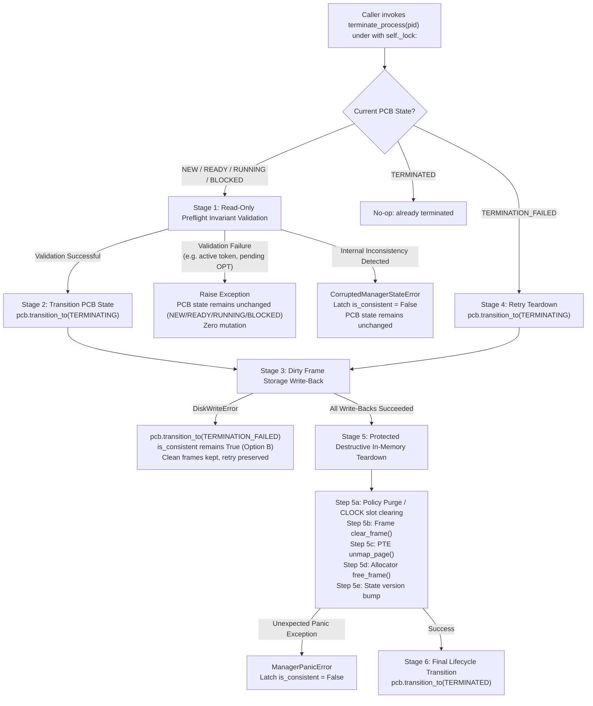

# Stage 12.2 Phase 4C — Final Pre-Implementation Specification & Review Corrections

**Document ID**: `docs/STAGE_12_PHASE_4C_FINAL_IMPLEMENTATION_PLAN.md`  
**Status**: Approved Pre-Implementation Specification (Planning & Source Inspection Only)  
**Target Working Directory**: `E:\OS_PROJECT`  
**Current Branch**: `feature/os-memory-management`  
**Pre-Implementation Baseline**: **283 passed, 0 failed, 1 warning**

---

## 1. ARC Cold-Miss and Eviction Operations Disambiguation

ARC exhibits three fundamentally distinct cold-miss and directory-management operations that must never be conflated in telemetry, state transitions, or test assertions:

### Operation A: Ghost-Directory Pruning (Non-Eviction Directory Trimming)
- **Preconditions**:
  - Cold miss Case 4A with $|L_1| = c$ and $|T_1| < c$ (where $B_1$ is non-empty), OR
  - Cold miss Case 4B with $|L_1 \cup L_2| = 2c$ and $B_2$ is non-empty.
- **Action**:
  - Removes the oldest ghost identifier from history list $B_1$ or $B_2$ (`popitem(last=False)`).
- **Physical Memory Impact**:
  - **Zero physical frames are freed, allocated, or modified.**
  - **Zero resident pages are evicted.**
  - **No backing-store disk I/O occurs.**
- **Telemetry Classification**:
  - Increments **only** `arc_ghost_prunes`.
  - Is **never added** to physical eviction count $E_{\text{phys}}$.

### Operation B: Normal ARC REPLACE (Physical Eviction with Ghost Recording)
- **Preconditions**:
  - Cache miss where ARC capacity requires resident eviction ($|T_1| + |T_2| = c$ or $|L_1| = c$ with $|T_1| < c$).
- **Action**:
  - Evaluates the standard ARC REPLACE condition:
    $$\text{evict\_t1} = (|T_1| \ge 1) \land [(\text{page} \in B_2 \land |T_1| == p) \lor (|T_1| > p)] \lor (|T_2| == 0)$$
  - Selects the victim page from primary list ($T_1$ if `evict_t1` else $T_2$).
  - Moves the victim page from $T_1 \to B_1$ or from $T_2 \to B_2$.
- **Physical Memory Impact**:
  - Reclaims and reuses the victim's physical frame for the incoming page.
  - Requires dirty write-back if the victim frame has `dirty == True`.
- **Telemetry Classification**:
  - Counts as **one physical eviction** ($E_{\text{phys}} += 1$).
  - Primary trigger is `PRIMARY_DIRECTORY_MANDATED` (if $R_P < \text{max}_P$) or `PRIMARY_QUOTA_CEILING` (if $R_P \ge \text{max}_P$).
  - Does **not** increment `arc_ghost_prunes`.

### Operation C: Special ARC Cold-Miss Direct $T_1$ Drop (Direct Physical Eviction Without Ghost Tracking)
- **Preconditions**:
  - Cold miss Case 4A where $|L_1| = c$ and $|T_1| = c$ (FAST 2003 paper Figure 4, Case IVa subcase 1b).
  - Because $|L_1| = |T_1| + |B_1| = c$ and $|T_1| = c$, history list $B_1$ is strictly empty ($|B_1| = 0$).
- **Action**:
  - The LRU resident page in $T_1$ is dropped directly from cache (`del self.T1[victim]`).
  - **No ghost entry is created in $B_1$**, preserving the invariant $|L_1| \le c$.
- **Physical Memory Impact**:
  - Reclaims and reuses the victim's physical frame for the incoming page.
  - Requires dirty write-back if the dropped page has `dirty == True`.
- **Telemetry Classification**:
  - Counts as **one physical eviction** ($E_{\text{phys}} += 1$).
  - Primary trigger is `PRIMARY_DIRECTORY_MANDATED` (or `PRIMARY_QUOTA_CEILING` if requester is at quota ceiling).
  - **Does NOT increment `arc_ghost_prunes`** (this is a physical eviction, not a ghost directory prune).

---

## 2. Complete Overlap Classification Table

The primary telemetry hierarchy is strictly prioritized:
1. `PRIMARY_QUOTA_CEILING` (Administrative per-process ceiling override)
2. `PRIMARY_DIRECTORY_MANDATED` (Algorithmic capacity and ghost-list balance invariant)
3. `PRIMARY_PHYSICAL_EXHAUSTION` (Hardware frame exhaustion)

Every physical eviction event belongs to **exactly one** primary trigger category. Secondary and simultaneous conditions are recorded via orthogonal diagnostic flags (`also_quota_ceiling`, `also_directory_mandated`, `also_physical_exhausted`).

The table below covers all $2 \times 2 \times 2 = 8$ logical permutations of Requester Quota Status ($R_P \ge \text{max}_P$), Policy Directory Mandate ($|L_1| = c$ or $|L_1 \cup L_2| = 2c$), and Physical Frame Availability ($F_{\text{free}} == 0$):

| # | Requester Quota Status | ARC Directory Mandated? | Physical Memory Full? | Primary Telemetry Metric | Secondary Diagnostic Flags | Candidate Eligibility Scope | Victim Selection Heuristic | Frame Action Taken | Decision Matrix Scenario |
| :---: | :---: | :---: | :---: | :---: | :---: | :---: | :---: | :---: | :---: |
| **1** | $R_P < \text{max}_P$ | No | No ($F_{\text{free}} > 0$) | *None* (No physical eviction) | None | N/A (Miss warmup / direct allocation) | None | Allocate new frame from `FrameAllocator` free list | **S-2** / **S-7** |
| **2** | $R_P \ge \text{max}_P$ | No | No ($F_{\text{free}} > 0$) | `PRIMARY_QUOTA_CEILING` | `also_directory_mandated = False`<br/>`also_physical_exhausted = False` | **Self Only** ($V.\text{pid} == P_{\text{req}}$) | Policy selects worst resident page of $P_{\text{req}}$ | In-place reuse of $P_{\text{req}}$'s reclaimed frame | **S-3** |
| **3** | $R_P < \text{max}_P$ | Yes | No ($F_{\text{free}} > 0$) | `PRIMARY_DIRECTORY_MANDATED` | `also_quota_ceiling = False`<br/>`also_physical_exhausted = False` | **Eligible Pool** (Global or Local eligible pages) | ARC REPLACE or Direct $T_1$ Drop (Op B or Op C) | Reclaimed frame reused; victim key moved to ghost list (or dropped if Op C) | **S-11** |
| **4** | $R_P < \text{max}_P$ | No | Yes ($F_{\text{free}} == 0$) | `PRIMARY_PHYSICAL_EXHAUSTION` | `also_quota_ceiling = False`<br/>`also_directory_mandated = False` | **Eligible Pool** ($\text{IsEligible}(V, P_{\text{req}})$) | Algorithm selects best victim among eligible candidates | In-place reuse of reclaimed physical frame | **S-4** / **S-5** / **S-8** |
| **5** | $R_P \ge \text{max}_P$ | Yes | No ($F_{\text{free}} > 0$) | `PRIMARY_QUOTA_CEILING` *(Precedence 1 > 2)* | `also_directory_mandated = True`<br/>`also_physical_exhausted = False` | **Self Only** ($V.\text{pid} == P_{\text{req}}$) | ARC REPLACE applied strictly to $P_{\text{req}}$'s pages with alternate-list fallback | In-place reuse of $P_{\text{req}}$'s reclaimed frame | **S-3** *(Dir-Constrained)* |
| **6** | $R_P \ge \text{max}_P$ | No | Yes ($F_{\text{free}} == 0$) | `PRIMARY_QUOTA_CEILING` *(Precedence 1 > 3)* | `also_directory_mandated = False`<br/>`also_physical_exhausted = True` | **Self Only** ($V.\text{pid} == P_{\text{req}}$) | Policy selects worst resident page of $P_{\text{req}}$ | In-place reuse of $P_{\text{req}}$'s reclaimed frame | **S-3** *(Phys-Full)* |
| **7** | $R_P < \text{max}_P$ | Yes | Yes ($F_{\text{free}} == 0$) | `PRIMARY_DIRECTORY_MANDATED` *(Precedence 2 > 3)* | `also_quota_ceiling = False`<br/>`also_physical_exhausted = True` | **Eligible Pool** ($\text{IsEligible}(V, P_{\text{req}})$) | ARC REPLACE or Direct $T_1$ Drop with alternate-list fallback | Reclaimed frame reused | **S-11** *(Phys-Full)* |
| **8** | $R_P \ge \text{max}_P$ | Yes | Yes ($F_{\text{free}} == 0$) | `PRIMARY_QUOTA_CEILING` *(Precedence 1 > 2 > 3)* | `also_directory_mandated = True`<br/>`also_physical_exhausted = True` | **Self Only** ($V.\text{pid} == P_{\text{req}}$) | ARC REPLACE applied strictly to $P_{\text{req}}$'s pages with alternate-list fallback | In-place reuse of $P_{\text{req}}$'s reclaimed frame | **S-3** *(Tri-Overlap)* |

### Metric Reconciliation Identities
For any workload sequence, the following three identities must hold exactly without divergence or double counting:
1. **Physical Cause Balance**:
   $$E_{\text{phys}} = E_{\text{quota\_ceiling}} + E_{\text{directory\_mandated}} + E_{\text{physical\_exhaustion}}$$
2. **State Cleanliness Balance**:
   $$E_{\text{phys}} = \text{clean\_evictions} + \text{dirty\_evictions}$$
3. **Cross-Process Ownership Balance**:
   $$E_{\text{phys}} = \text{cross\_process\_evictions} + \text{self\_evictions}$$
4. **Ghost Disjointness Invariant**:
   `arc_ghost_prunes` represents ghost-directory key drops (Operation A) where no physical frame or backing-store write occurs. It is strictly tracked as a separate counter and **never added** to $E_{\text{phys}}$.

---

## 3. ARC Exact Eligibility Fallback & Standardized Victim-Selection Contract

### ARC Selection Procedure
When `select_victim(plan=None, is_eligible_cb=None)` is called on `ARCCache`:

1. **Determine Primary List**:
   - Evaluate the normal ARC REPLACE condition against target parameter $p$:
     $$\text{condition\_t1} = (|T_1| \ge 1) \land [(\text{page} \in B_2 \land |T_1| == p) \lor (|T_1| > p)]$$
     $$\text{evict\_t1} = \text{condition\_t1} \lor (|T_2| == 0)$$
   - If `evict_t1` is `True`, the **primary list** is $T_1$ and the **alternate list** is $T_2$.
   - If `evict_t1` is `False`, the **primary list** is $T_2$ and the **alternate list** is $T_1$.
2. **Primary List Search**:
   - Scan the primary list in LRU-to-MRU order (`iter(self.T1)` or `iter(self.T2)`).
   - For each candidate $V$, evaluate `is_eligible_cb(V)`.
   - If `is_eligible_cb is None` or `is_eligible_cb(V)` returns `True`:
     - Select $V$ as victim.
     - Record actual eviction type: `"T1->B1"` if from $T_1$, `"T2->B2"` if from $T_2$.
     - Bind `self._pending_plan.victim = V` and `self._pending_plan.eviction_type = eviction_type`.
     - Return $V$ (the victim page key).
3. **Alternate List Fallback**:
   - If no page in the primary list satisfies `is_eligible_cb`, scan the alternate list in LRU-to-MRU order.
   - For each candidate $V$, evaluate `is_eligible_cb(V)`.
   - If an eligible candidate is found:
     - Select $V$ as victim.
     - Record actual eviction type: `"T2->B2"` if fallback to $T_2$, `"T1->B1"` if fallback to $T_1$.
     - Bind `self._pending_plan.victim = V` and `self._pending_plan.eviction_type = eviction_type`.
     - Return $V$ (the victim page key).
4. **Exhaustion Without Mutation**:
   - If neither list contains an eligible victim:
     - **Return `None`** (never a tuple `(None, None)`).
     - Bind `self._pending_plan.victim = None`.
     - Zero mutation occurs; no lists, pointers, or counters are modified.
5. **Preservation of Target Parameter $p$**:
   - The adaptation parameter $p$ is strictly governed by hits in ghost lists $B_1$ and $B_2$.
   - **$p$ is NOT modified** when eligibility fallback diverts selection to the alternate list.
6. **Correct Ghost List Destination**:
   - Eviction hook `evict_victim(victim, plan)` moves the victim strictly to the ghost list corresponding to its actual source list ($B_1$ if from $T_1$, $B_2$ if from $T_2$).

### Standardized Victim-Selection Contracts Across All Seven Algorithms
To ensure deterministic, unambiguous communication between algorithms, `PolicyAdapter`, and `MemoryManager`, the return contracts are standardized at two levels:

#### Level 1: Underlying Algorithm Public Method Contract (`select_victim(...)`)
| Algorithm | Signature | Return When Victim Found | Return When No Eligible Victim | Token / Metadata Retention |
| :--- | :--- | :--- | :---: | :--- |
| **`ARCCache`** | `select_victim(plan=None, is_eligible_cb=None)` | `VirtualPage` | **`None`** | Binds `_pending_plan.victim` and `_pending_plan.eviction_type`. |
| **`CLOCKCache`** | `select_victim(get_frame_ref_bit=None, token=None, is_eligible_cb=None)` | `ClockVictimToken` | **`None`** | Returns `ClockVictimToken(victim_page, victim_frame_id, ...)`; retains in `_pending_token`. |
| **`OptimalCache`** | `select_victim(incoming_page=None, process_context=None, token=None, is_eligible_cb=None)` | `VirtualPage` | **`None`** | Retains `OptVictimToken` in `_pending_token`. |
| **`LFUCache`** | `select_victim(incoming_page=None, process_context=None, is_eligible_cb=None)` | `VirtualPage` | **`None`** | N/A (State updated on commit). |
| **`MRUCache`** | `select_victim(incoming_page=None, process_context=None, is_eligible_cb=None)` | `VirtualPage` | **`None`** | N/A (State updated on commit). |
| **`LRUCache`** | `select_victim(is_eligible_cb=None)` | `VirtualPage` | **`None`** | N/A (State updated on commit). |
| **`FIFOCache`** | `select_victim(is_eligible_cb=None)` | `VirtualPage` | **`None`** | N/A (State updated on commit). |

**Universal Invariant**: When no eligible victim exists, **every algorithm returns `None`**.

#### Level 2: Manager-Facing Contract (`PolicyAdapter.select_victim()`)
The `PolicyAdapter` standardizes all policy returns into a single typed dataclass:

```python
@dataclass(frozen=True)
class VictimSelectionResult:
    """Standardized manager-facing victim selection result."""
    victim: VirtualPage
    frame_id: Optional[int]
    token: Optional[Any] = None
    eviction_path: Optional[str] = None
```

- **`PolicyAdapter.select_victim(...) -> Optional[VictimSelectionResult]`**:
  - When an eligible victim is selected:
    - **CLOCK**: `victim = token.victim_page`, `frame_id = token.victim_frame_id`, `token = token`, `eviction_path = "CLOCK_SWEEP"`.
    - **ARC**: `victim = plan.victim`, `frame_id = None`, `token = plan`, `eviction_path = plan.eviction_type`.
    - **OPT**: `victim = opt_victim`, `frame_id = None`, `token = self._pending_token`, `eviction_path = "OPT_FURTHEST_FUTURE"`.
    - **LRU / FIFO / MRU / LFU**: `victim = victim`, `frame_id = None`, `token = None`, `eviction_path = self.name`.
  - When NO eligible victim exists:
    - **Returns `None`**.

- **Manager Detection**:
  The memory manager checks victim availability with zero ambiguity and zero tuple unpacking:
  ```python
  selection = self.policy.select_victim(self._get_frame_ref_bit, token=val_token, is_eligible_cb=is_eligible_cb)
  if selection is None:
      # Deterministically NO eligible victim exists!
      # Triggers S-6 (starvation), S-12 (local OOM), or S-13 (universal catch-all).
      raise NoFreeFrameError(...)

  # Guaranteed unambiguous access:
  victim_vpage = selection.victim
  victim_token = selection.token
  target_fid = selection.frame_id if selection.frame_id is not None else pcb.page_table.get_frame_id(victim_vpage.vpn)
  ```

---

## 4. Corrected Complete S-1 through S-13 Decision Matrix

| Scenario | State / Preconditions | Free Frames ($F_{\text{free}}$) | Requester Residency ($R_P$) | Scope | Selected Policy Adapter | Eligibility Predicate Applied | Action Taken | Frame Allocated or Reused | Eviction Scope | Primary Trigger Metric | Failure Semantics |
| :---: | :--- | :---: | :---: | :---: | :---: | :---: | :--- | :--- | :---: | :--- | :--- |
| **S-1** | Hit | Any | Any | Any | Requester Local or Global | None | Hit Commit: update MMU ref/dirty; record hit in policy. | None (existing frame retained) | None | None | None |
| **S-2** | Free frame available, requester below max | $> 0$ | $R_P < \text{max}_P$ | Any | Requester Local or Global | None | Allocate free frame via `FrameAllocator.allocate_frame()`. | New free frame | None | None | None |
| **S-3** | Requester at max quota (whether memory full or free frames exist) | Any | $R_P \ge \text{max}_P$ | Any | Requester Local (or Global forced to self) | Strictly $V.\text{pid} == P_{\text{req}}$ | **Forced Self-Eviction**: Administrative ceiling enforced. Algorithm selects worst page among $P_{\text{req}}$'s pages. | Reuses reclaimed frame | Self-Eviction ($P_{\text{req}}$) | `PRIMARY_QUOTA_CEILING` | If $P_{\text{req}}$ has 0 resident pages, raises `NoFreeFrameError`. |
| **S-4** | Memory full, eligible candidates exist (foreign or self) | $0$ | $R_P < \text{max}_P$ | Global | Global `PolicyAdapter` | $\text{IsEligible}(V, P_{\text{req}})$ | **Global Eviction**: Global policy chooses best candidate among eligible pages (can be foreign or self). | Reuses reclaimed frame | Cross-Process or Self | `PRIMARY_PHYSICAL_EXHAUSTION` | Disk write error aborts transaction cleanly. |
| **S-5** | Memory full, foreign processes shielded, $R_P > 0$ | $0$ | $R_P > 0$ | Global | Global `PolicyAdapter` | Strictly $V.\text{pid} == P_{\text{req}}$ | **Shielding Fallback (Self-Eviction)**: Foreign frames protected by min quota. Requester evicts its own page. | Reuses reclaimed frame | Self-Eviction ($P_{\text{req}}$) | `PRIMARY_PHYSICAL_EXHAUSTION` | Disk write error aborts transaction cleanly. |
| **S-6** | Memory full, foreign processes shielded, $R_P = 0$ | $0$ | $R_P == 0$ | Global | Global `PolicyAdapter` | $\text{IsEligible}(V, P_{\text{req}})$ | **Foreign Shielding Starvation**: Precedence 2. Foreign frames shielded; requester has no pages. | None | None | None | Aborts in Phase 1; raises `NoFreeFrameError`. Zero state mutation. |
| **S-7** | Requester has no resident pages, free frame exists | $> 0$ | $R_P == 0$ | Any | Requester Local or Global | None | Allocate free frame from `FrameAllocator`. | New free frame | None | None | None |
| **S-8** | Requester at/below minimum quota ($R_P \le \text{min}_P$), memory full | $0$ | $R_P \le \text{min}_P$ | Global | Global `PolicyAdapter` | $\text{IsEligible}(V, P_{\text{req}})$ | Requester faults; evicts best eligible candidate (foreign or self). Requester pages shielded from foreign faults. | Reuses reclaimed frame | Cross-Process or Self | `PRIMARY_PHYSICAL_EXHAUSTION` | None |
| **S-9** | Requester at min and max simultaneously ($R_P == \text{min}_P == \text{max}_P$) | Any | $R_P == \text{max}_P$ | Any | Requester Local or Global forced to self | Strictly $V.\text{pid} == P_{\text{req}}$ | **Self-Eviction Required**: Ceiling enforced. Policy selects victim using algorithm heuristic among $P_{\text{req}}$'s pages. | Reuses reclaimed frame | Self-Eviction ($P_{\text{req}}$) | `PRIMARY_QUOTA_CEILING` | If $K == 0$, rejected by `ProcessQuota` validation. |
| **S-10** | ARC ghost directory pruning ($|L_1| = c$ with $|T_1| < c$, or $|L_1 \cup L_2| = 2c$) | Any | Any | Any | Global or Local ARC | None | **Ghost Directory Trimming** (Op A): Drops oldest ghost key from $B_1$ or $B_2$. No physical frame or disk I/O involved. | None | None | `arc_ghost_prunes` (Non-eviction) | None |
| **S-11** | ARC resident eviction ($T_1 \to B_1$, $T_2 \to B_2$, or Direct $T_1$ Drop) | Any | $R_P < \text{max}_P$ | Any | Global or Local ARC | **Global ARC**: Global eligibility.<br/>**Local ARC**: Local $P_{\text{req}}$ only.<br/>**Quota Ceiling**: Local $P_{\text{req}}$ only. | **Directory-Mandated Eviction** (Op B or Op C): Evicts resident page into ghost list (or direct drop if Op C) with alternate-list fallback. | Reuses reclaimed frame | Candidate via REPLACE (Self or Cross) | `PRIMARY_DIRECTORY_MANDATED` | None |
| **S-12** | Local replacement, memory full, requester $R_P = 0$ | $0$ | $R_P == 0$ | Local | Requester Local `PolicyAdapter` | Strictly $V.\text{pid} == P_{\text{req}}$ | **Local Out of Memory**: Precedence 1. Requester has no resident pages and cannot evict foreign frames. | None | None | None | Aborts in Phase 1; raises `NoFreeFrameError`. Zero state mutation. |
| **S-13** | Universal No-Legal-Victim Catch-All | Any | Any | Any | Global or Local Policy | All return `False` | **No Legal Victim**: Precedence 3. Policy returns `None` for any unhandled state. | None | None | None | Aborts in Phase 1; raises `NoFreeFrameError`. Zero state mutation. |

---

## 5. Verified Source APIs and Complete Process Termination Lifecycle

### Source Inspection and API Verification Results
Inspection of actual source code confirms the following exact attributes, methods, and constraints:

1. **`PhysicalFrame` (`backend/memory/frame.py`)**:
   - `PhysicalFrame.dirty` is a **read-only `@property`**. Modifying it directly (`frame.dirty = False`) raises `AttributeError`.
   - The verified mutator is `frame._set_dirty(value: bool)`.
   - `frame.clear_frame()` is verified: resets `_vpage = None`, `_reference_bit = False`, `_dirty = False`, `_data = None`.
2. **`PageTable` (`backend/memory/page_table.py`)**:
   - `page_table.get_entry(vpn: int) -> PageTableEntry`: verified.
   - `page_table.is_valid(vpn: int) -> bool`: verified.
   - `page_table.get_frame_id(vpn: int) -> Optional[int]`: verified.
   - `page_table.unmap_page(vpn: int) -> Optional[PageTableEntry]`: verified. Sets `entry.valid = False` and `entry.frame_id = None`.
   - `page_table.get_resident_pages() -> List[int]`: verified. Returns sorted list of resident VPNs.
3. **`FrameAllocator` (`backend/memory/allocator.py`)**:
   - `allocator.is_allocated(frame_id: int) -> bool`: verified.
   - `allocator.free_frame(frame_id: int) -> None`: verified. Raises `DoubleFreeError` if frame is not allocated.
   - `allocator.allocate_frame() -> int`: verified.
4. **`ProcessControlBlock` and `ProcessTable` (`backend/memory/process.py`)**:
   - `ProcessControlBlock.resident_pages` **does NOT exist**. Residency is derived from `pcb.page_table.get_resident_pages()` and tracked via `pcb.resident_count`.
   - `ProcessTable.mark_terminated()` **does NOT exist**. Lifecycle transitions are performed directly on the PCB via `pcb.transition_to(ProcessState.TERMINATED)`.
   - `VALID_TRANSITIONS` in `backend/memory/process.py`:
     - `ProcessState.NEW: {ProcessState.READY, ProcessState.TERMINATING}`
     - `ProcessState.READY: {ProcessState.RUNNING, ProcessState.TERMINATING}`
     - `ProcessState.RUNNING: {ProcessState.READY, ProcessState.BLOCKED, ProcessState.TERMINATING}`
     - `ProcessState.BLOCKED: {ProcessState.READY, ProcessState.RUNNING, ProcessState.TERMINATING}`
     - `ProcessState.TERMINATING: {ProcessState.TERMINATED, ProcessState.TERMINATION_FAILED}`
     - `ProcessState.TERMINATION_FAILED: {ProcessState.TERMINATING}`
     - `ProcessState.TERMINATED: set()`
5. **Concurrency Lock & Transaction State (`backend/memory/manager.py`)**:
   - `self._lock` is `threading.RLock()`. In Python, `threading.RLock` **does not have a `.locked()` method**. The manager protects teardown by executing directly within `with self._lock:`.
   - `self._in_transaction: bool`: Authoritative manager-level transaction flag. Set to `True` during page-fault request execution; reset to `False` on completion or abort.

---

### Complete Unified Process Termination Protocol
The following 6-stage lifecycle protocol governs **both** integrated CLOCK teardown and normal non-CLOCK teardown paths:



#### Detailed Stage-by-Stage Specification

1. **Stage 1: Preflight Validation (Read-Only)**:
   - **Initial Process State**: Executed while the PCB remains in its initial active state: `ProcessState.NEW`, `ProcessState.READY`, `ProcessState.RUNNING`, or `ProcessState.BLOCKED`.
   - **Manager-Level Transaction Guard**:
     - Asserts `self._in_transaction is False`.
     - If `self._in_transaction` is `True`, an access request or eviction is currently executing. Raises:
       ```python
       UnsupportedOperationError(f"Cannot terminate process {pcb.pid}: MemoryManager transaction is currently active.")
       ```
   - **PolicyAdapter-Level Guard**:
     - Asserts `self.policy._pending_token is None`. If non-None, raises:
       ```python
       UnsupportedOperationError(f"Cannot terminate process {pcb.pid}: PolicyAdapter has an active pending token.")
       ```
   - **Policy-Specific Transaction Guards (Actual Verified Fields)**:
     - **For ARC (`ARCCache`)**:
       - Asserts `self.policy.policy._pending_plan is None` AND `self.policy.policy._active_commit_plan is None`.
       - If `_pending_plan is not None`, raises:
         ```python
         UnsupportedOperationError(f"Cannot terminate process {pcb.pid}: ARC pending plan is active ({self.policy.policy._pending_plan.case}).")
         ```
       - If `_active_commit_plan is not None`, raises:
         ```python
         UnsupportedOperationError(f"Cannot terminate process {pcb.pid}: ARC commit plan session is active.")
         ```
     - **For CLOCK (`CLOCKCache`)**:
       - Asserts `self.policy.policy._pending_token is None` AND `self.policy.policy._active_commit_token is None`.
       - If `_pending_token is not None`, raises:
         ```python
         UnsupportedOperationError(f"Cannot terminate process {pcb.pid}: CLOCK pending token is active.")
         ```
       - If `_active_commit_token is not None`, raises:
         ```python
         UnsupportedOperationError(f"Cannot terminate process {pcb.pid}: CLOCK active commit token session is active.")
         ```
     - **For OPT (`OptimalCache`)**:
       - Asserts `self.policy.policy._pending_token is None` AND `self.policy.policy._active_commit_token is None`.
       - If `_pending_token is not None`, raises:
         ```python
         UnsupportedOperationError(f"Cannot terminate process {pcb.pid}: OPT pending token is active.")
         ```
       - If `_active_commit_token is not None`, raises:
         ```python
         UnsupportedOperationError(f"Cannot terminate process {pcb.pid}: OPT active commit token session is active.")
         ```
   - **OPT Trace Guard**:
     - In Global OPT, checks remaining future references from current simulation step:
       $$N_{\text{pending}} = \sum_{k = \text{current\_step}}^{M-1} \mathbb{I}(\mathcal{S}_{\text{global}}[k].\text{pid} == \text{pcb.pid})$$
     - If $N_{\text{pending}} > 0 \implies$ raises:
       ```python
       InvalidProcessStateError(f"Cannot terminate process {pcb.pid}: {N_pending} unconsumed future references exist in Global OPT trace.")
       ```
   - **Bidirectional Invariant Symmetry Audit**:
     - Direction 1: Every allocated frame owned by PID has a matching CLOCK slot (if CLOCK), matching valid PTE, and allocator allocation.
     - Direction 2: Every CLOCK slot/mapping owned by PID corresponds to an allocated physical frame and valid PTE.
     - If any mismatch is detected: latches `manager.is_consistent = False` and raises `CorruptedManagerStateError`.
   - **Preflight Rejection Guarantee**:
     - If any preflight validation check fails, the operation terminates immediately with an exception.
     - **The PCB state remains strictly unchanged in its initial state (`NEW`, `READY`, `RUNNING`, or `BLOCKED`)**.
     - Zero page-table entries are unmapped.
     - Zero physical frames are freed.
     - Zero CLOCK slots or policy entries are purged.
     - Zero backing-store write-backs are initiated.

2. **Stage 2: Transition to `TERMINATING`**:
   - Only after Preflight Validation succeeds 100%:
     `pcb.transition_to(ProcessState.TERMINATING)`.
   - In `TERMINATING`, memory access is permanently blocked (`pcb.assert_can_access_memory()` raises `InvalidProcessStateError`).
   - Direct transitions from an active state (`NEW`, `READY`, `RUNNING`, `BLOCKED`) or `TERMINATION_FAILED` directly to `TERMINATED` are **strictly forbidden** (rejected by `VALID_TRANSITIONS`).

3. **Stage 3: Dirty Write-Back (Fallible Storage I/O)**:
   - Identifies all frames owned by PID where `frame.dirty == True`.
   - For each dirty frame: writes to `BackingStore`. On success, calls `frame._set_dirty(False)`.
   - **If a write fails (`DiskWriteError`)**:
     - Calls `pcb.transition_to(ProcessState.TERMINATION_FAILED)`.
     - `manager.is_consistent` remains `True` (Option B: storage failure is recoverable).
     - Successfully written frames retain `dirty == False`. Failed frame retains `dirty == True`.
     - In-memory frames, PTEs, and CLOCK slots remain completely mapped and valid.
     - Raises `DiskWriteError`.

4. **Stage 4: Safe Idempotent Retry**:
   - Re-invoking `terminate_process(pid)` when process is in `TERMINATION_FAILED`:
     - Preflight re-verifies invariants.
     - Transitions `pcb.transition_to(ProcessState.TERMINATING)` (valid per `VALID_TRANSITIONS`).
     - Clean frames (`dirty == False`) are safely skipped.
     - Retries write-back only for remaining dirty frames.

5. **Stage 5: Destructive In-Memory Teardown (Protected Lockstep)**:
   - Under `with self._lock:`:
     - **For Integrated CLOCK**:
       - Clear CLOCK mappings: `clock.slots[fid] = None`, `del clock.page_to_slot[vpage]`.
       - Clear physical frame: `frame.clear_frame()`.
       - Invalidate PTE: `pcb.page_table.unmap_page(vpn)`.
       - Release frame to allocator: `self.allocator.free_frame(fid)`.
       - Monotonically advance policy version: `clock.state_version += 1`.
     - **For Non-CLOCK Global Policies (ARC, OPT, LRU, FIFO, LFU, MRU)**:
       - Purge policy state: `self.policy.purge_process(pcb.pid)`.
       - Clear physical frame: `frame.clear_frame()`.
       - Invalidate PTE: `pcb.page_table.unmap_page(vpn)`.
       - Release frame to allocator: `self.allocator.free_frame(fid)`.
     - **For Local Replacement Policies**:
       - Clear physical frame and release to allocator: `frame.clear_frame()`, `self.allocator.free_frame(fid)`.
       - Invalidate PTE: `pcb.page_table.unmap_page(vpn)`.
       - Reset and discard local policy: `pcb.local_policy.reset()`, `pcb.local_policy = None`.
   - If an unexpected Python error occurs during in-memory teardown:
     - Latches `manager.is_consistent = False`.
     - Raises `ManagerPanicError`.

6. **Stage 6: Final Process Lifecycle Transition**:
   - Once all in-memory structures are cleared:
     `pcb.transition_to(ProcessState.TERMINATED)`.
   - Process is now permanently terminated.

---

### Verified Coordinated CLOCK Teardown Implementation Method

```python
def _coordinated_clock_process_teardown(self, pcb: ProcessControlBlock) -> None:
    """
    Dedicated manager-owned atomic teardown for processes running under integrated CLOCK.
    Prevalidates bidirectional frame, PTE, allocator, and CLOCK slot consistency before destructive modification.
    Enforces Phase 4B lifecycle: NEW/READY/RUNNING/BLOCKED -> TERMINATING -> TERMINATED (with TERMINATION_FAILED retry).
    """
    assert self._in_transaction or True  # Executing within with self._lock
    clock: CLOCKCache = self.policy.policy

    # ---------------------------------------------------------
    # STAGE 1: Read-Only Preflight Invariant Validation
    # (PCB is in NEW, READY, RUNNING, BLOCKED, or retrying from TERMINATION_FAILED)
    # ---------------------------------------------------------
    # Check manager-level transaction guard
    if self._in_transaction:
        raise UnsupportedOperationError(
            f"Cannot terminate process {pcb.pid}: MemoryManager transaction is currently active."
        )

    # Check policy adapter token guard
    if self.policy._pending_token is not None:
        raise UnsupportedOperationError(
            f"Cannot terminate process {pcb.pid}: PolicyAdapter has an active pending token."
        )

    # Check CLOCK policy transaction guards
    if clock._pending_token is not None:
        raise UnsupportedOperationError(
            f"Cannot terminate process {pcb.pid}: an integrated CLOCK transaction is active "
            f"(_pending_token={clock._pending_token!r})."
        )
    if clock._active_commit_token is not None:
        raise UnsupportedOperationError(
            f"Cannot terminate process {pcb.pid}: an integrated CLOCK commit session is active "
            f"(_active_commit_token={clock._active_commit_token!r})."
        )

    owned_frames = [f for f in self.frames.values() if f.is_allocated and f.owner_pid == pcb.pid]
    resident_vpns = set(pcb.page_table.get_resident_pages())

    if len(owned_frames) != len(resident_vpns):
        self.is_consistent = False
        raise CorruptedManagerStateError(
            f"Pre-teardown audit failed: {len(owned_frames)} allocated frames vs "
            f"{len(resident_vpns)} PCB resident pages for PID {pcb.pid}."
        )

    # Direction 1: Audit all allocated frames owned by PID
    for frame in owned_frames:
        slot = frame.frame_id
        vpage = frame.vpage
        vpn = frame.vpn

        if vpn not in resident_vpns:
            self.is_consistent = False
            raise CorruptedManagerStateError(f"Frame {slot} contains VPN {vpn} not marked resident in page table.")
        if vpage not in clock.page_to_slot or clock.page_to_slot[vpage] != slot:
            self.is_consistent = False
            raise CorruptedManagerStateError(f"CLOCK page_to_slot mismatch for {vpage}: expected slot {slot}.")
        if clock.slots[slot] != vpage:
            self.is_consistent = False
            raise CorruptedManagerStateError(f"CLOCK slot {slot} mismatch: expected {vpage}, found {clock.slots[slot]}.")
        if not self.allocator.is_allocated(slot):
            self.is_consistent = False
            raise CorruptedManagerStateError(f"Allocator invariant violated: frame {slot} marked free in allocator.")
        if not pcb.page_table.is_valid(vpn) or pcb.page_table.get_frame_id(vpn) != slot:
            self.is_consistent = False
            raise CorruptedManagerStateError(f"PTE mismatch for VPN {vpn}: frame={pcb.page_table.get_frame_id(vpn)}.")

    # Direction 2: Audit all CLOCK slots and mappings owned by PID
    for slot_idx, slot_vpage in enumerate(clock.slots):
        if slot_vpage is not None and getattr(slot_vpage, "pid", None) == pcb.pid:
            if slot_vpage not in clock.page_to_slot or clock.page_to_slot[slot_vpage] != slot_idx:
                self.is_consistent = False
                raise CorruptedManagerStateError(f"CLOCK slot {slot_idx} holds {slot_vpage} but page_to_slot disagrees.")
            frame = self.frames[slot_idx]
            if not frame.is_allocated or frame.vpage != slot_vpage:
                self.is_consistent = False
                raise CorruptedManagerStateError(f"CLOCK slot {slot_idx} allocated in CLOCK but not in PhysicalFrame.")
            if not self.allocator.is_allocated(slot_idx):
                self.is_consistent = False
                raise CorruptedManagerStateError(f"CLOCK slot {slot_idx} allocated in CLOCK but marked free in allocator.")

    # ---------------------------------------------------------
    # STAGE 2: Transition PCB to TERMINATING
    # ---------------------------------------------------------
    pcb.transition_to(ProcessState.TERMINATING)

    # ---------------------------------------------------------
    # STAGE 3: Fallible Storage Write-Back
    # ---------------------------------------------------------
    for frame in owned_frames:
        if frame.dirty:
            try:
                self.backing_store.write_page(frame.vpage, frame.data)
                frame._set_dirty(False)  # Verified internal mutator
            except DiskWriteError as e:
                # Option B: recoverable storage failure retains is_consistent = True
                pcb.transition_to(ProcessState.TERMINATION_FAILED)
                raise DiskWriteError(f"Termination write-back failed for PID {pcb.pid}: {e}")

    # ---------------------------------------------------------
    # STAGE 5: Destructive In-Memory Teardown (Protected Lockstep)
    # ---------------------------------------------------------
    try:
        for frame in owned_frames:
            slot = frame.frame_id
            vpage = frame.vpage
            vpn = frame.vpn

            # Step 5a: Clear CLOCK slot and mapping
            clock.slots[slot] = None
            if vpage in clock.page_to_slot:
                del clock.page_to_slot[vpage]

            # Step 5b: Clear physical frame and MMU bits
            frame.clear_frame()

            # Step 5c: Invalidate Page Table Entry
            pcb.page_table.unmap_page(vpn)

            # Step 5d: Release frame to allocator pool
            self.allocator.free_frame(slot)

        # Step 5e: Advance CLOCK version monotonically
        clock.state_version += 1

        # ---------------------------------------------------------
        # STAGE 6: Final Lifecycle Transition to TERMINATED
        # ---------------------------------------------------------
        pcb.transition_to(ProcessState.TERMINATED)

    except Exception as fatal_exc:
        # Unexpected in-memory divergence triggers panic latch
        self.is_consistent = False
        raise ManagerPanicError(f"Catastrophic failure during CLOCK teardown: {fatal_exc}")
```

---

## 6. CLOCK Global Single-Victim Eviction Interaction

- **Single-Victim Eviction (Page Fault Replacement)**:
  - Sweeps clock hand to find an eligible frame $s$ where `reference_bit == 0`.
  - Atomically reassigns frame $s$ from victim $V_{\text{old}}$ to incoming $V_{\text{new}}$.
  - `frames[s].assign_page(V_new)` in-place.
  - Updates `clock.slots[s] = V_new` and `clock.page_to_slot[V_new] = s`.
  - **Frame $s$ is NEVER returned to `FrameAllocator`!** It transitions directly between virtual pages.
- **Coordinated Teardown (Process Termination)**:
  - Process frames are returned to `FrameAllocator.free_frame(s)`.
  - `clock.slots[s]` is set to `None`.
  - The CLOCK hand automatically skips unallocated frames during subsequent sweeps (`if not self._is_frame_allocated(hand): continue`).
  - When frame $s$ is later allocated from the free list for a new page, `clock.insert_page(incoming, frame_id=s)` populates the slot.
- **Mutual Exclusion**:
  - Both operations execute under `with self._lock:` and inspect active transaction tokens.
  - A frame undergoing teardown cannot be selected for eviction, and an active transaction token prevents process termination.

---

## 7. Verified Source Transaction Lifecycle Fields for ARC, CLOCK, and OPT

| Algorithm Module & Class | Pending Plan / Token Field | Active Commit Plan / Token Field | State Version Field | Creation & Retain Methods | Consumption & Commit Methods | Invalidation & Abort Methods |
| :--- | :--- | :--- | :--- | :--- | :--- | :--- |
| **`ARCCache`**<br/>(`backend/algorithms/arc.py`) | `self._pending_plan`<br/>*(Type: `Optional[ArcPlan]`)* | `self._active_commit_plan`<br/>*(Type: `Optional[ArcPlan]`)* | `self.state_version`<br/>*(Type: `int`)* | `prepare_request()` sets `_pending_plan`.<br/>`_validate_and_bind_plan()` checks `_pending_plan` and binds `_active_commit_plan`. | `commit_request()` clears both `_active_commit_plan = None` and `_pending_plan = None`, and increments `state_version += 1`. | `abort_request()` clears both to `None`.<br/>`reset()` clears both to `None`.<br/>`state_version` mismatch in `_validate_and_bind_plan()` raises `StalePlanError`. |
| **`CLOCKCache`**<br/>(`backend/algorithms/clock.py`) | `self._pending_token`<br/>*(Type: `Optional[Any]`)* | `self._active_commit_token`<br/>*(Type: `Optional[Any]`)* | `self.state_version`<br/>*(Type: `int`)* | `prepare_request()` and `select_victim()` set `_pending_token`.<br/>`_validate_and_bind_token()` checks `_pending_token` and binds `_active_commit_token`. | `commit_request()` clears both `_active_commit_token = None` and `_pending_token = None`, and increments `state_version += 1`. | `abort_request()` clears both to `None`.<br/>`reset()` clears both to `None`.<br/>`notify_frame_bit_changed()` clears `_pending_token = None` and bumps `state_version += 1` if no active commit is in progress. |
| **`OptimalCache`**<br/>(`backend/algorithms/opt.py`) | `self._pending_token`<br/>*(Type: `Optional[Any]`)* | `self._active_commit_token`<br/>*(Type: `Optional[Any]`)* | `self.state_version`<br/>*(Type: `int`)* | `prepare_request()` and `select_victim()` set `_pending_token`.<br/>`_validate_and_bind_token()` checks `_pending_token` and binds `_active_commit_token`. | `commit_request()` clears both `_active_commit_token = None` and `_pending_token = None`, and increments `state_version += 1`. | `abort_request()` clears both to `None`.<br/>`reset()` clears both to `None`.<br/>`state_version` mismatch in `_validate_and_bind_token()` raises `StaleTokenError`. |

---

## 8. Implementation Substages & Focused Tests

### Substage 4C.1: Algorithmic Eligibility Callbacks, Active Transaction Guards, and Purge Hooks
- **Objective**: Add `is_eligible_cb` and alternate-list fallback to ARC, CLOCK, and OPT; standardize algorithm `select_victim()` return to `Optional[PageKey]` (or `Optional[ClockVictimToken]`) returning `None` on ineligibility; implement `purge_pid()` across all seven algorithms with active transaction guards and verified key handling.
- **Files to Modify**:
  - `backend/algorithms/lru.py`
  - `backend/algorithms/fifo.py`
  - `backend/algorithms/mru.py`
  - `backend/algorithms/lfu.py`
  - `backend/algorithms/clock.py`
  - `backend/algorithms/arc.py`
  - `backend/algorithms/opt.py`
- **Focused Tests** (`backend/tests/test_algorithms_eligibility.py`):
  - `test_arc_select_victim_returns_none_when_ineligible`
  - `test_arc_direct_t1_drop_versus_ghost_pruning`
  - `test_arc_quota_constrained_primary_and_alternate_list_selection`
  - `test_arc_p_unchanged_during_eligibility_fallback`
  - `test_arc_victim_entering_correct_ghost_list`
  - `test_clock_select_victim_returns_none_when_ineligible`
  - `test_opt_select_victim_returns_none_when_ineligible`
  - `test_purge_pid_rejects_during_active_transaction_arc_clock_opt`
  - `test_purge_pid_safely_ignores_non_process_integer_keys`

### Substage 4C.2: PolicyAdapter Strict Purge & Eligibility Forwarding
- **Objective**: Implement `VictimSelectionResult` dataclass; update `PolicyAdapter.select_victim()` to forward `is_eligible_cb` and return `Optional[VictimSelectionResult]` (returning `None` on ineligibility); delegate `purge_process(pid)` to `policy.purge_pid(pid)`.
- **Files to Modify**:
  - `backend/memory/policy_adapter.py`
- **Focused Tests** (`backend/tests/test_memory_policy_adapter_eligibility.py`):
  - `test_adapter_select_victim_standardized_result_structure`
  - `test_adapter_select_victim_returns_none_when_all_ineligible`
  - `test_adapter_forwards_eligibility_callback_all_policies`
  - `test_adapter_purge_process_delegates_strictly`
  - `test_adapter_rejects_missing_purge_pid`

### Substage 4C.3: Process Table Aggregate Quota Validation & PCB Extensions
- **Objective**: Extend `ProcessControlBlock` with `local_policy: Optional[PolicyAdapter]` and enforce $\sum \text{min\_frames} \le C$ in `ProcessTable`.
- **Files to Modify**:
  - `backend/memory/process.py`
- **Focused Tests** (`backend/tests/test_memory_process_quotas.py`):
  - `test_aggregate_quota_validation_hard_limit`
  - `test_aggregate_quota_allows_equality`
  - `test_pcb_local_policy_attribute`

### Substage 4C.4: MultiProcessMemoryManager Core, Global Mode, Coordinated CLOCK Teardown & Overlap Eviction Engine
- **Objective**: Create `MultiProcessMemoryManager` implementing Global replacement scope, the complete Decision Matrix (S-1 to S-13), the complete overlap telemetry resolution, the unified 6-stage process termination lifecycle, and verified coordinated CLOCK teardown.
- **Files to Create/Modify**:
  - Create `backend/memory/multi_process_manager.py`
  - Modify `backend/memory/__init__.py`
- **Focused Tests** (`backend/tests/test_memory_multi_process_global.py`):
  - `test_global_decision_matrix_s1_through_s13`
  - `test_overlapping_eviction_telemetry_precedence`
  - `test_termination_from_new_state_transitions_to_terminating_then_terminated`
  - `test_termination_lifecycle_active_to_terminating_to_terminated`
  - `test_termination_lifecycle_disk_failure_transitions_to_termination_failed`
  - `test_termination_lifecycle_retry_transitions_failed_to_terminating`
  - `test_termination_disallows_direct_transition_to_terminated_without_terminating`
  - `test_termination_preflight_rejects_active_arc_pending_plan`
  - `test_termination_preflight_rejects_active_arc_commit_plan`
  - `test_termination_preflight_rejects_active_clock_pending_token`
  - `test_termination_preflight_rejects_active_clock_commit_token`
  - `test_termination_preflight_rejects_active_opt_pending_token`
  - `test_termination_preflight_rejects_active_opt_commit_token`
  - `test_termination_preflight_rejection_leaves_state_and_mappings_unchanged`
  - `test_clock_teardown_detecting_orphaned_clock_mappings`
  - `test_clock_teardown_detecting_orphaned_allocated_frames`
  - `test_clock_teardown_using_only_actual_verified_project_apis`

### Substage 4C.5: Local Replacement Engine & Independent Policy Adapters
- **Objective**: Implement Local replacement scope with per-process `PolicyAdapter` sized according to `min(pcb.quota.max_frames, physical_capacity)`.
- **Files to Modify**:
  - `backend/memory/multi_process_manager.py`
- **Focused Tests** (`backend/tests/test_memory_multi_process_local.py`):
  - `test_local_replacement_complete_isolation_all_policies`
  - `test_local_capacity_sizing_finite_and_unlimited`
  - `test_local_out_of_memory_s12_raises_no_free_frame`

### Substage 4C.6: Multi-Process OPT Sequence Slicing & Termination Contract
- **Objective**: Implement sequence projection for Local OPT and freeze-safe termination rules for Global OPT.
- **Files to Modify**:
  - `backend/algorithms/opt.py`
  - `backend/memory/multi_process_manager.py`
- **Focused Tests** (`backend/tests/test_memory_multi_process_opt.py`):
  - `test_global_opt_rejects_termination_with_pending_references`
  - `test_global_opt_terminates_cleanly_when_references_exhausted`
  - `test_local_opt_sequence_projection_and_isolation`

### Substage 4C.7: Comprehensive Multi-Process Test Suite & Fault Injection
- **Objective**: Run and verify the comprehensive multi-process test suite covering all 13 Decision Matrix scenarios, all 7 algorithms in global and local modes, cross-process dirty write-backs, fault injection, and telemetry reconciliation.
- **Files to Create**:
  - `backend/tests/test_memory_multi_process.py`
- **Verification Command**:
  ```powershell
  .\venv\Scripts\pytest.exe backend/tests/ -v
  ```
- **Target Suite Result**: **~330+ passed, 0 failed, 1 warning in ~2.0s**.

---

## 9. Final Acceptance Invariants

1. **Zero Test Regressions**: All 283 existing unit and integration tests continue passing without regression.
2. **Strict Telemetry Reconciliation**:
   - $E_{\text{phys}} = E_{\text{quota\_ceiling}} + E_{\text{directory\_mandated}} + E_{\text{physical\_exhaustion}}$
   - $E_{\text{phys}} = \text{clean\_evictions} + \text{dirty\_evictions} = \text{cross\_process\_evictions} + \text{self\_evictions}$
   - Every physical eviction receives exactly one primary trigger.
   - `arc_ghost_prunes` is strictly disjoint from $E_{\text{phys}}$.
3. **Standardized Victim-Selection Contract**:
   - Every algorithm returns `None` when no eligible victim exists.
   - `PolicyAdapter.select_victim()` returns `Optional[VictimSelectionResult]` (returning `None` on ineligibility).
   - Manager checks `if selection is None:` without tuple unpacking or guesswork.
4. **Coordinated CLOCK & Lifecycle Integrity**:
   - Termination lifecycle strictly follows: `NEW / READY / RUNNING / BLOCKED -> TERMINATING -> TERMINATED` (with `TERMINATING -> TERMINATION_FAILED` on storage error, and `TERMINATION_FAILED -> TERMINATING` on retry).
   - Direct transitions from active states or `TERMINATION_FAILED` to `TERMINATED` without passing through `TERMINATING` are strictly forbidden.
   - Preflight validation occurs while PCB is in its initial state (`NEW`, `READY`, `RUNNING`, or `BLOCKED`). Preflight rejection leaves state and mappings untouched.
   - Policy-specific active plan/token preflight checks (`ARCCache._pending_plan`, `_active_commit_plan`, `CLOCKCache._pending_token`, `_active_commit_token`, `OptimalCache._pending_token`, `_active_commit_token`, and manager `_in_transaction`) are strictly enforced.
   - No frame freed to allocator while CLOCK retains slot mapping.
   - No valid PTE points to an unallocated or freed frame.
   - Bidirectional pre-teardown audit validates 100% symmetry between frames, PTEs, allocator, and CLOCK mappings before destructive mutation.
5. **OPT Sequence Immutability**:
   - Sequence indices and future occurrence deques remain immutable.
   - Global OPT processes with pending references cannot terminate normally.
6. **Panic vs. Storage Recovery**:
   - Storage I/O failures transition to `TERMINATION_FAILED` and remain retryable with `is_consistent = True`.
   - In-memory data-structure corruption triggers panic latch `is_consistent = False`.
